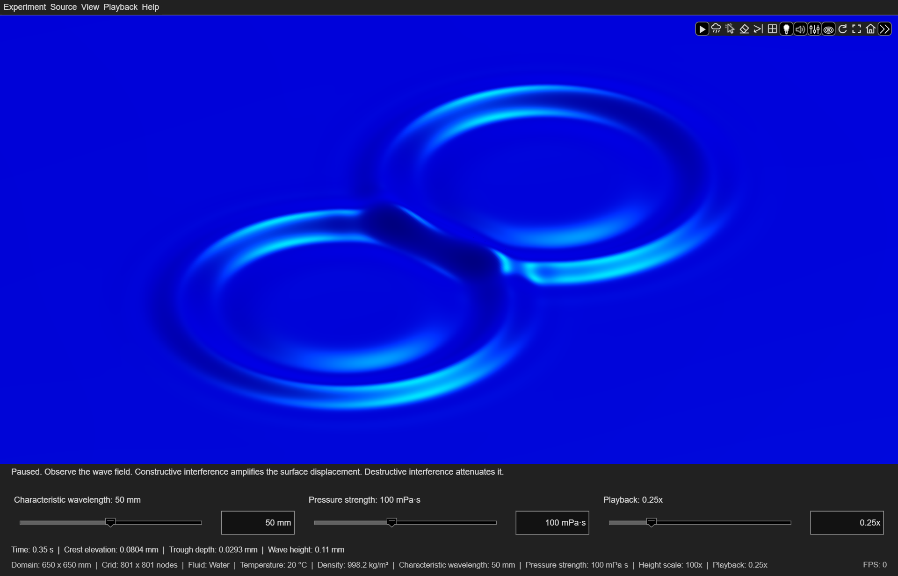
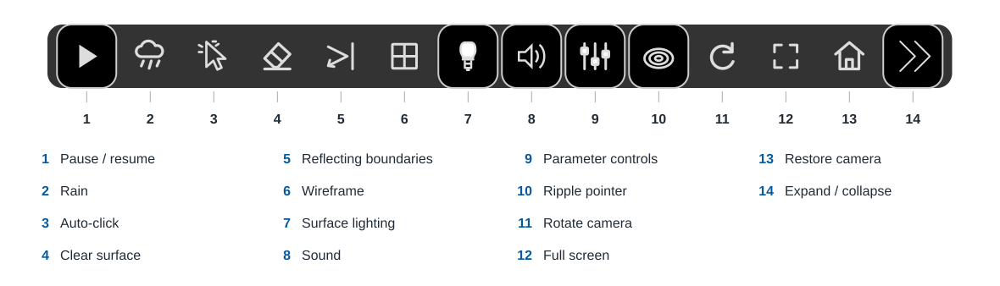
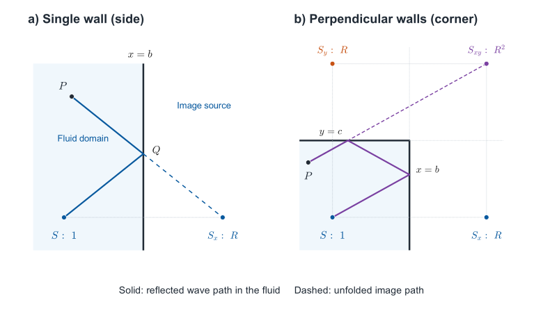

<h1 align="center">Ripple Simulator</h1>

<h2 align="center">An interactive MATLAB app for visualizing surface gravity waves and capillary wave ripples</h2>

<p align="center">
  <a href="https://www.mathworks.com/matlabcentral/fileexchange/185123-ripple-simulator"></a>&nbsp;&nbsp;
  <a href="https://matlab.mathworks.com/open/github/v1?repo=Vasileios-Bellos/RippleSimulator"></a>&nbsp;&nbsp;
  <a href="https://vasileios-bellos.github.io/RippleSimulator/"></a>
</p>

<p align="center">
  <strong><a href="https://vasileios-bellos.github.io/RippleSimulator/index.html">Getting Started</a></strong> &nbsp;·&nbsp;
  <strong><a href="https://vasileios-bellos.github.io/RippleSimulator/guide/controls.html">Controls</a></strong> &nbsp;·&nbsp;
  <strong><a href="https://vasileios-bellos.github.io/RippleSimulator/guide/physics.html">Physics</a></strong> &nbsp;·&nbsp;
  <strong><a href="https://vasileios-bellos.github.io/RippleSimulator/guide/numerics.html">Numerical methods</a></strong> &nbsp;·&nbsp;
  <strong><a href="https://vasileios-bellos.github.io/RippleSimulator/guide/materials.html">Materials</a></strong> &nbsp;·&nbsp;
  <strong><a href="https://vasileios-bellos.github.io/RippleSimulator/guide/experiments.html">Experiments</a></strong> &nbsp;·&nbsp;
  <strong><a href="https://vasileios-bellos.github.io/RippleSimulator/guide/examples.html">Examples</a></strong> &nbsp;·&nbsp;
  <strong><a href="https://vasileios-bellos.github.io/RippleSimulator/reference/index.html">Functions and Properties</a></strong>
</p>

---

Explore how gravity, surface tension and viscosity shape waves on a fluid's surface. Click the surface to create ripples, and watch a localized disturbance separate into waves of different wavelengths and speeds. Overlap multiple sources or trigger a burst of rain to produce wave interference patterns, and vary the fluid and wave properties to investigate wave propagation, dispersion, reflection, and viscous dissipation.

<p align="center">
  
</p>

*No, it’s not the blue screen of death. This one makes waves. Water at 20 °C; 50 mm characteristic wavelength in a 650 × 650 mm domain; 801×801 nodes, 100x height scale, and 0.25x playback, exported at 50 frames per second.*

Each experiment has physical dimensions and specified fluid properties. Camera zoom, vertical exaggeration, and playback speed make the motion visible without changing those quantities. A class-based interface supports reproducible experiments and access to surface elevation, vertical velocity, and surface gradients.

Learn as you experiment. Contextual explanations in the bottom panel help you interpret the observed wave motion and provide insights into the underlying physics, from dispersion and viscosity to reflected wave energy. Live crest elevation, trough depth, and wave height measurements enable you to compare the changes you see on the screen with the fluid's physical response.

[Quick start](#quick-start) · [Learning objectives](#learning-objectives) · [Explore](#explore) · [Controls](#controls) · [Physics of ripples](#physics-of-ripples) · [Numerical Approximations](#model-assumptions-and-numerical-approximations) · [Examples](#examples) · [Experiments](#programmatic-experiments) · [Documentation](#documentation)

## Quick start

Add the project folder to the MATLAB search path and run:

```matlab
app = rippleSimulator();
```
The app opens maximized with the characteristic wavelength, pressure strength, and playback controls visible. Click the surface to create a ripple. Press **R** for rain, **P** to pause or resume, and **C** to clear. The menus and axes toolbar provide visible controls for the same actions. 

## Learning objectives

Through the app and [guided experiments](https://vasileios-bellos.github.io/RippleSimulator/guide/experiments.html), learn to:

- [Observe the wave field](https://vasileios-bellos.github.io/RippleSimulator/guide/examples.html#observe-the-wave-field) by creating a ripple and examine how the surface elevation changes as the ripple propagates.
- [Compare physical scales](https://vasileios-bellos.github.io/RippleSimulator/guide/examples.html#compare-physical-scales) by examining the relative contributions of the restoring forces of gravity and surface tension and identify the gravity and capillary wave regimes.
- [Compare phase and group velocities](https://vasileios-bellos.github.io/RippleSimulator/guide/examples.html#compare-phase-and-group-velocities) by using the gravity–capillary wave dispersion relation and explain why individual wave crests can move differently from the wave-packet envelope.
- [Investigate wave interference](https://vasileios-bellos.github.io/RippleSimulator/guide/examples.html#investigate-wave-interference) by creating overlapping ripples and visualize constructive and destructive interference through linear superposition.
- [Investigate wave reflection](https://vasileios-bellos.github.io/RippleSimulator/guide/examples.html#investigate-wave-reflection) by varying the reflection coefficient and quantify how the wave amplitude and energy change after successive reflections.
- [Compare different fluids](https://vasileios-bellos.github.io/RippleSimulator/guide/examples.html#compare-different-fluids) by applying identical pressure impulses and assess the combined effects of the viscosity, density, and surface tension on the propagation and amplitude of the waves.
- [Isolate the effect of viscosity](https://vasileios-bellos.github.io/RippleSimulator/guide/examples.html#isolate-the-effect-of-viscosity) by varying it while keeping the other fluid properties and source settings constant and determine how viscous dissipation reduces wave amplitude and why shorter-wavelength components decay more rapidly.

The [manual](https://vasileios-bellos.github.io/RippleSimulator/index.html#learning-objectives) pairs each learning objective with an experiment and identifies the quantities to inspect. You can use the app to visualize the learning objectives, while contextual explanations and live measurements support the observations.

The following example illustrates wave interference. Each localized source excites a spectrum of wavelengths. When ripples overlap, their surface elevations are superimposed to form the wave field. Constructive interference amplifies the local displacement; destructive interference attenuates it.

<p align="center">
  
</p>

*Two simultaneous impulses produce constructive and destructive interference. The animation shows the wave field at 0.25x playback, exported at 50 frames per second.*

## Explore

Freely explore additional concepts. Create ripples using a pressure impulse or a four-cycle wavemaker. Combine sources at different positions, vary their characteristic wavelength and pressure strength, or use rain to produce overlapping waves. Try to answer the following questions:

1. **Why do wave rings separate?** Select the gravity water setup, create a ripple and [follow its expanding pattern](https://vasileios-bellos.github.io/RippleSimulator/guide/examples.html#observe-the-wave-field). Compare the motion of individual crests with the outward motion of the wave packet. Different spectral components travel at different [phase and group velocities](https://vasileios-bellos.github.io/RippleSimulator/guide/examples.html#compare-phase-and-group-velocities). Changing the characteristic wavelength changes the [wave spectrum](https://vasileios-bellos.github.io/RippleSimulator/guide/physics.html#characteristic-wavelength).
2. **What changes at smaller scales?** Compare the [gravity and capillary wave setups](https://vasileios-bellos.github.io/RippleSimulator/guide/examples.html#compare-physical-scales). Each setup represents a different wave regime. Gravity is the dominant restoring force for the long waves, while [surface tension](https://vasileios-bellos.github.io/RippleSimulator/guide/physics.html#gravity-and-surface-tension) becomes more important at shorter wavelengths.
3. **What is the role of viscosity?** Compare water at 25 °C with the specified [silicone oils](https://vasileios-bellos.github.io/RippleSimulator/guide/materials.html#silicone-oils) while keeping the source settings constant. Observe how [viscous dissipation](https://vasileios-bellos.github.io/RippleSimulator/guide/examples.html#isolate-the-effect-of-viscosity) acts to reduce the wave amplitude and suppress oscillations in [strongly damped wave components](https://vasileios-bellos.github.io/RippleSimulator/guide/physics.html#viscosity-and-transient-motion).
4. **What happens when it rains?** Generate a [rain burst](https://vasileios-bellos.github.io/RippleSimulator/guide/examples.html#reproduce-rain) of twenty ripples at random positions. Observe how the [overlapping sources](https://vasileios-bellos.github.io/RippleSimulator/guide/physics.html#overlapping-sources-and-rain) produce constructive and destructive interference. Repeat with [different random seeds](https://vasileios-bellos.github.io/RippleSimulator/guide/controls.html#source) to compare the resulting [interference patterns](https://vasileios-bellos.github.io/RippleSimulator/guide/examples.html#investigate-wave-interference).
5. **What happens when waves reach a boundary?** Enable [wave reflection](https://vasileios-bellos.github.io/RippleSimulator/guide/examples.html#investigate-wave-reflection) and create a ripple near a boundary. Use the top view to observe the reflected waves and their interference with the outgoing waves. Compare reflection coefficients of 100% and 50% to examine how successive boundary encounters affect a wave component’s [amplitude and energy](https://vasileios-bellos.github.io/RippleSimulator/guide/physics.html#wave-reflection).
6. **How do the waves differ between fluids?** [Compare](https://vasileios-bellos.github.io/RippleSimulator/guide/examples.html#compare-different-fluids) water, olive oil, two silicone oil grades, and Newtonian approximations for honey and molten compound chocolate by applying identical pressure impulses. Keep the domain and height scale constant, and examine the wave propagation and amplitude at the same elapsed time. Use a [custom fluid](https://vasileios-bellos.github.io/RippleSimulator/guide/materials.html#custom-fluids) to vary one property at a time.
7.  **How does the excitation method affect the wave field?** Apply a [pressure impulse](https://vasileios-bellos.github.io/RippleSimulator/guide/physics.html#pressure-impulse), [observe the wave field](https://vasileios-bellos.github.io/RippleSimulator/guide/examples.html#observe-the-wave-field), and then repeat with a [four-cycle wavemaker](https://vasileios-bellos.github.io/RippleSimulator/guide/physics.html#four-cycle-wavemaker) at the same position. Keep the fluid properties, characteristic wavelength, and pressure strength constant. Observe the differences in the formation and propagation of the resulting wave packets.
8.  **How does spatial resolution affect the sampled physical quantities?** Pause playback, then refine the [observation grid](https://vasileios-bellos.github.io/RippleSimulator/guide/numerics.html#spatial-sampling) while preserving the existing wave state. Use the wireframe view to visualize the effect of [spatial resolution](https://vasileios-bellos.github.io/RippleSimulator/guide/examples.html#examine-the-effect-of-spatial-resolution) on the sampled physical quantities.

## Controls

The menus and parameter controls provide access to the app's settings. Common actions are also available through the axes toolbar and keyboard shortcuts.

| Control | Action |
| --- | --- |
| Click the surface | Create a source at that physical position |
| **P** | Pause or resume the simulation and scheduled rain |
| **Space** / Auto-click toolbar button | Toggle auto-click |
| **R** | Start a twenty-click rain burst |
| **M** / speaker toolbar button | Enable or mute all sounds |
| **C** | Clear the surface and cancel pending rain |
| **B** / Reflecting boundaries toolbar button | Toggle reflecting boundaries |
| **View > Parameter controls** | Show or hide wavelength, pressure strength, and playback controls |
| **A / S / D** | Solid surface / colormap / high contrast |
| **1 / 2 / 3** | Close oblique / top / wide oblique view |
| **W** / wireframe toolbar button | Toggle wireframe |
| **L** / lighting toolbar button | Toggle surface lighting |
| **F11** / full-screen toolbar button | Show only the surface; hide menus, toolbar, and bottom panels |
| **Escape** | Exit full screen; otherwise, close the app |
| **X** | Close the app in either window mode |
| **Ctrl+S** (**Command+S** on macOS) | Save a screenshot of the displayed frame |
| **View > Show FPS** | Show or hide the rolling frame rate, displayed by default; pause resets it to zero |
| **Experiment > Restore default experiment** | Restore the default physical and display settings |

The default water experiment uses a 50 mm characteristic source wavelength, a 650 × 650 mm observation domain, 201 nodes per side, and 0.25x playback.

<p align="center">
  
</p>

*Two simultaneous impulses in water at 20 °C, shown after 0.35 s of simulation time on an 801×801 grid, with 50 mm characteristic wavelength and 100 mPa·s pressure strength per source.*

The **Experiment** menu controls the physical scale, fluid properties, boundaries, and grid resolution. **Source** controls the excitation method, characteristic wavelength, and pressure strength. **View** controls the appearance, colormap, camera, and display scale. **Playback** provides pause/resume, speed, and sound controls. **Help** provides access to the [documentation](https://vasileios-bellos.github.io/RippleSimulator/index.html).

<p align="center">
  
</p>

*The axes toolbar provides direct access to playback, ripple sources, surface appearance, and camera controls. The first button switches between Pause and Resume.*

Changes to the wavelength or pressure strength affect subsequent inputs. Resolution changes resample existing waves at the same physical time. Material, domain, and boundary changes start a new experiment. The complete [controls guide](https://vasileios-bellos.github.io/RippleSimulator/guide/controls.html) describes every menu, shortcut, range, and reset behavior.

**Height scale and simulation time.** Vertical exaggeration multiplies the displayed surface elevation without changing the physical wave field. The playback rate sets the number of simulation seconds per second of real time. Simulation time excludes user pauses and manual or Auto-click source preparation.

Optional automatic height scaling makes the smaller displacements of viscous fluids visible. It selects a fixed multiplier by comparing equal reference impulses with water at 20 °C; the bottom panel reports the result. The physical measurements remain unchanged. Choose the same manual multiplier when comparing amplitudes across materials. No scaling follows the instantaneous wave amplitude, so the visible response still decays naturally.

## Physics of ripples

Ripple Simulator models small-amplitude gravity–capillary waves on a homogeneous, incompressible Newtonian fluid of infinite depth. A source supplies a localized excitation, and the response propagates according to the governing equations below. Gravity and surface tension restore the displaced surface, and viscosity dissipates the wave energy. The full viscous response is obtained by solving the linearized Navier–Stokes and continuity equations subject to the linearized kinematic and dynamic free-surface boundary conditions. For the definitions of the terms used below, see the [Glossary](https://vasileios-bellos.github.io/RippleSimulator/guide/physics.html#glossary).

The following table lists the physical quantities used in the model and their units in the International System of Units (SI):

| Symbol | Quantity | Units |
| --- | --- | --- |
| $\eta(x,y,t)$ | Surface elevation relative to the still water level | m |
| $\boldsymbol{u}=(u,v,w)$ | Fluid velocity | m/s |
| $p$ | Pressure perturbation from hydrostatic equilibrium | Pa |
| $p_{\mathrm{ext}}$ | Applied downward pressure | Pa |
| $\rho$ | Density | kg/m³ |
| $\mu$ | Dynamic viscosity | Pa s |
| $\nu=\mu/\rho$ | Kinematic viscosity | m²/s |
| $\sigma$ | Surface tension | N/m |
| $g$ | Gravitational acceleration, 9.81 | m/s² |
| $k=2\pi/\lambda$ | Wavenumber | rad/m |
| $\omega_0$ | Inviscid reference angular frequency | rad/s |

### Governing equations

The model is based on [small-amplitude wave theory](https://vasileios-bellos.github.io/RippleSimulator/guide/physics.html#governing-equations). It assumes small wave amplitudes relative to the wavelengths and small free-surface slopes. The governing equations are therefore linearized, retaining first-order terms in the surface displacement and fluid velocity. For a sinusoidal component of amplitude $a$ and wavenumber $k$, the maximum slope is $ka$.

$$
\eta=a\cos(kx-\omega t),\qquad
\max_x|\partial_x\eta|=ka=\frac{2\pi a}{\lambda}.
$$

For overlapping ripples, the small-slope condition applies to the combined surface:

$$
\epsilon_s(t)=\max_{x,y}\left\|\nabla_h\sum\nolimits_j\eta_j(x,y,t)\right\|\ll1.
$$

<a id="fluid-motion-and-surface-conditions"></a>

#### Linear boundary-value problem

With the undisturbed surface at $z=0$ and fluid occupying $z<0$, the fluid satisfies the linearized incompressible Navier–Stokes and continuity equations ([Patibandla et al., 2023](https://doi.org/10.1016/j.ijmultiphaseflow.2023.104592)):

$$
\rho\frac{\partial\boldsymbol{u}}{\partial t}
=-\boldsymbol{\nabla}p+\mu\nabla^2\boldsymbol{u},
\qquad \boldsymbol{\nabla}\cdot\boldsymbol{u}=0.
$$

The linearized kinematic, tangential stress, and normal stress free-surface boundary conditions at $z=0$ are:

$$
\frac{\partial\eta}{\partial t}=w,
\qquad
\frac{\partial\boldsymbol{u}_h}{\partial z}
+\boldsymbol{\nabla}_h w=\boldsymbol{0},
$$

$$
p-2\mu\frac{\partial w}{\partial z}
=\rho g\eta-\sigma\nabla_h^2\eta+p_{\mathrm{ext}}.
$$

The tangential and normal stress conditions are the dynamic free-surface boundary conditions. The subscript $h$ denotes horizontal components or derivatives. Disturbances decay with depth, and the fluid is initially at rest. Gravity and surface tension restore the displaced surface, and viscosity dissipates the wave energy.

<a id="gravity-capillary-dispersion"></a>
<a id="gravitycapillary-wave-dispersion"></a>

### Gravity and surface tension

The inviscid deep-water angular frequency satisfies

$$
\boxed{\omega_0^2(k)=gk+\frac{\sigma}{\rho}k^3.}
$$

Gravity supplies the restoring term $gk$, and surface tension supplies $\sigma k^3/\rho$. The two contributions are equal at the gravity–capillary crossover wavelength:

$$
\lambda_c=2\pi\sqrt{\frac{\sigma}{\rho g}}.
$$

Waves much longer than $\lambda_c$ are predominantly gravity waves; much shorter waves are predominantly capillary waves. The model includes both restoring terms at every wavelength.

### Wave dispersion

The inviscid phase velocity and group velocity are

$$
c_p=\frac{\omega_0}{k},
\qquad
c_g=\frac{d\omega_0}{dk}
=\frac{g+3\sigma k^2/\rho}{2\omega_0}.
$$

In the gravity and capillary deep-water limits, respectively, $c_g=c_p/2$ and $c_g=3c_p/2$. A localized source contains many wavenumbers; its individual crests and overall envelope generally propagate at different velocities.

<a id="viscous-response"></a>

### Viscosity and transient motion

The underlying equations are the linearized incompressible Navier–Stokes and continuity equations, subject to the linearized kinematic and dynamic boundary conditions at the free surface. The response includes the surface-wave modes and the transient contribution from vorticity diffusion.

For each nonzero wavenumber, define dimensionless time $\tau=\omega_0t$ and viscosity $\varepsilon=\nu k^2/\omega_0$. The dimensionless unit-initial-velocity response $h_\varepsilon(\tau)$ has Laplace transform

$$
\mathcal{L}\{h_\varepsilon\}(\zeta)
=\frac{1}
{(\zeta+2\varepsilon)^2+1
-4\varepsilon^2\sqrt{1+\zeta/\varepsilon}}.
$$

Here $\zeta$ is the dimensionless Laplace variable, and the square-root branch is chosen consistently with decay into the fluid. The surface-wave modes correspond to poles of the Laplace transform, where its denominator vanishes. Their real and imaginary parts determine modal decay and oscillation, respectively. The inverse transform also includes the branch contribution from vorticity diffusion.

The response satisfies $h_\varepsilon(0)=0$ and $h_\varepsilon'(0)=1$, where the prime denotes a derivative with respect to $\tau$. As viscosity tends to zero, the transform tends to $1/(\zeta^2+1)$ and the response tends to $\sin\tau$.

For weak viscosity, the leading amplitude decay of a nearly monochromatic wave is

$$
A_k(t)\approx A_k(0)\exp(-2\nu k^2t).
$$

This expression explains why short waves often damp faster; it is a limiting description, not the general response used for every material.

<a id="clicks-rain-and-reconstruction"></a>

### Source definitions

A click at time $t_j$ and horizontal position $\boldsymbol{x}_j$ applies a Gaussian pressure impulse of strength $J$ and width $s$:

$$
p_{\mathrm{ext}}(\boldsymbol{x},t)
=J\exp\!\left(-\frac{|\boldsymbol{x}-\boldsymbol{x}_j|^2}{2s^2}\right)
\delta(t-t_j),
\qquad s=\frac{\lambda_0}{2\pi},\quad k_0=\frac{1}{s}.
$$

The pressure impulse $J$ is the time integral of the pressure at the center of an individual Gaussian source, measured in Pa·s. An impulse changes velocity immediately while elevation remains continuous. A new source contributes zero elevation at its exact start; its center initially moves downward.

**Source > Pressure strength** sets this physical loading. With the fluid, source width, and excitation method fixed, the surface displacement is directly proportional to $J$. Auto-click defaults to one fifth of the selected pressure strength; rain uses the full value by default. Independent pressure multipliers are available under **Source > Auto-click** and **Source > Rain**. The characteristic amplitude associated with the loading is

$$
A_0=\frac{Jk_0}{\rho\omega_0(k_0)}.
$$

For water at 20 °C, $J=0.10\,\mathrm{Pa\,s}$ and $\lambda_0=50\,\mathrm{mm}$ give $A_0\approx0.339\,\mathrm{mm}$ and $A_0/\lambda_0\approx0.00678$. The balanced and capillary setups preserve this dimensionless loading. The resulting unbounded ripple has an early central depression of approximately 0.30 mm, an outward crest of approximately 0.055 mm beyond a radius of 25 mm, and a maximum surface slope of approximately 0.027. The [source calculations](https://vasileios-bellos.github.io/RippleSimulator/guide/physics.html#physical-scales-and-drop-impacts) relate the integrated impulse to published drop measurements and distinguish the initial depression from the later outgoing rings. Display exaggeration changes neither $J$ nor the calculated elevation.

For one impulse in open water, radial reconstruction gives

$$
\eta_j(r,a)
=-\frac{Js^2}{\rho}
\int_0^\infty
\frac{k^2}{\omega_0(k)}
e^{-s^2k^2/2}J_0(kr)
h_{\varepsilon(k)}\!\bigl(\omega_0(k)a\bigr)\,dk,
\qquad a=t-t_j\geq0.
$$

Here $r=|\boldsymbol{x}-\boldsymbol{x}_j|$ and $J_0$ is the Bessel function of the first kind of order zero. Linear superposition gives $\eta=\sum_j\eta_j$. The reconstruction accounts for geometric spreading, dispersion, and viscous dissipation.

Rain schedules twenty instances of the same source operation. Their elevations are superimposed to form the wave field.

<p align="center">
  
</p>

*A rain burst generates overlapping gravity–capillary ripples across the surface. The animation shows the wave field at 0.25x playback, exported at 50 frames per second.*

The optional four-cycle wavemaker replaces the temporal impulse with

$$
p_{\mathrm{ext}}(r,a)
=J\omega_0(k_0)e^{-r^2/(2s^2)}
\sin\theta\,\sin^2\!\left(\frac{\theta}{8}\right),
\quad \theta=\omega_0(k_0)a,\quad 0\leq\theta\leq8\pi,
$$

and zero pressure outside that interval. Its response is the convolution of the same viscous impulse response with the imposed pressure history. In this mode $J$ is a pressure-time scale; the completed signed pressure integral is zero. The characteristic wavelength sets both the Gaussian footprint and the reference forcing frequency $\omega_0(k_0)$ through the gravity-capillary wave dispersion relation.

The **Pressure strength** control sets $J$ for both excitation methods, displayed in mPa·s. It specifies the center pressure impulse of an individual Gaussian source for impulsive loading and the pressure amplitude coefficient divided by $\omega_0(k_0)$ for the wavemaker.

### Wave reflection

For a domain of width $L$ in both horizontal directions, perfectly reflecting boundaries use cosine modes

$$
\phi_{mn}(x,y)
=\cos\!\left(\frac{m\pi(x+L/2)}{L}\right)
\cos\!\left(\frac{n\pi(y+L/2)}{L}\right),
\qquad k_{mn}=\frac{\pi}{L}\sqrt{m^2+n^2}.
$$

The indices $m,n$ are nonnegative integers. Each nonzero mode uses the same gravity–capillary frequency and viscous response as an open-water component of equal wavenumber. The zero elevation mode is absent, preserving the mean fluid level. The pressure source is extended evenly across the walls. Ideal reflection adds no wall loss; bulk viscous dissipation continues throughout the motion.

**Experiment > Wave reflection > Reflection coefficient** sets the amplitude fraction $R$ returned by each wall encounter. Its default is 100%; an individual reflected component retains the energy fraction $R^2$. Intermediate coefficients use weighted images of the open-water source:

$$
\boldsymbol{x}_{mn}
=\left(mL+(-1)^m x_0,\ nL+(-1)^n y_0\right),
\qquad
\eta_R(\boldsymbol{x},a)
=\sum\nolimits_{m=-\infty}^{\infty}\sum\nolimits_{n=-\infty}^{\infty}
R^{|m|+|n|}\eta_{\mathrm{open}}
\!\left(\lVert\boldsymbol{x}-\boldsymbol{x}_{mn}\rVert,a\right).
$$

Every image retains the original source age, viscous decay, and dispersion. One wall encounter contributes one factor of $R$; two successive encounters contribute $R^2$. The image indices include repeated returns between opposite walls as well as reflections at perpendicular walls.

<p align="center">
  
</p>

*a) Single wall (side). b) Perpendicular walls (corner). A reflected path has the same length as its unfolded image path. Each image reuses the precomputed radial response at that distance and the original source age.*

<p align="center">
  
  
</p>

*Side and corner reflections in a 300 × 300 mm domain, with a 50-mm characteristic wavelength and a 100% reflection coefficient. Both animations show the wave field at 0.25x playback, exported at 50 frames per second.*

The coefficient represents specular reflection without a phase reversal; it does not resolve a wall's material impedance or distinguish transmitted energy from boundary dissipation. Partial reflections use a domain 6.5–26 characteristic wavelengths wide. Preparation combines a finite image expansion with an infinite filtered sum for the long-wave contribution. At 100%, the cosine solution above is used; at 0%, propagation is open water. For more information, see [Numerical methods](https://vasileios-bellos.github.io/RippleSimulator/guide/numerics.html#images-for-partial-wave-reflection).

The [wave reflection geometry and implementation](https://vasileios-bellos.github.io/RippleSimulator/guide/numerics.html#wave-reflection-geometry) derive the image weights, repeated reflections, and the translated groups used to reuse precomputed fields. Numerical convergence checks are reported separately from the physical boundary assumptions.

### Model assumptions and numerical approximations

**Physical scope.** The fluid is incompressible and Newtonian, with constant properties within an experiment, no background flow, and a clean free surface. The model excludes splashes, breaking waves, bubbles, surfactants, bottom friction, and nonlinear impact dynamics. Perfectly reflecting walls are impermeable and free-slip, with a 90-degree contact angle. They do not represent a calibrated laboratory tank. Yield stress, shear-dependent viscosity, and viscoelasticity are outside the model. The [material descriptions](https://vasileios-bellos.github.io/RippleSimulator/guide/materials.html) describe the measured ranges, assumptions and approximations.

**Finite settling.** To return to equilibrium completely in a short interactive experiment, each source has a finite-duration envelope. This is an additional approximation, not a claim that viscous waves physically vanish at a finite time. For Gaussian width $s_j$, let

```math
T_{s,j}=\max\left\{\frac{2\pi}{\omega_0(k_{0,j})},\; \max_{0\lt k\leq12/s_j}\frac{2\nu k}{g+(\sigma/\rho)k^2}\right\}, \qquad T_j=10T_{s,j}.
```

The second term retains the longest Stokes relaxation time over the retained source spectrum, allowing strongly viscous disturbances to relax beyond the inviscid reference period. This sets the duration of the numerical envelope; the full viscous equations still determine the response. Define $q=(a-0.8T_j)/(0.2T_j)$. The envelope is

```math
E_j(a)= \begin{cases} 1, & 0\leq a\leq0.8T_j,\\ 1-10q^3+15q^4-6q^5, & 0.8T_j\lt a\lt T_j,\\ 0, & a\geq T_j. \end{cases}
```

Elevation and its first two time derivatives join continuously at both ends of the transition. The app evaluates

$$
\eta_{\mathrm{app}}=\sum\nolimits_j E_j\eta_j,
\qquad
\frac{\partial\eta_{\mathrm{app}}}{\partial t}
=\sum\nolimits_j\left(E_j\frac{\partial\eta_j}{\partial t}+E_j'\eta_j\right).
$$

The envelope applies to the entire source, including its reflections; a wall encounter does not restart the source's age. During the transition, this regularized response differs from the unmodified viscous solution. In the default gravity-scale experiment at 0.25x playback, the transition spans approximately 5.4–6.8 real seconds after each input. The smaller-scale presets have shorter reference periods. Pausing or changing playback speed changes the real-time duration.

**Sampling and numerical errors.** The observation grid provides the spatial discretization for sampling and rendering the continuous response; it does not set the physical propagation speed. Quadrature, spectral truncation, and interpolation have separate numerical errors. Smaller physical wavelengths require adequate spatial sampling. See the [numerical methods](https://vasileios-bellos.github.io/RippleSimulator/guide/numerics.html) for supported ranges and convergence considerations.

## Calculations and rendering

The app prepares reusable wave responses when the physical configuration or source definition changes. In open water, every grid-aligned source draws from the same table of responses at distinct grid distances. Translation uses lookup indices, and the resulting elevations are added by linear superposition. Ideal reflecting walls use precomputed modal responses and cosine bases. Partial reflections reuse precomputed weighted-image bases and temporal factors.

When an input is accepted, its complete response is superimposed on a rolling animation sequence. Open water and partial reflections store combined surface elevations; ideal walls store combined cosine coefficients. Established ripples therefore do not need to be reconstructed individually on every frame. Each source configuration uses fourteen samples per settling time scale for open water and ideal walls, or sixteen for partial reflections. Ninth-degree interpolation evaluates the combined field at the elapsed simulation time. Direct corrections at source onset and final settling preserve causality and exact stillness.

The accumulated display uses single precision. Physical snapshots use the precomputed response tables or image factors independently of that display sequence. A comparison of five independently timed impacts on a 101×101 grid covered interference and settling in water at 50 and 5 mm, with open water and ideal walls. The maximum absolute elevation difference from the snapshot calculation was below $1.16\times10^{-3}$ of the reference sequence's largest absolute elevation. Additional partial-reflection comparisons, including viscous fluids, gave a maximum peak-scaled elevation difference below $2.6\times10^{-4}$. These are sampled numerical comparisons, not universal error bounds or experimental validation. Off-grid open-water sources and configurations exceeding the animation-memory budget use direct interpolation of the precomputed responses. The numerical guide describes the onset and endpoint corrections and the storage limits for each representation.

The existing surface, rain graphics, and bottom panel text are updated in place. A slower rendering rate produces fewer views of the same evolution, without changing wave speed or scheduled impact times. See [Precomputed animation and performance](https://vasileios-bellos.github.io/RippleSimulator/guide/numerics.html#precomputed-animation-and-performance) for the equations, interpolation errors, memory policy, and numerical concessions.

The app owns its figure, timer, controls, and graphics. Physics and sampling are separate from rendering; changing the grid does not replace the source history. Rain uses a private random number stream so it does not alter MATLAB's global random number stream. See [Functions and Properties](https://vasileios-bellos.github.io/RippleSimulator/reference/index.html) for application ownership and rain reproducibility, and [Numerical methods](https://vasileios-bellos.github.io/RippleSimulator/guide/numerics.html) for the representation and sampling of the wave field.

Splash and rain recordings are loaded once. Java clips are initialized silently before interaction and reused; initialized MATLAB audio players provide a fallback. Audio and wave evolution have separate timing. See [Sound](https://vasileios-bellos.github.io/RippleSimulator/guide/sound.html) for recording playback and overlapping sounds.

**View > Show FPS** displays the reciprocal of the mean of the last ten frame intervals. The same measurement is available as `app.MeasuredFPS`.

## Examples

The `examples` folder contains interactive experiments and demonstrations. Interactive examples open the app with a still surface, ready for clicks and changes through the controls. The demonstrations generate wave patterns, animate the wave field, or plot the dispersion relation.

| Example | Type | Description |
| --- | --- | --- |
| [gravityWavesExample](examples/gravityWavesExample.m) | Interactive | Gravity-scale water waves |
| [gravityCapillaryWavesExample](examples/gravityCapillaryWavesExample.m) | Interactive | Equal gravity and capillary restoring contributions at the characteristic wavelength |
| [capillaryWavesExample](examples/capillaryWavesExample.m) | Interactive | Capillary-scale water waves |
| [waveReflectionExample](examples/waveReflectionExample.m) | Interactive | Reflecting boundaries, viewed from above |
| [oliveOilRipplesExample](examples/oliveOilRipplesExample.m) | Interactive | Olive-oil ripples |
| [siliconeOil5cStRipplesExample](examples/siliconeOil5cStRipplesExample.m) | Interactive | Ripples in 5 cSt silicone oil |
| [siliconeOil100cStRipplesExample](examples/siliconeOil100cStRipplesExample.m) | Interactive | Ripples in 100 cSt silicone oil |
| [moltenChocolateRipplesExample](examples/moltenChocolateRipplesExample.m) | Interactive | Molten-chocolate ripples under the Newtonian approximation |
| [honeyRipplesExample](examples/honeyRipplesExample.m) | Interactive | Acacia-honey ripples |
| [wavemakerRipplesExample](examples/wavemakerRipplesExample.m) | Interactive | Localized four-cycle pressure forcing |
| [wireframeRipplesExample](examples/wireframeRipplesExample.m) | Interactive | Water ripples with a wireframe display |
| [colormapRipplesExample](examples/colormapRipplesExample.m) | Interactive | Surface elevation shown with the HSV colormap |
| [waveInterferenceExample](examples/waveInterferenceExample.m) | Demonstration | Wave interference between two simultaneous ripples |
| [sideReflectionExample](examples/sideReflectionExample.m) | Demonstration | Wave reflection from the right boundary, viewed from above |
| [cornerReflectionExample](examples/cornerReflectionExample.m) | Demonstration | Wave reflection near the top-right corner, viewed from above |
| [rainRipplesExample](examples/rainRipplesExample.m) | Demonstration | A reproducible burst of twenty localized sources |
| [plotWaveDispersion](examples/plotWaveDispersion.m) | Demonstration | Phase and group velocities across gravity and capillary wavelengths |
| [inspectWaveField](examples/inspectWaveField.m) | Demonstration | Surface elevation and radial profiles animated through settling |

Add the `examples` folder to the MATLAB search path, then run a function from the table. For example, `inspectWaveField` animates the surface elevation for capillary waves generated using a four-cycle wavemaker source in three different plots: the wave field, the complete centerline profile, and the outward profile. The fixed elevation scales show both the central motion and the smaller traveling waves.

```matlab
exampleFolder = fullfile(fileparts(which("rippleSimulator")), "examples");
addpath(exampleFolder);
waveField = inspectWaveField();
```


`waveField` contains the sample times, coordinates, surface elevation, vertical velocity, and surface gradients throughout the motion. See [Examples](https://vasileios-bellos.github.io/RippleSimulator/guide/examples.html) for the MATLAB demonstrations, options, and interpretation of the results.

## Programmatic experiments

The launcher returns an `app.RippleSimulatorApp` object. Its properties use the same setting routes as the menus and toolbar:

```matlab
app = rippleSimulator(Setup="Gravity", Paused=true);
app.addRipple([-0.06, -0.015]);
app.addRipple([0.06, 0.015]);
```

The two sources begin at the same simulation time. Their surface elevations are superimposed to form the wave field. View the interference pattern from above and use a colormap to distinguish positive and negative elevations:

```matlab
app.setCameraView("Top");
app.SurfaceMode = "Elevation";
app.Colormap = "hsv";
app.Paused = false;
```

These view changes preserve the physical wave field. The menus and toolbar remain available for further exploration. Close the app when the experiment is finished:

```matlab
app.close();
```

See [Experiments](https://vasileios-bellos.github.io/RippleSimulator/guide/experiments.html) for numerical investigations and guidance on interpreting the wave field.

## Customization

Additional fluid presets can be implemented using the definitions in `+app/+internal/+materials/` as templates. These definitions specify the fluid properties at a stated temperature and include their supporting references. See [Customization](https://vasileios-bellos.github.io/RippleSimulator/reference/index.html#customization) for the complete procedure for adding a preset to the app.

After modifying the source code, run the [tests](https://vasileios-bellos.github.io/RippleSimulator/reference/index.html#tests) from the project folder to check the calculations and application behavior:

```matlab
results = runtests("tests", IncludeSubfolders=true);
assertSuccess(results);
```

## Requirements

- **MATLAB R2022a** or later (**MATLAB R2026b** recommended)
- No additional toolboxes
  
## Project structure

```text
rippleSimulator.m             Application launcher
+app/
    RippleSimulatorApp.m      Public application class
    +internal/
        +audio/               Reusable audio playback and sound assets
        +input/               Sources and input scheduling
        +materials/           Fluid properties and material presets
        +numerics/            Quadrature, interpolation, and slope bounds
        +physics/             Gravity-capillary equations and viscous response
        +playback/            Elapsed time and precomputed animation
        +responses/           Precomputed source responses and caches
        +simulation/          Active sources and wave-field superposition
        +ui/                  Surface rendering, appearance, and controls
docs/                         User guide, scientific manual, and reference
examples/                     MATLAB examples
tests/                        Unit and integration tests
Contents.m                    MATLAB help summary
info.xml                      Custom Help registration
```

## Documentation

The documentation has two complementary parts:

- **User and scientific guide:** [getting started](https://vasileios-bellos.github.io/RippleSimulator/index.html), [controls](https://vasileios-bellos.github.io/RippleSimulator/guide/controls.html), [experiments](https://vasileios-bellos.github.io/RippleSimulator/guide/experiments.html), [worked examples](https://vasileios-bellos.github.io/RippleSimulator/guide/examples.html), [physics and sources](https://vasileios-bellos.github.io/RippleSimulator/guide/physics.html), [numerical methods](https://vasileios-bellos.github.io/RippleSimulator/guide/numerics.html), and [materials](https://vasileios-bellos.github.io/RippleSimulator/guide/materials.html).
- **API reference and native MATLAB help:** [programmatic reference](https://vasileios-bellos.github.io/RippleSimulator/reference/index.html) and the source-based help for the launcher, class, public methods, and properties.

Open **Help > Getting started** in the app, or open `docs/index.html` in a browser. The HTML manual includes its styles, illustrations, and equations for offline reading. The Markdown pages are available directly in the repository.

```matlab
help rippleSimulator
doc app.RippleSimulatorApp
help app.RippleSimulatorApp.addRipple
```

To register the HTML manual under MATLAB Help's **Supplemental Software**, add the project root and `docs` folder to the MATLAB path from a different current folder. The included `info.xml`, table of contents, and search database support this integration. See [Installation and requirements](https://vasileios-bellos.github.io/RippleSimulator/guide/installation.html) for additional details.

## References and acknowledgments

The viscous formulation follows dispersion and initial-value analyses of surface waves ([Armaroli et al., 2018](https://doi.org/10.1103/PhysRevFluids.3.124803); [Patibandla et al., 2023](https://doi.org/10.1016/j.ijmultiphaseflow.2023.104592)). See the [scientific references](https://vasileios-bellos.github.io/RippleSimulator/guide/references.html) and [sources for the material properties](https://vasileios-bellos.github.io/RippleSimulator/guide/materials.html) for the complete list of references.

The HTML guide is generated using [MATLAB DocMaker](https://github.com/mathworks/docmaker), with custom navigation, equation assets, and styling. Native `help` and `doc` references are supplied independently through the MATLAB source documentation. Included documentation resources retain their [third-party notices](https://vasileios-bellos.github.io/RippleSimulator/guide/notices.html).


## Author

**[Vasileios Bellos](https://www.mathworks.com/matlabcentral/profile/authors/13754969)**. The visual concept is based on the author's [Ripples 3D](https://www.mathworks.com/matlabcentral/communitycontests/contests/8/entries/16413) entry from the [2024 MATLAB Shorts Mini Hack](https://www.mathworks.com/matlabcentral/communitycontests/contests/8/entries). Adapted for the [2026 MATLAB STEM Showcase](https://www.mathworks.com/matlabcentral/contests/2026-matlab-stem-showcase.html).

## License

[MIT](LICENSE)
