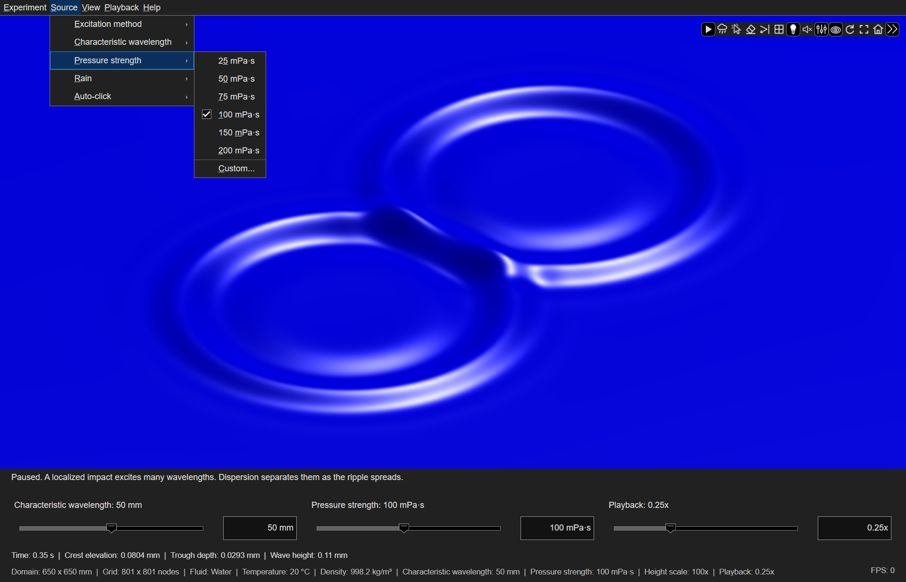
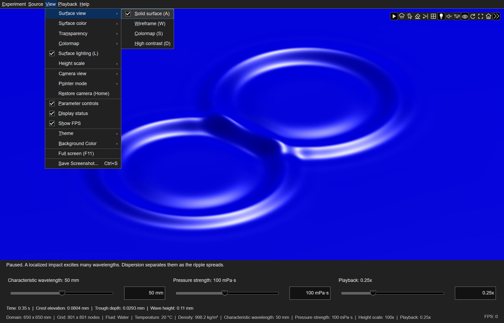
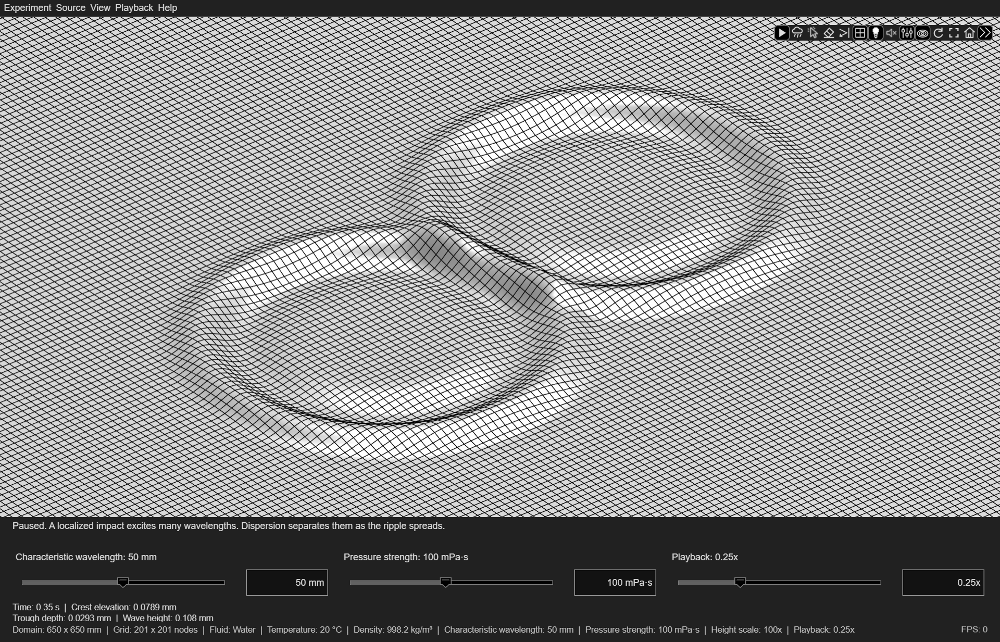

# Controls

Click the surface to apply a localized pressure source. The resulting waves
propagate, disperse, interfere, and dissipate according to the selected fluid.
The menus, axes toolbar, parameter controls, and keyboard shortcuts provide
access to the fluid and source properties, display options, and playback controls.

## Menus

The Experiment, Source, View, Playback, and Help menus provide access to
the app's controls. Frequently used commands also appear on the
[axes toolbar](#axes-toolbar).

| Command | Effect |
| --- | --- |
| Playback > Pause / Resume | Pause or resume the waves and scheduled rain. |
| Source > Rain > Create rain | Schedule twenty clicks over 0.95 seconds of elapsed real time while playback runs. |
| Source > Rain > Pressure multiplier | Scale the pressure strength for rain relative to a manual click; default 1x. |
| Source > Auto-click > Enable | Create ripples as the pointer moves over the surface. |
| Source > Auto-click > Pressure multiplier | Scale the pressure strength for Auto-click relative to a manual click; default 0.2x. |
| Experiment > Clear surface | Remove waves and cancel pending rain without resetting simulation time or the rain generator. |
| Source > Rain > Random seed | Set the private generator used by subsequent rain bursts. |
| View > Save Screenshot | Save the displayed surface and visible controls to a PNG file. |

On platforms with native menu access keys, press **Alt** to reveal their
underlines. **Alt+E**, **Alt+S**,
**Alt+V**, **Alt+P**, and **Alt+H** open Experiment, Source, View, Playback,
and Help. The underlined keys in each submenu select its commands.

### Experiment

**Experiment > New scaled experiment** selects the gravity, balanced, or
capillary water setup. Each setup defines the fluid, physical domain, source,
playback rate, and height scale. A checkmark identifies a setup whose
preset values match the current settings.

The **Material** submenu selects water, an oil grade under **Oil**,
acacia honey, molten chocolate, or a custom Newtonian fluid.
**Experiment > Temperature** adjusts water temperature from 0 to 40 °C, with
presets and **Custom...**. The submenu is enabled for water. Olive oil uses
room-temperature measurements at a nominal temperature of 23 °C; silicone oils
use manufacturer data at 25 °C. The oil presets do not provide a temperature
correlation.
The honey sample is specified at 30 °C. Molten chocolate uses a constant-viscosity
approximation at a nominal 60 °C. Use **Experiment > Material > Custom** to enter
measured properties and their temperature. These operations start a new experiment
and clear existing waves.

Selecting a named material restores its fluid properties, wavelength, pressure
strength, height scale, and appearance, including when the same material is
selected again. The domain, grid, excitation method, and playback rate are
preserved. Equal pressure loading does not imply equal wave height in different
fluids. See [Material presets](materials.md#material-presets) for the property values
and measurement conditions.

Selecting a material enables surface lighting. Presets also restore their
default surface color; custom materials retain the selected color.

**Experiment > Physical size** selects the domain width in millimeters,
with presets and **Custom...**. Changing the physical size starts a new experiment
and clears existing waves.

**Experiment > Grid resolution** provides presets and a custom node count. Changing
resolution resamples the existing wave field at its current physical time.
Increasing the count gives finer spatial sampling and increases drawing and
sampling costs; it does not change the physical size or speed of the waves.
A requested grid must resolve every
active source as well as the source selected for new clicks.
Increase the grid resolution, choose a larger characteristic wavelength, or reduce
the physical domain size to satisfy this sampling requirement.

**Experiment > Wave reflection** contains **Reflecting boundaries** and
**Reflection coefficient**, which select the boundary model and reflected
amplitude fraction. The **Reflecting boundaries** axes-toolbar button and **B**
toggle the same boundary setting.

**Experiment > Restore default experiment** restores the initial physical
settings, grid, appearance, camera, playback, sound, and random seed.

See [Experiments](experiments.md) for numerical comparisons of physical scale,
fluid properties, and reflecting boundaries.

### Source

**Source > Excitation method** selects a pressure impulse or a four-cycle
wavemaker. The Source menu also sets the characteristic wavelength and pressure
strength of subsequent inputs. A localized source excites a spectrum of wavelengths;
the characteristic wavelength is not the wavelength of every visible ring.

Changing the source settings leaves existing waves unchanged. For example, change the wavelength
between two clicks to compare the resulting wave propagation in the same fluid. During
rain, these changes affect the clicks that have not yet occurred. The separate
rain multiplier applies to newly scheduled bursts.

**Source > Pressure strength** controls the physical amplitude. For unchanged
fluid properties, wavelength, and excitation method, the surface displacement
is directly proportional to the pressure strength. The presets are
25, 50, 75, 100, 150, and 200 mPa·s.
Choose **Custom...** to enter another value in millipascal-seconds. In **Pressure
impulse** mode, this is the time integral of the pressure at the center of an
individual Gaussian source. In **Four-cycle wavemaker** mode, it is a pressure-time scale; multiplying
it by the reference angular frequency gives the pressure amplitude coefficient
before the envelope is applied. See [Source definitions](physics.md#source-definitions)
for the forcing equations.

*The Pressure strength submenu provides preset values and a custom value.
The checkmark identifies the selected pressure strength.*

A rain burst applies twenty localized sources. By default, each has the same pressure strength,
wavelength parameter, and excitation method as a manual click. Its pressure
multiplier offers 0.25x, 0.5x, 0.75x, 1x, 1.5x, 2x, and **Custom...**.
Each burst retains its selected multiplier; other source settings follow their
values at each input time. Repeated bursts overlap and retain all
previously scheduled drops.
Pausing partway through a burst preserves its remaining scheduled clicks.
**Experiment > Clear surface** cancels the pending schedule along with the waves.
Falling streaks mark the impact positions in oblique views. Top view hides the
streaks while preserving the impacts and resulting ripples.

**Source > Auto-click > Enable**, the Auto-click axes-toolbar button, or **Space** enables
pointer-driven ripples. Each new
accepted position uses the selected Auto-click pressure multiplier, with at
least 0.05 seconds of elapsed real time between inputs. Remaining over the same grid node does not
repeat the input. Auto-click operates in Ripple pointer mode during playback;
pause and camera navigation suspend it.

**Source > Auto-click > Pressure multiplier** offers 0.1x, 0.2x, 0.5x, 1x,
1.5x, 2x, and **Custom...**. The default is 0.2x: one fifth of the selected
pressure strength. This multiplier affects new Auto-click inputs independently
of the Rain multiplier. Existing waves retain their pressure loading.

### View

**View > Surface view** provides Solid surface (**A**), Wireframe (**W**),
Colormap (**S**), and High contrast (**D**).

*The View menu groups surface appearance, lighting, and camera controls.
The expanded submenu identifies the selected surface view.*

Selecting Wireframe enables lighting
and displays black mesh edges. With lighting enabled, white faces show the
surface shape; with lighting disabled, the faces are transparent. Both
presentations use the same mesh.
Leaving Wireframe restores the previous surface view and its default lighting:
enabled for Solid surface and High contrast, disabled for Colormap.
In Solid surface, turning lighting off shows a transparent mesh in the selected
surface color; white surfaces use black edges for visibility. Turning lighting
on restores the filled surface without edge lines.
These choices only affect the display.

*Wireframe view of the same two-source wave field, with lighting enabled.*

**View > Transparency** sets the filled surface to 10%, 25%, 50%, 75%, or
100% opaque, with **Custom...** for any percentage in that range.
At 10% the surface is highly transparent; 100% is fully opaque. Wireframe and views with
lighting disabled ignore this setting. Returning to a lit
surface restores the selected opacity. Selecting a named material sets
100% opacity. Changing the surface color retains
the selected opacity. Transparency changes only the display.

Selecting High contrast also enables lighting; the lighting toggle remains available.
High contrast maps elevations above a fixed positive threshold to white and
the remaining elevations to black. Lighting provides additional surface-shape cues.
Colormap and High contrast use a fixed range in the displayed vertical coordinates, so
fading waves are not automatically recolored to appear stronger.

**View > Colormap** selects the colors for Colormap (**S**). Choose a
MATLAB colormap available in the current release, reverse its order, or choose
**Custom...** to enter a function name or RGB matrix. Each matrix row defines
one color with red, green, and blue components between 0 and 1. For example,
`[0 0 1; 0 1 1; 1 1 1]` defines blue, cyan, and white. A single RGB triplet
defines a constant-color map.
Selecting a colormap activates Colormap. The chosen map is retained
when switching to another view and back. Color limits remain fixed as waves
decay.

**Full screen**, available in the View menu, axes toolbar, and through **F11**,
shows only the surface. Menus, the axes toolbar, information panels, and
parameter controls are hidden. Press **F11** again or **Escape** to restore them
with their previous settings. Outside full screen, **Escape** closes the app.
**X** closes the app in either window mode.

**View > Height scale** selects the vertical display multiplier. A value of 1 uses
equal physical scales in the horizontal and vertical directions. Larger
values make small surface slopes visible in the lighting. The calculation,
physical quantities, and stored elevation remain unchanged. The multiplier
does not vary automatically with the current wave amplitude.
Menu presets are 20x, 50x, 75x, 100x, 150x, and 200x.
**Custom...** accepts values from 1x to 1,000,000x.

**Automatic**, enabled when the app opens, adjusts the multiplier when fluid properties
or characteristic wavelength change. Equal reference pressure impulses are
compared with water at 20 °C, whose scale is 100x. This makes small viscous
responses visible without changing their physical amplitude or damping.
The scale stays fixed as waves propagate and settle; pressure strength changes
remain visible. Selecting a numeric multiplier or a named material disables
Automatic; selecting **Automatic** recalculates the multiplier. Use the same
manual scale when comparing physical wave amplitudes between fluids.

**View > Display status** shows or hides the explanatory text and numerical
measurements. The bottom panel identifies the domain, fluid,
temperature, density, grid, playback rate, and height scale. The same screen
footprint can represent different physical sizes; use the dimensions shown
in the bottom panel when comparing experiments.

**Crest elevation** is the highest sampled elevation relative to the still water
level. **Trough depth** is the greatest depth below that level, reported as
a nonnegative value. **Wave height** is the difference between the highest
and lowest sampled elevations. All three quantities are expressed in millimeters
before vertical exaggeration. The accompanying text explains the selected
control or suggests a physical comparison.

**View > Surface color** changes color and lighting independently of
the physical fluid. Choose a basic MATLAB color or Dark brown, Brown, Ivory,
Amber, Golden, Caramel, or Sand. **Custom color...** opens MATLAB's color picker.
The same picker is available under **Experiment > Material > Custom**.
Selecting a color switches to Solid view with lighting enabled.

The interface initially follows MATLAB's figure theme. Use **View > Theme** to
select **Light**, **Dark**, or **MATLAB Desktop** while the app is running.
**MATLAB Desktop** restores automatic selection from MATLAB's **Figure Theme**
setting, which follows the desktop unless a figure-specific preference is set.
The selected menu item shows whether the app follows this setting or uses an
explicit light or dark theme.
The submenu appears only when the installed release supports figure themes.
Dark mode uses charcoal panels,
light text, and contrasting toolbar icons. Theme changes preserve the surface
colors, colormap, camera, and wave field. On MATLAB releases without figure
theme support, the interface uses its light palette.

**View > Background Color** selects the color behind the surface. The default
follows the figure theme, or uses white on releases without theme support.
Choose a basic MATLAB color or use **Custom color...** to open
the color picker. **Theme** follows the figure theme; this choice appears only
on releases with theme support. Fixed colors remain unchanged when the
interface theme changes. The background does not affect the surface color or
the wave field.

### Playback

**View > Show FPS** controls the frame-rate display in the bottom panel. It is
on by default. The value updates during playback and uses the reciprocal of
the mean of the last ten frame intervals. Pausing displays **FPS: 0**; resuming
starts a fresh measurement. Frame rate measures display smoothness, not wave speed.

The playback rate ranges from 0.1x to 2x. Gravity and Balanced start
at 0.25x; Capillary starts at 0.10x. It sets how
quickly simulation time passes relative to real time. At 0.1x, one second in the simulation takes ten seconds to watch.
Changing the frame rate does not change wave speed or the rain schedule.

The simulation pauses while the app calculates a new wave response. It resumes
afterward if playback was running before the calculation. Time spent paused
does not count toward the simulation. During playback, a delayed frame still
shows the state at the correct elapsed time. The displayed time corresponds to
the most recently calculated state.

Manual clicks and Auto-click share 16 overlapping splash voices. Each rain
burst plays one recording of rain striking water. Repeated bursts can overlap
without restarting an earlier recording. The speaker toolbar button, **M**, and
**Playback > Sound** mute or unmute both recordings.
See [Sound](sound.md) for recording playback, overlap, and audio preparation.

### Help

The Help menu opens the manual, controls, worked examples, physics of ripples,
material properties, numerical methods, and programming reference.

## Axes toolbar

The axes toolbar buttons provide camera
restore, rotate/ripple mode, pause, rain, Auto-click, clear, reflections, wireframe,
lighting, sound, parameter controls, and full screen. The lighting button uses a
white bulb interior when lighting is on and a dark interior when it is off.
Its selected state follows the lighting setting.
The menus and toolbar reflect the same application settings.
Surface clicks, Auto-click, and rain requests are ignored while paused.

*The axes toolbar provides direct access to playback, ripple sources, surface
appearance, and camera controls. The first button switches between Pause and Resume.*

## Parameter controls

**View > Parameter controls** shows or hides
the wavelength, pressure strength, and playback sliders and numeric fields.
These controls are visible at startup. Slider changes are applied when you
release the slider thumb.

The pressure strength slider starts at 10 mPa·s. Its upper endpoint is
200 mPa·s, or the selected pressure strength if greater. The adjacent numeric fields
accept custom values subject to the source and sampling limits.

## Mouse interaction

Choose the pointer mode from **View > Pointer mode**. In **Ripple** mode, a
click on the displayed surface creates a source. In **Rotate**, **Pan**, or
**Zoom** mode, dragging changes only the camera. Camera motion does not change
the observation domain, wavelength, grid, or wave state.

The mouse wheel zooms over the surface. **Restore camera** returns to the
original oblique angle and fits the surface to the available viewport. This close
view adjusts to window and panel resizing. **Camera view** also provides top and wide
oblique views.

## Keyboard shortcuts

| Key | Command |
| --- | --- |
| P | Pause or resume |
| R or Insert | Rain burst |
| Space or N | Toggle auto-click |
| C | Clear surface |
| W | Toggle wireframe |
| A | Solid surface |
| S | Colormap |
| D | High-contrast elevation colors |
| F11 | Toggle full screen |
| Home | Restore camera |
| 1 / 2 / 3 | Close oblique / top / wide oblique view |
| L | Toggle surface lighting |
| B | Toggle reflecting boundaries; clears waves |
| M | Toggle sound |
| Escape | Exit full screen; otherwise, close the app |
| X | Close the app in either window mode |
| Ctrl+S | Save a screenshot |

Text and numeric entry retain their normal editing behavior. The screenshot
command uses the platform's menu accelerator: Ctrl+S on Windows and Command+S
on macOS.

See [Getting started](../index.md) for an introduction to the app, [Physics](physics.md) for
the governing equations, and [Functions and Properties](../reference/index.md) for
programmatic controls.
