# Examples

These MATLAB examples demonstrate source excitation, wave interference, and reflection,
and show how to inspect physical quantities. See
[Interpreting the experiments](experiments.md#interpreting-the-experiments) for guidance
on wave propagation, interference, and viscous dissipation. Use the physical dimensions shown in the bottom panel when comparing
results, and restore the default experiment between unrelated investigations.

For each comparison, predict what will change, inspect the resulting wave
field, and explain the observation using the governing equations. The
[learning objectives](../index.md#learning-objectives) identify the concepts addressed
by these examples.

## Application examples

Add the `examples` folder to the MATLAB path, then call a function such as
`app = gravityWavesExample()`. The interactive examples and four application
demonstrations return an `app.RippleSimulatorApp` object and leave the application open. Click the surface to add sources and
use the menus and controls to change the experiment. Close the window or call
`app.close()` when finished.

### Interactive examples

These examples begin with a still surface and the stated experiment settings.

| Function | Description |
| --- | --- |
| `gravityWavesExample` | Gravity-scale water waves |
| `gravityCapillaryWavesExample` | Water with equal gravity and capillary restoring contributions at the characteristic wavelength |
| `capillaryWavesExample` | Capillary-scale water waves at the preset 0.10x playback rate |
| `waveReflectionExample` | Water in a 0.3 m square with ideal reflecting walls, viewed from above |
| `oliveOilRipplesExample` | Extra virgin olive-oil preset at a nominal temperature of 23 °C |
| `siliconeOil5cStRipplesExample` | KF-96L-5cs silicone-oil preset at 25 °C |
| `siliconeOil100cStRipplesExample` | KF-96-100cs silicone-oil preset at 25 °C |
| `moltenChocolateRipplesExample` | Newtonian approximation for molten compound chocolate at 60 °C |
| `honeyRipplesExample` | Newtonian approximation for acacia honey at 30 °C |
| `wavemakerRipplesExample` | Four-cycle localized wavemaker in gravity-scale water |
| `wireframeRipplesExample` | Gravity-scale water with the wireframe display |
| `colormapRipplesExample` | Gravity-scale water colored by surface elevation with the HSV colormap, viewed from above |

The gravity-capillary example has equal restoring contributions at its
characteristic wavelength; its localized source excites wavelengths on both
sides. Material examples use the app's source and display presets. The honey and
chocolate property sets are Newtonian approximations; their source data and
constitutive assumptions are described in [Materials](materials.md).
Wireframe and colormap settings change only the display.

<a id="automatic-examples"></a>

### Demonstrations

The application demonstrations start the stated inputs and remain open for further interaction.

Use `plotWaveDispersion` to compare the deep-water inviscid phase and group
velocities over a range of wavelengths. It returns wavelengths, angular
frequencies, both velocities, and the crossover wavelength. Use `inspectWaveField`
to examine the full viscous evolution of a localized disturbance. It returns
surface elevation, vertical velocity, and horizontal elevation gradients,
together with the sample times and spatial coordinates.

| Function | Description |
| --- | --- |
| `waveInterferenceExample` | Two simultaneous sources at opposite positions |
| `sideReflectionExample` | One source near the right wall, viewed from above |
| `cornerReflectionExample` | One source near the top-right corner, viewed from above |
| `rainRipplesExample` | One reproducible burst of twenty localized sources |
| `plotWaveDispersion` | Compare inviscid phase and group velocities over a range of wavelengths |
| `inspectWaveField` | Observe the full viscous evolution of a localized disturbance through settling |

The reflection demonstrations use a 0.3 m square domain. Their sources are at
`[0.100125, 0]` m and `[0.100125, 0.100125]` m, respectively. The interference
example uses the Gravity water setup with equal sources at
`[-0.063375, -0.013]` m and `[0.063375, 0.013]` m, applied at the same physical
time.

<a id="one-localized-impulse"></a>

## Apply a single localized impulse

```matlab
app = rippleSimulator(Setup="Balanced");
app.addRipple([0, 0]);
```

Follow the central disturbance as rings spread outward. A localized Gaussian
input excites multiple wavenumbers, so the pattern is dispersive. The impulse
starts from zero elevation; its initial vertical motion develops into visible
elevation during playback.

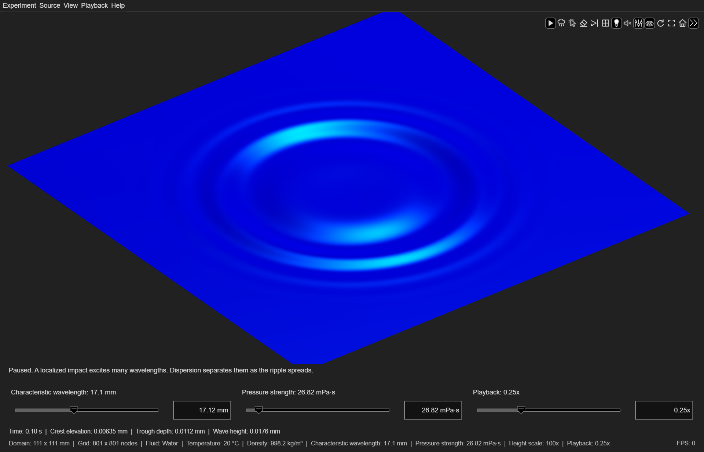

*The Balanced water experiment at 0.103 s, with a 17.1 mm characteristic
wavelength and a 26.82 mPa·s pressure impulse. The 801-by-801 grid resolves the
outward rings.*

The concentric crests and troughs reflect the radial symmetry of the pressure
impulse. Wave dispersion changes their spacing during propagation, while
geometric spreading and viscous dissipation reduce the amplitude of the
outward waves.

**Check your reasoning:** How does doubling the pressure strength affect the
wave height and ring spacing at the same elapsed time after excitation?

<a id="inspect-a-resolved-wave-field"></a>

## Observe the wave field

The supplied example animates a central water disturbance from zero elevation
through settling. The elevation map and complete centerline profile include
the full displacement; a separately scaled outward profile shows the smaller
traveling rings. All scales remain fixed throughout playback. The example uses
the Capillary water setup with a four-cycle wavemaker. The duration follows the source's
calculated settling time, including the [finite settling envelope](physics.md#model-assumptions-and-numerical-approximations).

```matlab
exampleFolder = fullfile(fileparts(which("rippleSimulator")), "examples");
addpath(exampleFolder);
waveField = inspectWaveField();
size(waveField.Elevation)
```

```text
ans =
   201   201   401
```

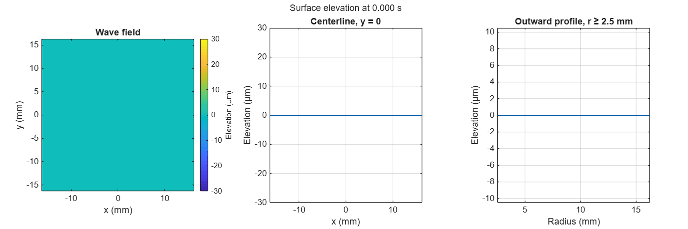

The central displacement oscillates during forcing, while successive rings
travel outward. The outward profile resolves their smaller elevations on a
separate fixed scale. Its crests and troughs correspond to the rings in the
wave field and to the same features in the complete centerline profile.

`waveField` contains the complete time history. `Elevation`, `Velocity`,
`GradientX`, and `GradientY` are *N*-by-*N*-by-*T* arrays, where *N* is the
number of nodes per axis and *T* is the number of sample times. Rows correspond
to *y*, columns to *x*, and page *j* to `waveField.Time(j)`. `Time` is in seconds;
`Coordinates`, `DomainSize`, and `Elevation` are in meters; `Velocity` is in m/s;
the elevation gradients are dimensionless. The figure reports millimeters
horizontally and micrometers vertically.

The wave field is precomputed at uniformly spaced time steps.
**Sampled** playback displays every time step; rendering delays can extend its
duration. **ElapsedTime** playback follows elapsed time and may skip intermediate
time steps. Both modes use the same calculated sequence.

```matlab
inspectWaveField(Setup="Gravity", SourceMode="Wavemaker", ...
    Wavelength=0.05, PressureImpulse=0.1, PlaybackMode="Sampled");
```

| Option | Description |
| --- | --- |
| `Setup` | `"Gravity"`, `"Balanced"`, or `"Capillary"`; defaults to `"Capillary"`. |
| `SourceMode` | `"Impulse"` or the four-cycle `"Wavemaker"`; defaults to `"Wavemaker"`. |
| `Wavelength` | Characteristic wavelength in meters; defaults to the selected setup. |
| `PressureImpulse` | Pressure strength in Pa·s; defaults to the selected setup. |
| `PlaybackRate` | Positive playback multiplier; `0.25` for Gravity and Balanced, `0.10` for Capillary unless specified. |
| `PlaybackMode` | `"Sampled"` or `"ElapsedTime"`; defaults to `"Sampled"`. |
| `SampleInterval` | Maximum time step between wave field samples, in seconds. The default provides at least 40 samples per reference period and targets at least 50 displayed samples per second at the requested playback rate. |

Wavelength and pressure strength overrides retain the setup's physical domain and must
satisfy the app's sampling and small-slope criteria. The restoring balance is
determined by the specified wavelength and fluid properties. An explicit
wavelength override can therefore change the dominant restoring force.

**Check your reasoning:** Compare the outward motion of a crest with the vertical
oscillation of the surface. How does the position of a crest change over time,
and how does the surface elevation change at a fixed distance from the source?

## Compare physical scales

Select **Experiment > New scaled experiment** and compare the gravity wave, gravity–capillary balance, and capillary wave scales. Create a central pressure impulse in each setup, keeping water at 20 °C and
the height scale at 100x.

Selecting a setup changes the domain size, characteristic wavelength, and
pressure strength. The Gravity domain spans 13 characteristic wavelengths per
side, while the Balanced and Capillary domains span 6.5. Gravity and Balanced start at 0.25x playback, and
Capillary starts at 0.10x. This scaling makes patterns easier to compare visually. The actual frequencies,
propagation speeds, pressure strengths, and physical durations differ.

<table>
  <thead><tr><th width="33.333333%">Gravity</th><th width="33.333333%">Balanced</th><th width="33.333333%">Capillary</th></tr></thead>
  <tbody><tr>
    <td><a href="../assets/scale-gravity.png">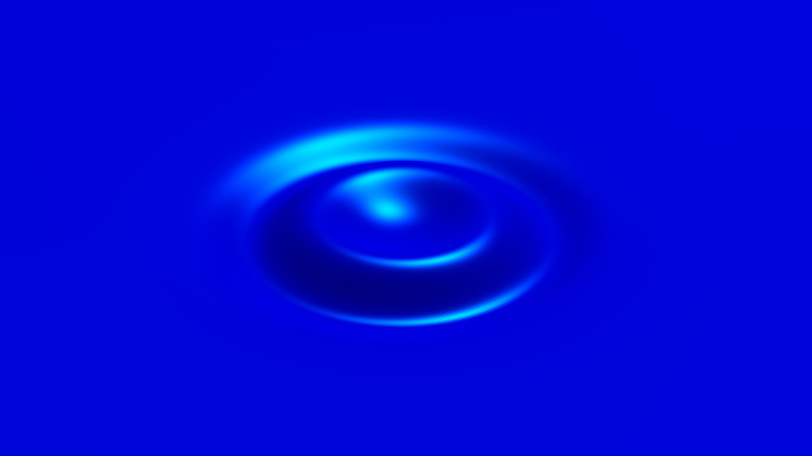</a></td>
    <td><a href="../assets/scale-balanced.png">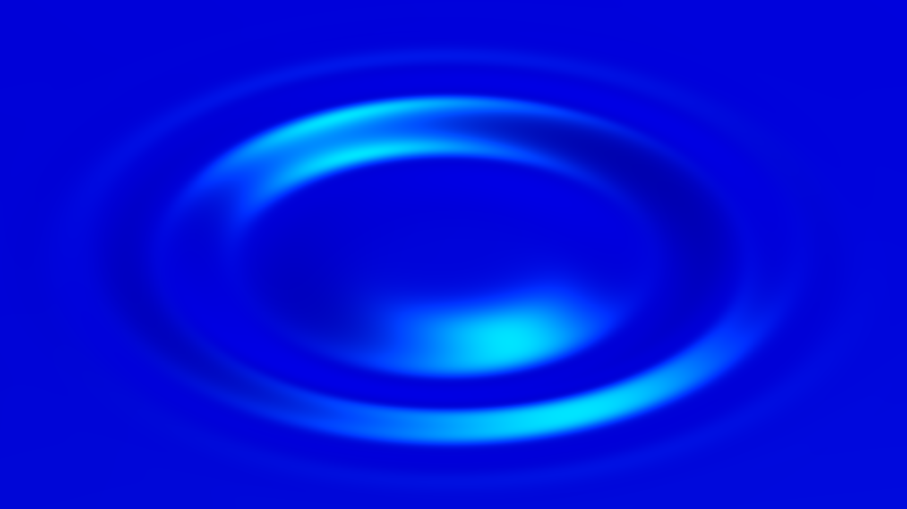</a></td>
    <td><a href="../assets/scale-capillary.png"></a></td>
  </tr></tbody>
</table>

*Ripples from central pressure impulses in water at 20 °C, shown after one reference period at each characteristic wavelength. The Gravity, Balanced, and
Capillary observation domains are 650 × 650 mm, 111.3 × 111.3 mm, and 32.5 × 32.5 mm,
respectively. Each uses an 801 × 801 grid and a 100x height scale. The images show
close views of the surface rather than the full domains, with the zoom adjusted so that the characteristic wavelength has the
same displayed length in each image.*

After one reference period in each setup, the main outward crest lies farther
from the source in the Capillary than in the Gravity wave setup when distance is measured in
characteristic wavelengths. This is consistent with the wavelength dependence of group velocity. For a narrow wave packet centered on the characteristic wavelength, the inviscid dispersion relation predicts travel distances of approximately 0.60 wavelengths for the Gravity, 1.00 for the Balanced, and 1.42 for the Capillary wave setup during one reference period.

The table below lists the preset parameters and the relative contributions of gravity and surface tension 
at each characteristic wavelength.
Each percentage gives the contribution of the restoring force to the squared reference angular frequency
supplied by the corresponding term in the
[inviscid gravity–capillary wave dispersion relation](physics.md#gravity-and-surface-tension):

<div id="scale-parameters">

| Quantity | Gravity | Balanced | Capillary |
| --- | ---: | ---: | ---: |
| Characteristic wavelength (mm) | 50 | 17.1 | 5 |
| Domain side length (mm) | 650 | 111.3 | 32.5 |
| Pressure strength (mPa·s) | 100 | 26.82 | 10.67 |
| Reference period (s) | 0.1693 | 0.0741 | 0.0159 |
| Gravity contribution (%) | 89.5 | 50 | 7.9 |
| Surface tension contribution (%) | 10.5 | 50 | 92.1 |

</div>

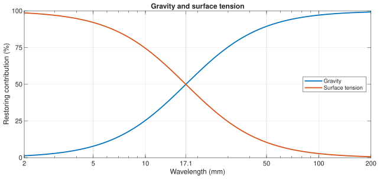

*Relative contributions of the restoring forces of gravity and surface tension in water at 20 °C. The vertical lines from left to right mark the characteristic wavelengths of the Capillary, Balanced, and Gravity setups respectively.*

Gravity is the dominant restoring force at the 50 mm characteristic wavelength,
whereas surface tension dominates at 5 mm. Their contributions are equal at
approximately 17.1 mm. Each Gaussian pressure impulse excites a spectrum of
wavelengths, so the restoring balance varies among the components within each
ripple. Components of different wavelengths propagate at different velocities according to the dispersion relation, changing the ring spacing as the wave field evolves.

**Check your reasoning:** If a wave component's wavelength is halved while the
fluid properties remain constant, how do the relative contributions of the
restoring forces of gravity and surface tension change?

<a id="wave-analysis"></a>
<a id="phase-velocity-and-group-velocity"></a>

## Compare phase and group velocities

Open `examples/plotWaveDispersion.m` in the MATLAB Editor and run it. The
example obtains water properties from the app's public record and plots the
deep-water inviscid phase and group velocities from the governing dispersion relation.

```matlab
waveProperties = plotWaveDispersion();
```

The `waveProperties` structure contains `Wavelength` (m), `AngularFrequency`
(rad/s), `PhaseVelocity` (m/s), and `GroupVelocity` (m/s), each a 1-by-400 array.
The scalar `CrossoverWavelength` (m) identifies equal gravity and
surface-tension contributions.

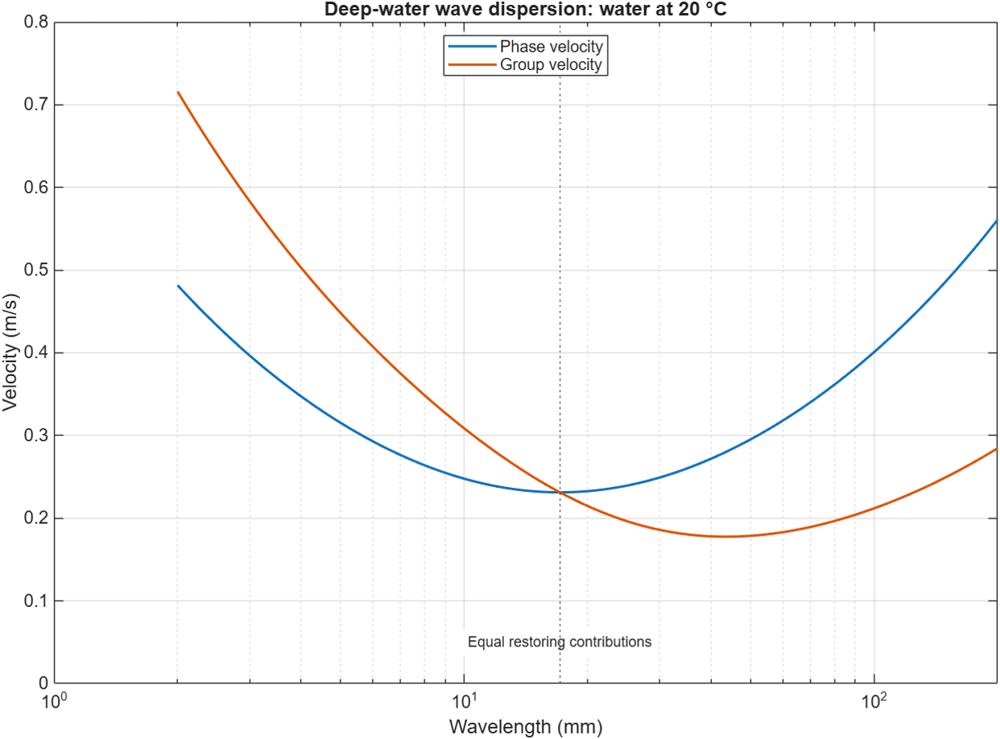

*Water at 20 °C, density and surface tension from the app's IAPWS property
record; gravity 9.81 m/s². The curves show the inviscid phase and group
velocities. Wavelengths span 2–200 mm.*

The group and phase velocities coincide at the minimum phase velocity, where gravity
and surface tension have equal restoring contributions. At long wavelengths
the deep-water gravity limit has group velocity half the phase velocity. In the
short-wavelength capillary limit, group velocity is three halves of phase velocity.

**Check your reasoning:** In the gravity-wave and capillary-wave limits, does
an individual crest move ahead of or behind the wave-packet envelope? Relate
the velocity curves to the rings observed in the app.

<a id="interference"></a>
<a id="wave-interference"></a>

## Investigate wave interference

Choose the balanced setup and apply sources on opposite sides of the center:

```matlab
app.applySetup("Balanced");
distance = app.DomainSize/5;
app.Paused = true;
app.addRipple([-distance, 0]);
app.addRipple([distance, 0]);
app.Paused = false;
```

The two sources' elevations are superimposed. Each command records its own
start time. Pausing fixes the physical time while both sources are added, so
they begin simultaneously.

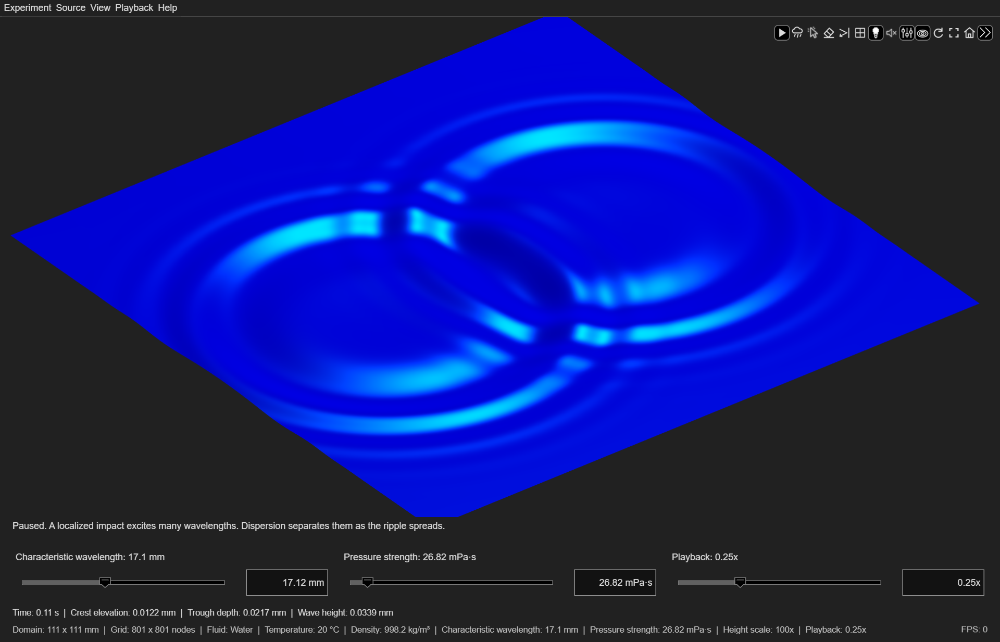

*Two simultaneous ripples, shown 0.109 s after excitation. Their overlapping rings produce
constructive and destructive interference; the fluid and source properties
are identical.*

Where two crests or two troughs overlap, their surface elevations reinforce
one another. Where a crest overlaps a trough, their opposite surface elevations
partially or completely cancel. The resulting wave field follows from the
linear superposition of the two ripples.

**Check your reasoning:** If the surface elevations of two ripples cancel at a
point, must their vertical velocities also cancel at that instant? Use the
[`snapshot`](../reference/index.md#snapshot) method to inspect both quantities
at the same time.

<a id="change-future-wavelengths"></a>

## Change wavelengths

```matlab
app.applySetup("Balanced");
app.Paused = true;
app.addRipple([-app.DomainSize/5, 0]);
app.Wavelength = 0.01;
app.addRipple([app.DomainSize/5, 0]);
app.Paused = false;
```

The first source retains its original spectrum. The second uses the new
10-mm characteristic wavelength. The physical domain and fluid remain fixed.
The pressure strength is also retained. Changing the source width can change
the resulting wave height.

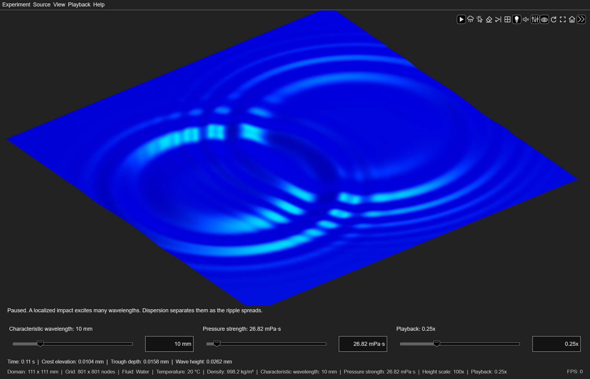

*Ripples generated by sources with 17.1 mm and 10 mm characteristic wavelengths,
shown 0.109 s after excitation. Both use a 26.82 mPa·s pressure impulse in the
same Balanced domain.*

The shorter characteristic wavelength gives the right-hand source a smaller
spatial footprint and shifts its spectrum toward shorter wavelengths. The
different ring spacings arise from these source spectra and the wavelength
dependence of the wave velocities.

**Check your reasoning:** Why can the two sources produce different wave
heights despite having the same pressure strength?

<a id="reflections"></a>
<a id="wave-reflections"></a>
<a id="wave-reflection"></a>

## Investigate wave reflection

Enable wave reflection with a reflection coefficient of 100%:

```matlab
app.applySetup("Gravity");
app.ReflectionCoefficient = 1;
app.ReflectionsEnabled = true;
app.addRipple([0.2, 0]);
```

Waves return from the boundaries and interfere with later disturbances.
Use the wide or top camera view to inspect the boundaries. The walls are
impermeable and free-slip, with a 90-degree contact angle; there is no bottom
or wall-friction model. Viscous dissipation continues to act on the reflected waves.
The same finite-duration envelope makes every source exactly zero at its
settling deadline; reflection does not restart a source's lifetime.

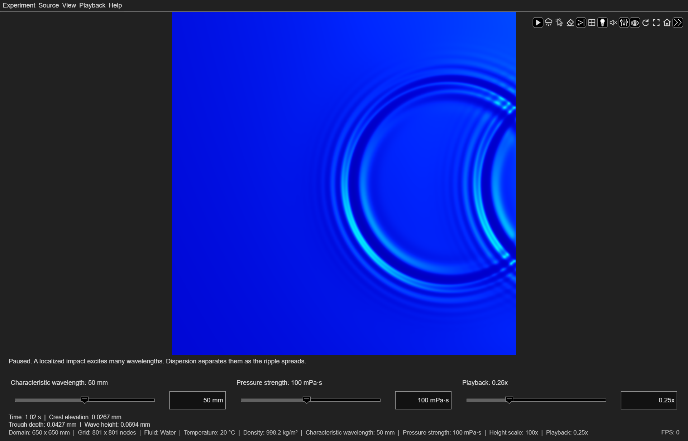

*An impulse at [0.2, 0] m in a 650-by-650 mm domain with ideal reflecting
walls, viewed from above at 1.016 s. The returning rings overlap the outgoing
wave.*

For partial reflection, choose **Experiment > Wave reflection > Reflection coefficient > 50%**.
A wave component retains 50% of its initial amplitude after one boundary
encounter and 25% after two. The corresponding energy fractions are 25% and
6.25%, before accounting for viscous loss along the path. These
fractions apply to reflected components; overlapping waves can produce a
different maximum elevation in the combined field.

**Check your reasoning:** For a reflection coefficient of 80%, what percentages of a wave
component's initial amplitude and energy remain after two boundary encounters?
How do two successive wall encounters differ from two reflected components
arriving at the same point?

<a id="reproducible-rain"></a>

## Reproduce rain

The random seed determines the burst positions:

```matlab
app.reset();
app.RandomSeed = 42;
app.rain();
```

To repeat the positions with the same physical settings, clear the surface and
set the seed again before starting the next burst. Clear alone preserves the
generator's progression. At its default pressure multiplier, rain has the same
pressure strength as clicking.

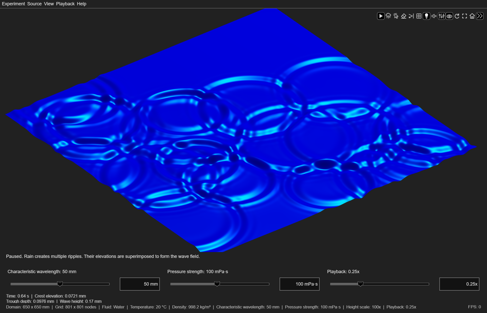

*A seed-42 rain burst at 0.637 s. The 801 × 801
observation grid resolves the overlapping ripples from twenty localized sources.*

Individual rings remain circular around their source positions. Their
overlapping crests and troughs form the irregular combined wave field through
constructive and destructive interference. Because the inputs occur at
different times, the rings also represent different stages of propagation.

**Check your reasoning:** For two rain bursts with the same random seed, which
other settings must match to produce identical wave profiles at the same
elapsed time?

<a id="isolate-viscosity"></a>

## Isolate the effect of viscosity

For a controlled comparison, keep density, surface tension, source loading,
physical dimensions, and playback unchanged. Begin with the default water
experiment and observe one central impulse:

```matlab
app.applySetup("Gravity");
app.HeightScale = 100;
fluid = app.FluidProperties;
app.addRipple([0, 0]);
```

Then create a custom fluid with twenty times the dynamic viscosity and repeat
the same input:

```matlab
fluid.DynamicViscosity = 20*fluid.DynamicViscosity;
app.FluidProperties = fluid;
app.addRipple([0, 0]);
```

Assigning the custom properties starts a fresh experiment while preserving
the source and the manually selected height scale. Compare the pattern at the same elapsed time after excitation,
before the finite settling envelope attenuates the response.

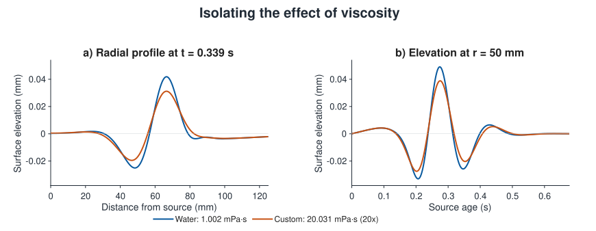

*A central 100 mPa·s impulse with a 50 mm characteristic wavelength. The radial
profiles are evaluated at 0.339 s; the histories are sampled 50 mm from the
source. Density and surface tension remain fixed at their water values at
20 °C. Both plots show physical elevations on the same vertical scale.*

Increasing the viscosity reduces the crest elevations and trough depths in both
plots. Viscous dissipation acts to reduce the wave energy and attenuates the
shorter-wavelength components more rapidly.

**Check your reasoning:** Why does the rate of attenuation due to viscous
dissipation depend on the wavelength? Why would selecting a different material not isolate
the effect of viscosity?

<a id="inspect-physical-measurements"></a>

<a id="inspect-physical-quantities"></a>

<a id="inspect-the-physical-quantities"></a>

## Examine the effect of spatial resolution

The [`snapshot`](../reference/index.md#snapshot) method retrieves the wave field
data at the current simulation time. Comparing these data on different
observation grids reveals the effect of spatial resolution on the sampled
physical quantities.

Pause playback and retrieve the wave field data:

```matlab
app.Paused = true;
waveField = app.snapshot(Derivatives=true);
peakElevation = max(abs(waveField.Elevation), [], "all");
peakSpeed = max(abs(waveField.Velocity), [], "all");
peakSlope = max(hypot(waveField.GradientX, waveField.GradientY), [], "all");
```

Each snapshot contains `Elevation`, `Velocity`, `GradientX`, `GradientY`, and
the physical coordinates.

`peakElevation` is the maximum absolute surface elevation in meters,
`peakSpeed` is the maximum vertical speed in m/s, and `peakSlope` is
dimensionless. These are maxima over the grid nodes, not guaranteed continuous-space
maxima. Changing vertical exaggeration changes none of these values.

The crest elevation is the highest sampled elevation relative to the still water level.
The trough depth is the greatest depth below the still water level, reported as a
nonnegative value. Wave height is the difference between the highest and
lowest sampled elevations. In an overlapping or dispersive wave field, these
extrema do not necessarily have equal magnitudes or belong to the same wave.

For a complete time history, see [Observe the wave field](#observe-the-wave-field).

<a id="compare-spatial-sampling"></a>

The observation grid defines the spatial discretization used to sample the
wave field. Increasing the number of nodes within a fixed physical domain decreases the grid spacing
and increases spatial resolution. To compare spatial sampling, keep playback
paused and retrieve the same wave field on grids with 101, 201, and 401 nodes
per side:

```matlab
app.Paused = true;
app.Wireframe = true;
app.GridResolution = 101;
coarse = app.snapshot(Derivatives=true);
app.GridResolution = 201;
medium = app.snapshot(Derivatives=true);
app.GridResolution = 401;
fine = app.snapshot(Derivatives=true);
settings = app.describe();
```

The `describe` record contains the material, source, domain, display, timing,
and numerical settings.

Compare the sampled wave height on each grid:

```matlab
nodesPerSide = [101; 201; 401];
gridSpacing = app.DomainSize./(nodesPerSide - 1);
waveHeight = [
    max(coarse.Elevation, [], "all") - min(coarse.Elevation, [], "all");
    max(medium.Elevation, [], "all") - min(medium.Elevation, [], "all");
    max(fine.Elevation, [], "all") - min(fine.Elevation, [], "all")];
samplingComparison = table(nodesPerSide, gridSpacing*1e3, waveHeight*1e6, ...
    VariableNames=["NodesPerSide", "GridSpacing_mm", "WaveHeight_um"])
```

<table>
  <thead><tr><th width="33.333333%">101 × 101 nodes</th><th width="33.333333%">201 × 201 nodes</th><th width="33.333333%">401 × 401 nodes</th></tr></thead>
  <tbody>
    <tr>
      <td><a href="../assets/sampling-101.png">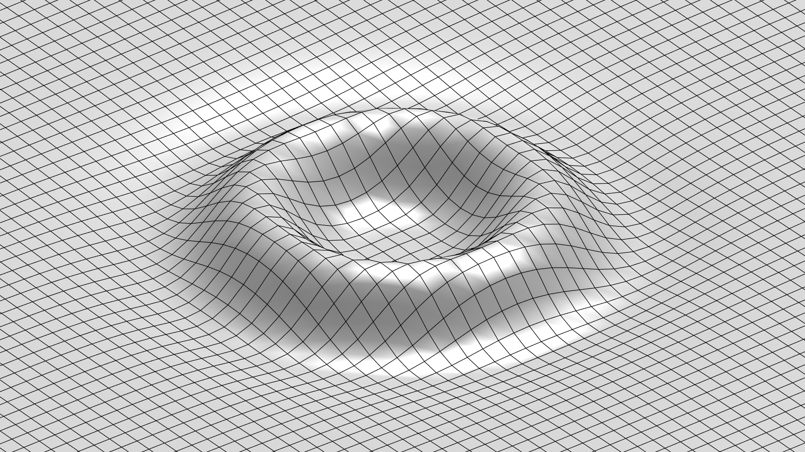</a></td>
      <td><a href="../assets/sampling-201.png">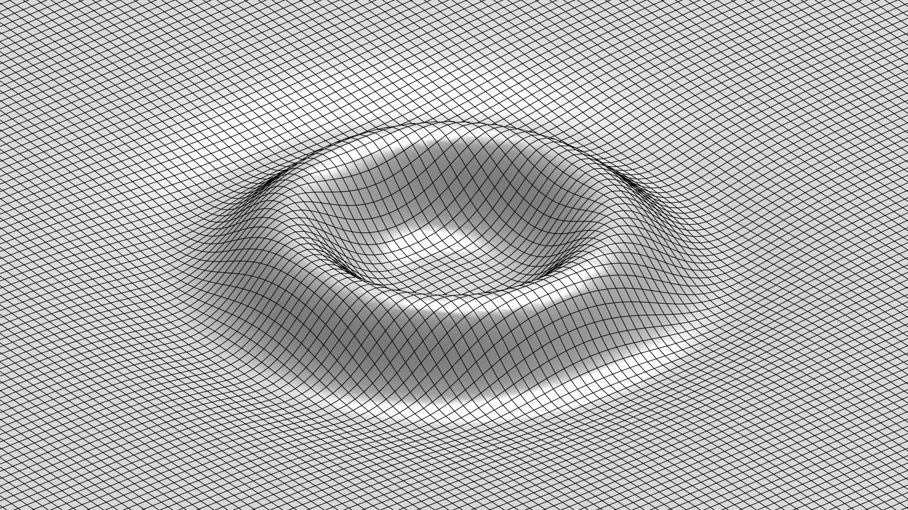</a></td>
      <td><a href="../assets/sampling-401.png">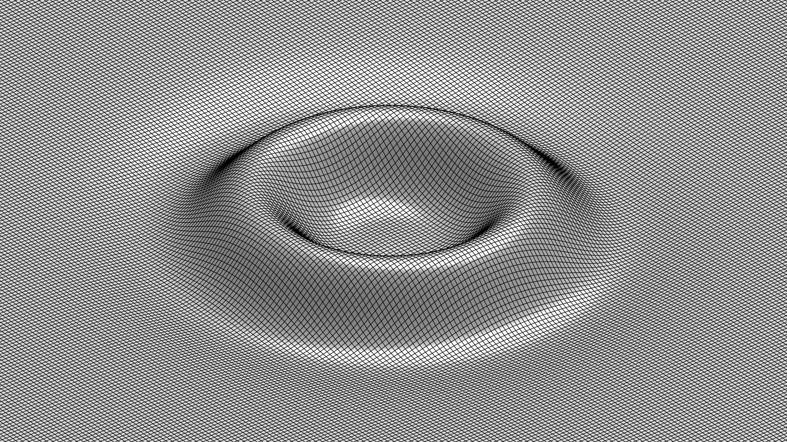</a></td>
    </tr>
    <tr><td>Grid spacing: 6.5 mm</td><td>Grid spacing: 3.25 mm</td><td>Grid spacing: 1.625 mm</td></tr>
  </tbody>
</table>

*A central 100 mPa·s pressure impulse in water at 25 °C, with a 100 mm
characteristic wavelength, shown at 0.275 s on three observation grids. All
three views use a 650 × 650 mm domain, a 300x height scale, and identical
camera and lighting settings.*

The grid spacing halves at each refinement, adding samples between the existing
nodes. All three grids resolve the main ring; the finer grids represent its
curvature with more samples. In this example, the sampled wave height differs
by approximately 0.27% between the 101 × 101 and 401 × 401 grids. Sampled extrema can change
slightly as additional nodes approach the extrema of the continuous wave field.

See [Spatial sampling](numerics.md#spatial-sampling) for the grid requirements.

**Check your reasoning:** If the characteristic wavelength is halved while the
domain size remains unchanged, how should the grid resolution change to maintain
the same number of samples per wavelength?

<a id="compare-fluids"></a>

## Compare different fluids

Compare a central pressure impulse in water, acacia honey, molten chocolate,
olive oil, and the two silicone grades. Start with the gravity setup. After
selecting each material, set the characteristic wavelength to 100 mm, the
pressure strength to 100 mPa·s, and the height scale to 300x. Set water to
25 °C; retain the other materials' preset temperatures. Keep the excitation
method, physical domain, grid resolution, playback rate, and camera fixed.

| Water, 25 °C | Acacia honey, 30 °C | Molten chocolate, 60 °C |
| --- | --- | --- |
| [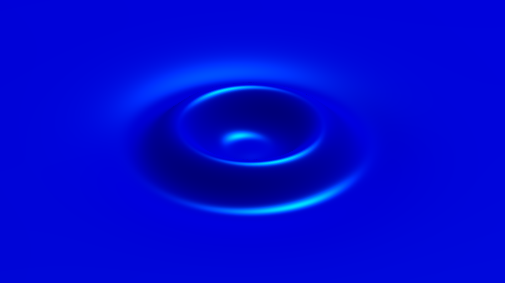](../assets/fluid-water-25c.png) | [](../assets/fluid-honey.png) | [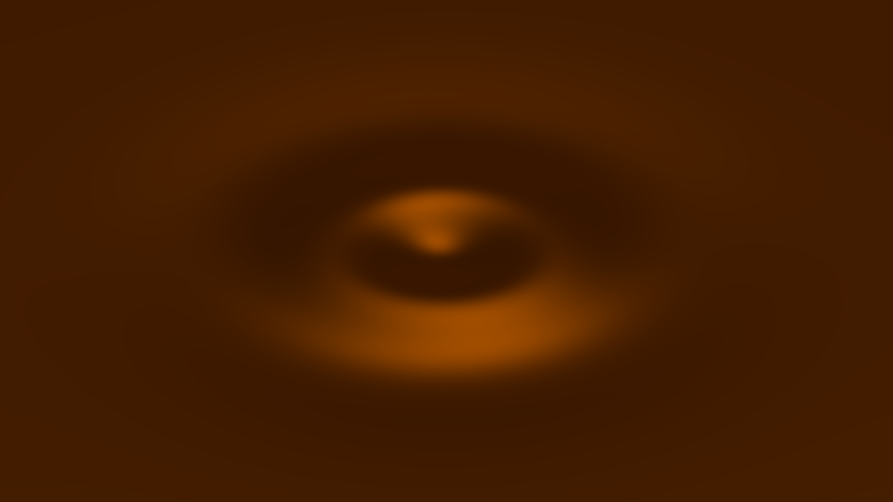](../assets/fluid-chocolate.png) |

| Olive oil, nominal 23 °C | 5 cSt silicone oil, 25 °C | 100 cSt silicone oil, 25 °C |
| --- | --- | --- |
| [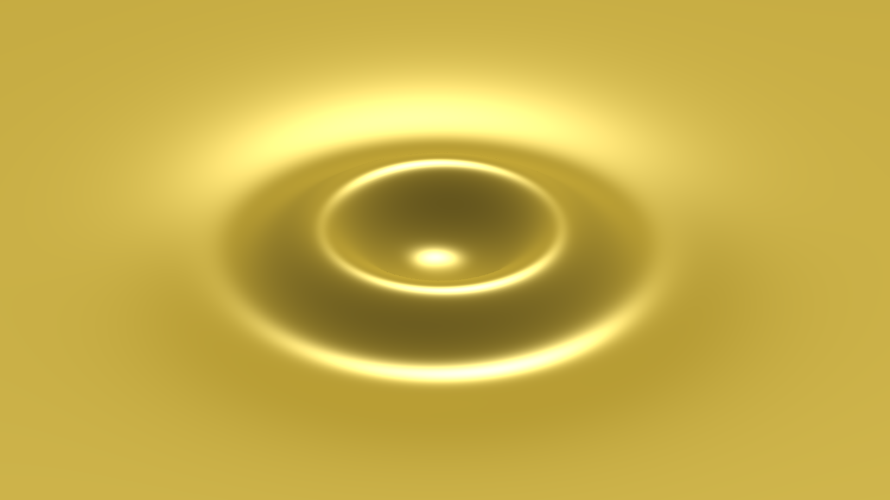](../assets/fluid-olive-oil.png) | [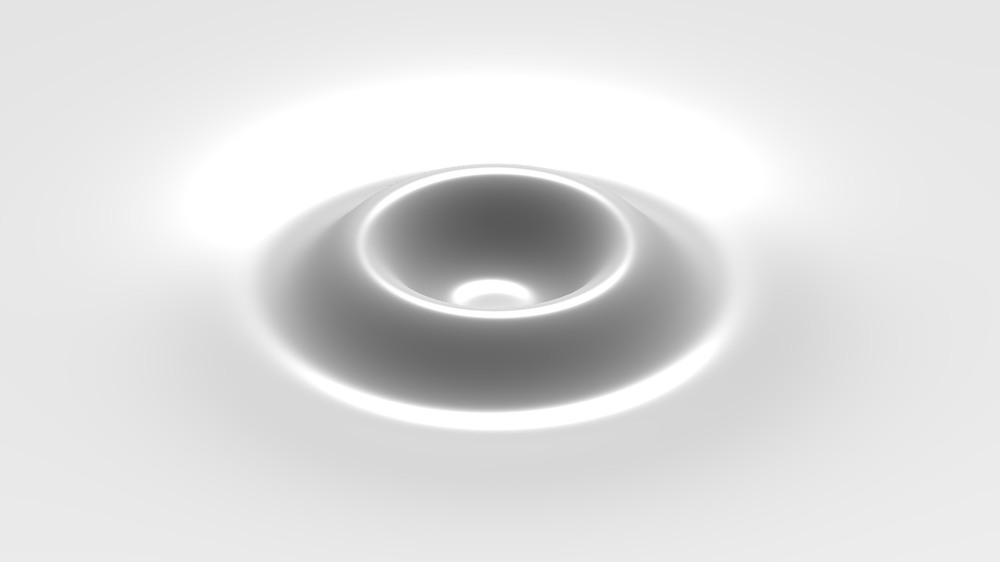](../assets/fluid-silicone-5cst.png) | [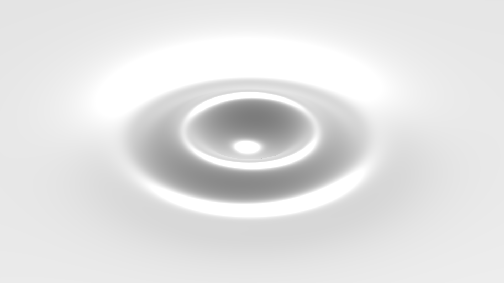](../assets/fluid-silicone-100cst.png) |

*Central impulses at 0.275 s, with a 100 mm characteristic wavelength,
100 mPa·s pressure impulse, 650 × 650 mm domain, 801 × 801 grid, and 300x
height scale. The images use a common camera and each material's preset surface
color and lighting. Temperatures are stated above the images.*

Compare the distance traveled by the rings, their spacing, and their physical
elevations at the same elapsed time. Density and surface tension affect the
restoring response, while kinematic viscosity controls viscous dissipation.
These properties differ between the fluids, so changes in the pattern cannot
be attributed to viscosity alone. At sufficiently high viscosity, some spectral
components relax toward equilibrium without oscillating
([Denner, 2016](https://doi.org/10.1103/PhysRevE.94.023110)).

The silicone grades provide a comparison within the same fluid family: their
kinematic viscosities differ by a factor of twenty. Honey and molten chocolate
extend the comparison to more viscous fluids at their stated temperatures.
These presets use constant-viscosity Newtonian approximations. See
[Materials](materials.md) for the measured properties, temperature conditions,
and rheological assumptions.

**Check your reasoning:** Which material properties are required to compare all six fluids at the same temperature?

See [Experiments](experiments.md) for guidance on interpreting the results,
[Numerical methods](numerics.md) for the calculation and sampling of the wave
field, and [Functions and Properties](../reference/index.md) for programmatic
use of the app.

