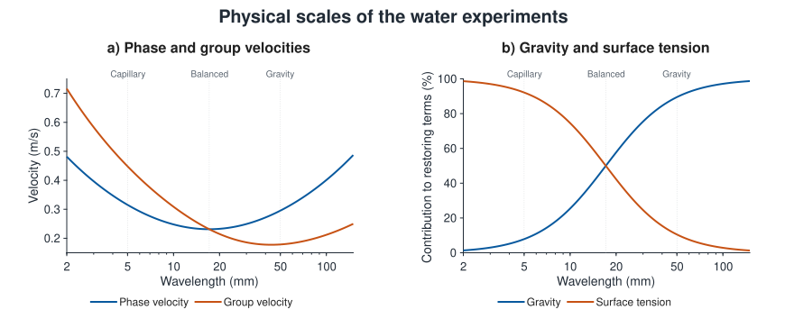
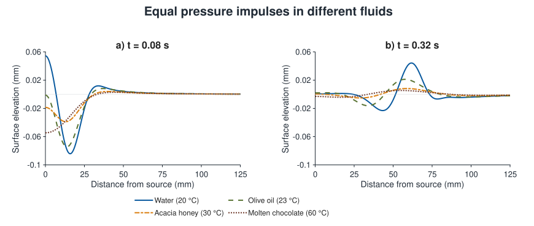

# Experiments

These numerical experiments examine wave dispersion, interference, reflection,
and viscous dissipation within the linear gravity–capillary model. Inspect the physical
quantities to distinguish changes in the wave field from changes in its presentation.

## Scaled water experiments

The **Experiment** menu provides gravity, gravity–capillary balance, and
capillary water setups. The default gravity setup uses a 50 mm characteristic
wavelength in a 650 × 650 mm domain. The balanced and capillary setups span 6.5
characteristic wavelengths. Changing setup establishes new physical
dimensions, source settings, and playback scaling.

Gravity and Balanced start at 0.25x playback; Capillary starts at 0.10x.
Both restoring forces contribute in all three setups. The characteristic
wavelength sets the source footprint and reference wavenumber; a localized
disturbance contains a spectrum of wave components.

*Water at 20 °C. The vertical lines mark the characteristic wavelengths of the
Capillary, Balanced, and Gravity setups. Plot (a) shows the inviscid phase and
group velocities. Plot (b) shows the fractions of the restoring relation supplied
by gravity and surface tension. At the balanced wavelength, the contributions
are equal and the phase and group velocities coincide.*

See [Compare physical scales](examples.md#compare-physical-scales) for a guided
comparison and [Wave dispersion](physics.md#wave-dispersion) for the phase and group velocities.

## Reflecting boundaries

**Reflecting boundaries** switches between an unbounded surface and a domain
with reflecting boundaries. Use the **Reflecting boundaries** axes-toolbar button,
**Experiment > Wave reflection > Reflecting boundaries**, or **B**. The button and
menu checkmark show the accepted setting. Switching clears existing waves and pending rain while preserving the
camera, lighting, source settings, and pause state. Reset restores open water.

Reflected waves dissipate through the same viscosity model as outgoing waves.
**Experiment > Wave reflection > Reflection coefficient** provides 100%, 75%,
50%, 25%, and 10% amplitude presets and a **Custom...** value. The default is 100%. Changing the
coefficient while wave reflections are enabled starts a new experiment. At 50%,
each reflected wave component retains half its incident amplitude and one
quarter of its incident energy.

At 100%, the walls are free-slip idealizations; wall friction and contact-line
losses are excluded. Intermediate coefficients prescribe partial reflection,
and 0% gives open-water propagation. All use the same finite settling envelope.
See [Physics](physics.md) for more details.

See [Investigate wave reflection](examples.md#investigate-wave-reflection) for an investigation of repeated wall
encounters and [Wave reflection geometry](numerics.md#wave-reflection-geometry)
for the image-source construction.

## Comparing different fluids

Select a fluid from **Experiment > Material**. Each named selection restores its
fluid properties, characteristic wavelength, pressure strength, height scale,
and appearance. To compare responses to identical pressure impulses, select
Pressure impulse and restore the same characteristic wavelength and pressure
strength after each selection. Use the same height scale, domain, source position,
reflection settings, playback rate, and elapsed time after excitation, as
described in [Compare different fluids](examples.md#compare-different-fluids).

Density, viscosity, and surface tension can all differ between materials.
The [material properties](materials.md) are documented with their measurement conditions
and constitutive assumptions. To isolate viscosity, use a custom fluid while
keeping the other properties constant, as described in [Isolate the effect of viscosity](examples.md#isolate-the-effect-of-viscosity).

*Unbounded responses to a 100 mPa·s pressure impulse with a 50 mm characteristic
wavelength. Both plots use the same distance and elevation scales. The curves
use the full viscous response and the property sets in [Materials](materials.md),
including the constant-viscosity approximations for honey and chocolate.
Differences reflect the combined effects of density, viscosity, and surface
tension; this comparison does not isolate viscosity alone.*

## Interpreting the experiments

Use a top view to follow wave propagation and interference across the surface, and
an oblique view to inspect its shape. Camera changes leave the physical wave
field unchanged. The animated elevation map and profiles in
[Observe the wave field](examples.md#observe-the-wave-field) follow a disturbance
from excitation through settling.

### Wave propagation and dispersion

A localized source excites a spectrum of wavelengths. Their different
propagation and decay rates change the pattern as it spreads. The inviscid
phase velocity describes a component's moving crest; the group velocity
describes a narrow wave packet. These velocities do not necessarily coincide.
Use the [dispersion curves](examples.md#compare-phase-and-group-velocities)
to relate the observed pattern to the gravity and surface-tension contributions.

Compare distances and physical times when judging propagation. Playback rate
changes the rate at which simulation time passes, while camera zoom changes
the apparent distance on screen. Neither changes the physical wave speeds.

### Wave interference

The surface elevations and vertical velocities of overlapping sources are superimposed.
Constructive interference amplifies the surface displacement; destructive
interference attenuates it. Cancellation of elevation does not require
cancellation of vertical velocity, so a zero crossing alone does not indicate
rest. Inspect both quantities at the same simulation time, as described in
[Investigate wave interference](examples.md#investigate-wave-interference).

Crest elevation and trough depth describe extrema of the combined surface.
Their magnitudes are not necessarily equal, and the extrema can belong to
different waves. The reported wave height spans the highest and lowest sampled
elevations. See [Examine the effect of spatial resolution](examples.md#examine-the-effect-of-spatial-resolution)
for the field values and the effect of spatial sampling.

### Viscous dissipation and geometric spreading

Viscous dissipation converts mechanical energy into heat. A decrease in local
wave height can also result from geometric spreading or propagation beyond the
observation window. Geometric spreading distributes the energy of outward
circular waves over an increasing circumference, reducing local amplitude even
without viscosity. Propagation beyond the observation window carries energy
out of view.

In a strongly viscous response, some components relax without completing an
oscillation. The fluid comparison above changes density and surface tension
as well as viscosity, so its wave-height differences cannot be attributed to
viscosity alone. The controlled comparison in
[Isolate the effect of viscosity](examples.md#isolate-the-effect-of-viscosity)
keeps density, surface tension, and source loading constant.
See [Viscosity and transient motion](physics.md#viscosity-and-transient-motion)
and [Why a ripple becomes less visible](physics.md#why-a-ripple-becomes-less-visible)
for these distinct effects.

On an unbounded surface, a small trailing response can remain after the main
packet leaves the visible area. Viscosity and the numerical settling envelope have
separate roles. Each source retains its viscous response
through eight settling time scales, then fades smoothly to exactly zero by
the tenth. This scale accounts for slow viscous relaxation as well as the
inviscid reference period.
See [Physics](physics.md#model-assumptions-and-numerical-approximations)
for details of the settling envelope.

### Wave reflection

At 100% reflection, ideal walls prevent waves from leaving the domain. The
fluid's viscosity continues to dissipate the wave energy, but the ideal
free-slip walls add no wall friction. Open-water waves also carry motion outside
the observation window. Compare the two cases at the same elapsed time after excitation, as
described in [Investigate wave reflection](examples.md#investigate-wave-reflection),
to distinguish transport out of view from viscous dissipation.

With partial reflection, each wall encounter applies the selected amplitude
factor again. The coefficient prescribes the returning fraction without
distinguishing transmission from absorption at the boundary. Viscosity
continues to act between encounters. The resulting pattern combines these
repeated losses with interference between the reflected waves; a change in the
largest crest alone does not isolate either effect.

Both boundary settings use the same finite-duration envelope: each source
is exactly zero after ten of its settling time scales. In the default gravity
setup this takes approximately 6.8 seconds at the default 0.25x playback rate.
Reflections retain the original source age.

See [Examples](examples.md) for MATLAB demonstrations of these experiments and
[Physics](physics.md) for the governing equations and model assumptions.
