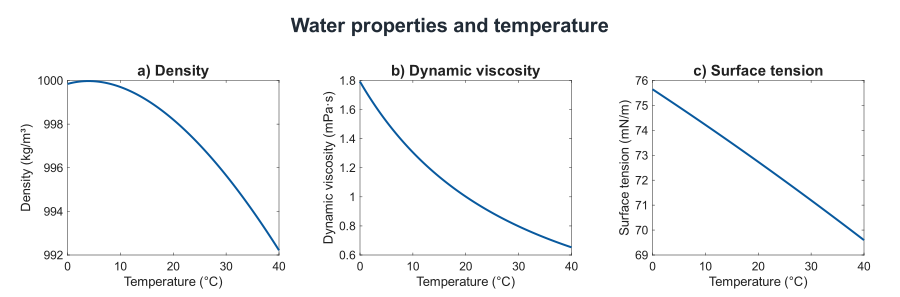
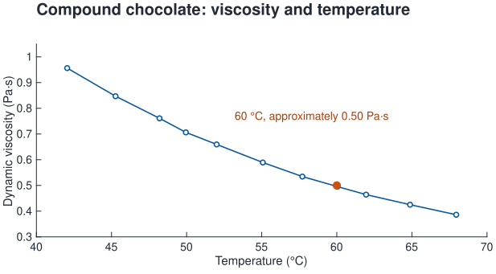

# Materials

Density, surface tension, and viscosity have separate roles in this model.
Density and surface tension set the balance between gravity and capillarity.
Kinematic viscosity controls momentum diffusion and the viscous response.
Changing a material starts a new experiment with the selected fluid properties.

## Water

The Water preset represents pure liquid water, with properties evaluated at the
selected temperature from 0 to 40 °C. At 20 °C (293.15 K) and a reference pressure
of 0.1 MPa, its density is approximately 998.21 kg/m³. Density and dynamic
viscosity use the correlations of the International Association for the
Properties of Water and Steam (IAPWS) at that reference pressure
([IAPWS, 2011](https://iapws.org/technical-guidance/release/LiquidWater)).
Surface tension uses the IAPWS liquid–vapor interface correlation
([IAPWS, 2014](https://iapws.org/technical-guidance/release/Surf-H2O)).
Kinematic viscosity is calculated as dynamic viscosity divided by density.

*Temperature dependence of water density, dynamic viscosity, and surface tension,
calculated from the IAPWS correlations. Density and viscosity are evaluated at
0.1 MPa; surface tension describes the liquid–vapor interface. Density has a
maximum near 4 °C, while dynamic viscosity and surface tension decrease over
the plotted range. Each plot uses its own vertical scale.*

These correlations describe a clean interface. Surfactants, contamination,
temperature gradients, and surface films can change observed wave propagation and
damping. The model does not represent those effects.

## Olive oil

**Oil > Olive oil** uses a measured extra virgin olive-oil sample:
density 908.7 kg/m³, dynamic viscosity 0.0741 Pa s,
and surface tension 0.0319 N/m. The nominal temperature is 23 °C; density and
viscosity are tabulated at 22 ± 1 °C, with at least three measurements for each reported
mean. Surface tension uses the KRÜSS pendant-drop result at 23 °C.
These are sample-specific measurements, not universal cooking-oil constants
([Sahasrabudhe et al., 2017, Tables 2, 4, and 6](https://doi.org/10.1080/10942912.2017.1360905)).

The study checked Newtonian behavior under its measurement conditions. This
preset uses the room-temperature values without a temperature correlation.
Selecting it applies a golden display color.

## Silicone oils

Silicone oils are synthetic silicone fluids, distinct from vegetable cooking
oils. Two specified commercial grades provide viscosity comparisons.
Their parameters are typical values reported by Shin-Etsu at 25 °C
([Shin-Etsu, property tables](https://www.shinetsusilicone-global.com/catalog/pdf/kf96_e.pdf)).

| Grade | Kinematic viscosity | Specific gravity, 25 °C / 4 °C | Surface tension |
| --- | ---: | ---: | ---: |
| KF-96L-5cs | 5 mm²/s | 0.915 | 19.7 mN/m |
| KF-96-100cs | 100 mm²/s | 0.965 | 20.9 mN/m |

Density is calculated from the tabulated specific gravity using the water
density at 4 °C
([Shin-Etsu, specific-gravity guidance](https://www.shinetsusilicone-global.com/catalog/pdf/kf96_e.pdf)).
Dynamic viscosity is then density times kinematic viscosity.
The values are nominal product data, not measurements of a particular batch.
No temperature interpolation or extrapolation is provided for these presets.

The simulator models these grades as Newtonian fluids. This is a constitutive
model assumption for the selected low-viscosity grades. It does not extend to
every silicone product or every shear rate. The manufacturer's discussion of
shear-dependent viscosity concerns substantially more viscous grades.

Both grades use a neutral light color and an opaque surface by default.
**View > Transparency** adjusts the opacity of the filled surface. The opacity
setting does not apply to Wireframe or views with lighting disabled. Alpha blending is a display
approximation; refraction and absorption through the fluid are not modeled.

## Honey

**Honey (acacia)** represents a liquid acacia honey at 30 °C, using a measured
viscosity of 0.27 Pa s. The study describes Newtonian flow for its honey samples
over the measured conditions
([Nayik et al., 2018, Table 2](https://doi.org/10.1016/j.jssas.2016.07.003)).

| Property | Value |
| --- | ---: |
| Nominal temperature | 30 °C |
| Dynamic viscosity | 0.27 Pa s |
| Representative density | 1420 kg/m³ |
| Representative surface tension | 0.0801 N/m |

Density and surface tension are approximations from separate samples.
The density lies within a reported acacia-honey range of 1398–1445 kg/m³
across moisture and temperature conditions
([Meli, 2022](https://meli.be/app/uploads/2024/09/1.-Technical-sheet-ACACIA-HONEY-ENG-EUR-PALL-07042022-REF-1024988.pdf)).
The surface tension is the central value measured for a different honey at
30 ± 2 °C ([Tyowua et al., 2023, Table 1](https://doi.org/10.3389/frsfm.2023.1163393)).

The combined properties define a representative Newtonian approximation;
they are not measurements of one common sample. No temperature correlation
is applied. Composition, temperature, and crystallization can give other honeys
markedly different behavior. Crystals, non-Newtonian effects, and nonlinear
impact cavities are excluded.

## Molten chocolate

**Chocolate (molten)** represents a fluid compound-chocolate formulation at
60 °C. Its approximate viscosity of 0.50 Pa s is read from the temperature
sweep for a 40 rpm, 10 minute refining condition, measured at
a shear rate of 50 s⁻¹. The formulation
contains vegetable fat and emulsifiers
([Toker et al., 2017, Figure 5](https://doi.org/10.1111/ijfs.13336)).

| Property | Value |
| --- | ---: |
| Nominal temperature | 60 °C |
| Density | 1270 kg/m³ |
| Dynamic viscosity | Approximately 0.50 Pa s |
| Surface tension | Approximately 0.030 N/m |

*Dynamic viscosity of compound chocolate as a function of temperature, measured
at a shear rate of 50 s⁻¹ after refining at 40 rpm for 10 minutes. The points are
digitized from [Toker et al. (2017), Figure 5](https://doi.org/10.1111/ijfs.13336).
The highlighted point marks the model's constant viscosity of approximately
0.50 Pa·s at 60 °C.*

The formulation's approximately Newtonian behavior was measured from 0.1 to
100 s⁻¹ at 40 °C, giving 0.992 ± 0.008 Pa s and a coefficient of determination
of 0.9986 ([Toker et al., 2017, methods and Table 3](https://doi.org/10.1111/ijfs.13336)).
The temperature sweep supports the lower viscosity at 60 °C;
extending constant viscosity to lower shear rates at that temperature is a
modeling assumption. Small surface disturbances can fall below the measured
range, so these measurements do not establish the formulation's rheology
arbitrarily close to rest.

Density is a representative compiled chocolate value
([Townsend & Wilson, 2016, Table 1 and Section 2](https://doi.org/10.1088/0143-0807/37/1/015803)).
Surface tension uses a representative 30 mN/m within the range of liquid
chocolate measurements at 50 °C using the Wilhelmy-plate method
([Keijbets, 2009, Section 4.3.1.2 and Figure 4.1](https://etheses.whiterose.ac.uk/id/eprint/12740/)).
Neither property receives a temperature correction. The complete set is a
documented approximation assembled from separate sources, not measurements
of one formulation at 60 °C.

Surface tension is spatially uniform in the model. Surfactant adsorption,
surface-tension gradients, and the resulting Marangoni stresses are excluded;
the measured equilibrium surface tension supplies the capillary restoring force.

Other chocolates can have yield stress and strongly shear-dependent viscosity.
For example, the Casson fit for a 95%-cocoa sample gives the following apparent
viscosity ([TA Instruments, Table 1](https://www.tainstruments.com/pdf/literature/RH113.pdf)):

<!-- equation: chocolate-casson-viscosity | Apparent viscosity equals the square of the sum of the square root of yield stress divided by shear rate and the square root of Casson plastic viscosity. The reference values are 0.61 pascal, 0.28 pascal seconds, and 10 inverse seconds. -->

$$
\mu_{\mathrm{app}}=
\left(\sqrt{\frac{\tau_y}{\dot\gamma}}+\sqrt{\mu_C}\right)^2,
\qquad \tau_y=0.61\;\mathrm{Pa},\quad
\mu_C=0.28\;\mathrm{Pa\,s},\quad \dot\gamma=10\;\mathrm{s}^{-1}.
$$

This relation describes a different formulation and is not the preset's
constitutive law. A viscosity selected at 10 s⁻¹ would not characterize its
nearly quiescent surface. The apparent viscosity increases strongly at lower
shear rates ([TA Instruments, Figure 8](https://www.tainstruments.com/pdf/literature/RH113.pdf)).

Yield stress, shear thinning, viscoelasticity, thixotropy, and crystallization are excluded
from the simulator. A yield-stress chocolate can support stress without
flowing, which the Newtonian model cannot represent
([Kumbár et al., 2021](https://doi.org/10.3390/foods10112519)).

Selecting the preset also applies its dark-brown display color. Changing the
color afterward does not change the physical properties.

## Material presets

Selecting a named material restores its fluid properties, characteristic
wavelength, pressure strength, height scale, and appearance. Selecting Water
also restores 20 °C. The excitation method, physical domain, grid resolution,
and playback rate remain selected independently.

| Material | Characteristic wavelength | Pressure strength | Height scale |
| --- | ---: | ---: | ---: |
| Water | 50 mm | 100 mPa·s | 100x |
| Olive oil | 50 mm | 100 mPa·s | 100x |
| Silicone oil, 5 cSt | 50 mm | 100 mPa·s | 100x |
| Silicone oil, 100 cSt | 50 mm | 100 mPa·s | 100x |
| Honey (acacia) | 100 mm | 150 mPa·s | 200x |
| Chocolate (molten) | 75 mm | 200 mPa·s | 200x |

These are adjustable experiment settings, not material properties.
**View > Height scale > Automatic** calculates the height scale
from the reference-impulse response instead of using a fixed preset.

## Comparing viscosity

In Pressure impulse mode, equal pressure strength and characteristic wavelength
specify the same individual Gaussian pressure impulse. The resulting surface
elevation also depends on the fluid properties. For the four-cycle wavemaker,
the reference frequency depends on density and surface tension, so equal
pressure strength does not generally give the same pressure amplitude or
forcing duration. Keep the physical domain, source position, reflection settings,
and playback rate fixed when comparing materials.

Automatic height scaling makes the smaller responses of viscous fluids
visible. It compares peak center displacements from equal reference pressure
impulses and adjusts the display multiplier relative to water at 20 °C.
The multiplier is fixed during playback and shown as **Height scale**.
For a visual comparison of physical amplitudes, select the same manual
multiplier for every material. Crest elevation, Trough depth, and Wave height
always report physical quantities before display exaggeration.

As viscosity increases, some spectral components cease to oscillate and relax
without completing a cycle. The linear deep-water response includes these
nonoscillatory modes, oscillatory modes, and a viscous transient.

In a high-viscosity fluid, a deformed surface can return to equilibrium more
slowly, while a brief pressure impulse can produce only small surface
displacements. Those are different initial conditions.
Greater viscosity does not imply larger ripples or more oscillations.
Increasing pressure strength scales the displacement without changing the
wave dispersion or damping in a given fluid. The documented
[finite settling envelope](physics.md#model-assumptions-and-numerical-approximations)
is an additional finite-duration model approximation, separate from
viscosity. It smoothly restores each source’s calculated surface elevation and vertical velocity to zero over the settling interval.

## Custom fluids

Choose **Experiment > Material > Custom > Define properties...** to enter
density in kg/m³, dynamic viscosity in Pa s, surface tension in N/m, and the
temperature in °C at which those values apply. Density and viscosity must be
positive; surface tension may be zero. Kinematic viscosity is calculated as
dynamic viscosity divided by density.

Enter a consistent property set for the intended fluid and temperature.
The app does not infer a temperature dependence for custom data. Editing
the temperature in this dialog labels the supplied measurements; it does not
recalculate the other properties. Custom fluids use the same homogeneous,
Newtonian, clean-interface assumptions as the other presets.

See [Physics](physics.md) for the governing equations and model assumptions,
[Source definitions](physics.md#source-definitions) for the applied pressure sources,
and [Numerical methods](numerics.md) for interpolation, sampling, and finite settling.
