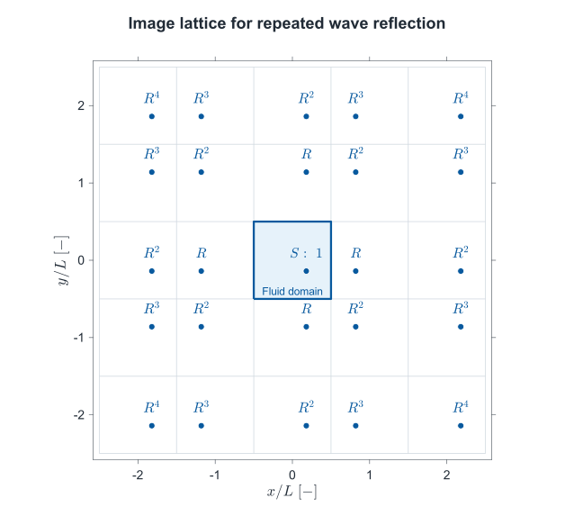
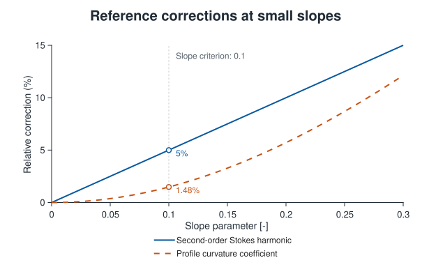

# Numerical methods

## State and coordinates

The physical state is a history of accepted localized sources in a homogeneous
fluid. Each source retains its position, start time, wavelength parameter,
pressure strength, and forcing mode. The field is the sum of their responses at
the requested physical time: radial responses in open water, weighted radial
images for partial reflections, or cosine modes between ideal reflecting walls.

The observation grid samples that continuous response. It is not a finite
difference state that is advanced once per animation frame. Changing the
grid resolution resamples the same sources at the same time. Existing waves
therefore retain their phase and wavelength. Coarsening the grid can still
reduce visible detail; it cannot make unresolved wavelengths accurate.

Mouse clicks and rain place sources at the nearest observation-grid node.
Changing resolution changes the spacing available to later interactive inputs; accepted source
positions remain fixed. Programmatic `addRipple` calls retain their supplied
physical coordinates.

Positions, wavelengths, and surface elevation use meters. Time uses seconds.
The renderer normalizes horizontal coordinates by the domain width and applies
the selected vertical exaggeration to elevation. Neither transformation enters
the physical calculation.

Automatic height scaling compares the peak center displacement of a
unit Gaussian pressure impulse with the corresponding response in water at
20 °C. Both calculations use the selected characteristic wavelength and the
full viscous response. The water reference has a display multiplier of 100;
the selected fluid uses 100 times the ratio of the two reference peaks, rounded
to three significant digits and bounded between 1 and 1,000,000. The impulse
reference is also used in wavemaker mode. This is a visibility convention,
not a physical amplitude correction.

The reference calculation occurs when the fluid properties or wavelength
change. Up to sixteen results are retained for reuse. Playback applies the
fixed multiplier to the existing surface; no amplitude search or rescaling
based on the current wave field occurs per frame. Pressure strength is excluded
from the ratio, so changing it still changes the visible displacement.

## Elapsed-time playback

The playback clock measures elapsed time independently of the rendering rate.
Each frame samples the wave field at the current simulation time. If rendering
takes longer on a particular computer, fewer intermediate views are shown;
the waves do not propagate more slowly. Elapsed playback time excludes user
pauses and input preparation through the first complete frame. A playback-rate change
applies only to subsequent elapsed time.

Scheduled rain retains each drop's due time even when an update arrives late.
The response is evaluated at its resulting age, preserving the same source
history and wave field at matching simulation times. Frame-rate measurement
uses a separate real-time clock and does not drive propagation.

## Radial reconstruction

A Hankel integral combines the response of individual horizontal wavenumbers
with the Gaussian source spectrum. Bessel functions provide the radial spatial
dependence. For a pressure impulse, the unmodified viscous response is

<!-- equation: hankel-response | The radial elevation is minus J s squared over density times the integral of k squared times the Gaussian spectrum, Bessel J zero, and h epsilon over omega zero. -->

$$
\eta_{\mathrm{v}}(r,a)=-\frac{Js^2}{\rho}\int_0^\infty\frac{k^2}{\omega_0(k)}e^{-s^2k^2/2}J_0(kr)h_\epsilon(\omega_0(k)a)\thinspace dk
$$

Here *J*₀ is the Bessel function of the first kind, order zero, and *h*ε is
the inverse Laplace transform of the [viscous transfer function](physics.md#viscosity-and-transient-motion).
The positive pressure strength *J* acts downward. Elevation, vertical velocity,
radial slope, and their mixed derivative follow from the same integral.

The viscous temporal response contains a pair of surface-wave poles and a
branch contribution associated with diffusing vorticity. A paired pole
representation remains finite when the poles approach one another near the
transition to nonoscillatory relaxation. Dropping the branch contribution
would change the initial transient and the late response.

The pole pair is calculated in batches through a scaled factorization of its
quartic equation. Computing the slow pole from the pole product avoids
cancellation in strongly viscous modes. This evaluates the same transfer
function without a general polynomial-root calculation for every wavenumber.
The temporal pole terms are evaluated in the same bounded modal blocks as
the branch integral. Real sine and cosine factors evaluate conjugate pairs;
local series preserve accuracy as the poles coalesce.
For wavemaker excitation, preparation combines the branch-quadrature weights
for each forcing frequency before evaluating its sine and cosine terms.
Elevation and velocity share one matrix contraction of the exponential terms,
with separate weights for the response and its time derivative.
Conjugate symmetry gives the oscillatory pole-pair response from one complex
convolution. Independent modal convolutions are evaluated in bounded arrays.
After the forcing ends, each pole contribution is propagated from its value
at that final forcing time. Near coalescence, a divided-difference formulation retains
numerical accuracy. These evaluations preserve the prescribed forcing integral.

The real-axis radial and reflecting cosine-mode calculations use 64 quadrature
points for the viscous branch. Checks against 256 points cover weakly and strongly viscous modes,
the transition between oscillation and relaxation, and both source types.
These quadrature settings affect numerical accuracy, not the physical damping rate.

At early ages, composite Gaussian quadrature evaluates the real-wavenumber
integral. The quadrature density increases with the oscillation in space and
time. Large quadratures use the piecewise Chebyshev interpolation described
under [reflecting-wall reconstruction](#reflecting-wall-reconstruction) to evaluate
the temporal response. Every original quadrature node contributes to the
spatial reconstruction. For quadrature wavenumbers *k*ⱼ, weights *b*ⱼ containing
the signed source spectrum, and interpolation weights *W*ⱼℓ, preparation forms

<!-- equation: radial-modal-projection | B i ell is the sum over quadrature nodes j of b j times Bessel J zero at k j r i times W j ell. Elevation at r i and t is approximated by the sum over interpolation nodes ell of B i ell times F at kappa ell and t. -->

$$
B_{i\ell}=\sum_j b_jJ_0(k_jr_i)W_{j\ell},\qquad
\eta(r_i,t)\approx\sum_\ell B_{i\ell}F(\kappa_\ell,t).
$$

Here *F(k, t)* = *h*ε(*ω*₀*t*)/*ω*₀ for an impulse; the wavemaker uses the
corresponding forced response. Replacing *J*₀(*kr*) with −*kJ*₁(*kr*) gives
the radial derivative. Replacing *F* with its time derivative gives velocity.
Thus the weighted spatial matrices are shared by elevation and velocity.
Interpolation is used when it more than halves the temporal evaluations;
smaller quadratures are evaluated directly.

Comparisons with direct evaluation at the same quadrature nodes cover 5, 50,
and 100 mm sources, both excitation methods, water from 0 to 40 °C, the acacia
and compound-chocolate approximations, a strongly viscous reference fluid,
and a zero-surface-tension reference. Across those sampled cases, the largest
difference in any of the four fields is below 2.5 × 10⁻⁹ of that field's peak
absolute reference value. This measures interpolation error separately from
the quadrature error.

At sufficiently late ages, a qualified low-wavenumber contour avoids
cancellation in an otherwise highly oscillatory integral. A real-axis
calculation completes the higher-wavenumber part when viscosity requires a
smaller contour region. The terminal arc and viscous branch are retained.

These quadrature methods evaluate the same wave response over its wavenumber
spectrum.

## Open-water response tables

Immutable response tables accelerate repeated evaluation. Their four stored
fields support a tensor cubic Hermite interpolant in radius and time. Radial
nodes are spaced at one thirty-second of the source wavelength parameter.
Time nodes are denser near the viscous onset and during the early oscillations.

The app prepares the complete finite source lifetime when a source
configuration is selected. During playback, open-water sources sample these
tables; a new radial integral is not needed when a source becomes old.
An input's finite-duration envelope reaches zero at the tabulated endpoint.
Tables belonging to active sources remain pinned when source settings change.

## Exact numerical equilibrium

Physical dissipation is already part of the viscous solution. The app also
applies the [finite-duration envelope](physics.md#model-assumptions-and-numerical-approximations):
each source becomes exactly zero after ten settling time scales. The scale is
the larger of its inviscid reference period and the longest retained Stokes
relaxation time. That additional
approximation is distinct from viscosity. Numerical omission estimates do not
measure the envelope's difference from an indefinitely evolving viscous solution.

Each accepted source keeps its full precomputed response until that deadline.
The envelope multiplies elevation and spatial gradients. Vertical velocity
includes both the envelope-scaled physical velocity and the derivative of
the envelope times physical elevation. This preserves consistency between
the displayed displacement and its time derivative.

At the deadline, elevation, velocity, and spatial gradients are exactly zero
for that source. Removing it then introduces no further approximation to the
finite-duration model. Later sources retain their own start times and deadlines.
Reflection does not restart a source's age or its settling envelope.

The unmodified viscous continuum response generally approaches equilibrium
asymptotically. The app's exactly flat final surface is a deliberate consequence
of the stated finite-duration approximation, not a new physical viscosity law.

## Wave reflection geometry

The method of images replaces a reflected path with a straight path from a
mirrored source. For a source at *(x₀, y₀)*, reflection across the wall *x* = *b*
places its image at *(2b − x₀, y₀)*. Mirroring across a second, perpendicular
wall *y* = *c* gives

<!-- equation: wall-image-geometry | The image across x equals b is at two b minus x zero, y zero. The image across both perpendicular walls is at two b minus x zero, two c minus y zero. -->

$$
\mathbf{x}_x=(2b-x_0,\ y_0),\qquad \mathbf{x}_{xy}=(2b-x_0,\ 2c-y_0).
$$

*Wave reflection geometry.* **a) Single wall (side):** the path from *S* through the wall point
*Q* to the observation point *P* has the same length as the straight path from
*S*ₓ to *P*. **b) Perpendicular walls (corner):** unfolding two successive reflections
gives a straight path from the doubly reflected image to *P*. The image across
both walls carries the amplitude factor *R*². The shaded area is the fluid
domain; the images are mathematical source locations outside it.

The reflected contribution is the same radial response evaluated at the
distance from the image source, multiplied by the boundary coefficient.
Its dispersion and viscous evolution remain part of that response. All images
use the original source age *a* = *t* − *t*₀; a wall encounter does not start a
new source clock. The diagram describes the reflection geometry, without
assigning a common speed or a sharp wave front to a dispersive ripple.

For *N* successive encounters, the boundary amplitude multiplier is

<!-- equation: reflection-path-weight | The amplitude multiplier for N successive wall encounters is the product of their reflection coefficients; for identical coefficients it is R to power N. -->

$$
w_N=\prod_{\ell=1}^{N}R_\ell=R^N\quad\mathrm{for\ identical\ walls}.
$$

Thus two encounters give *R* × *R* = *R*². Adding two distinct, coincident
singly reflected components is a different operation: their elevations are
superimposed. Also distinguish the path multiplier from the energy fraction:
one reflected component retains the amplitude fraction *R* and the energy
fraction *R*² at a single encounter.

The app uses a real, nonnegative coefficient with no reflection-induced phase
change. Its physical scope is described under
[Partial wave reflection](physics.md#partial-wave-reflection). The image construction
and the role of amplitude and phase are discussed in the
[reflection references](references.md#wave-reflection).

## Reflecting-wall reconstruction

For perfectly reflecting walls, the image construction is an even, periodic
extension of the source across the boundaries. A cosine expansion represents
the same repeated reflections without enumerating individual image paths.
The reflecting domain uses products of cosine modes in the two horizontal directions:

<!-- equation: reflecting-modes | A cosine mode is cos of m pi X over L times cos of n pi Y over L; its wavenumber is pi over L times the square root of m squared plus n squared. -->

$$
\phi_{mn}=\cos\negthinspace \left(\frac{m\pi X}{L}\right)\cos\negthinspace \left(\frac{n\pi Y}{L}\right),\qquad k_{mn}=\frac{\pi}{L}\sqrt{m^2+n^2}
$$

Here *X* and *Y* measure distance from the lower domain boundaries; *m* and
*n* are nonnegative integers. The zero mode has no elevation response.
The largest retained index in each direction is the ceiling of *8L/(πs)*.
This numerical spectral cutoff does not depend on the display grid.
Gaussian-tail inequalities account for omitted modes beyond this index range.

Preparation evaluates the complete viscous pole pair and a 64-point branch
quadrature at Chebyshev nodes in dimensionless wavenumber *q* = *ks*.
Piecewise degree-19 barycentric interpolation reconstructs the response at
every retained cosine-mode wavenumber. For an impulse, define
*F(k, t)* = *h*ε(*ω*₀*t*)/*ω*₀, whose long-wavelength limit is *t*.
Within each panel, the same interpolation weights
apply to this response and its time derivative:

<!-- equation: modal-wavenumber-interpolation | F at wavenumber k j is approximated by a weighted sum of F at Chebyshev wavenumbers kappa l. Its time derivative uses the same weights. -->

$$
F(k_j,t)\approx\sum_\ell W_{j\ell}F(\kappa_\ell,t),\qquad
\partial_t F(k_j,t)\approx\sum_\ell W_{j\ell}\partial_t F(\kappa_\ell,t).
$$

Here *κ*ℓ denotes a panel's Chebyshev wavenumbers and *W* its barycentric
interpolation weights. Panels span at most 0.125 in *q* and become narrower
for response intervals longer than ten inviscid reference periods. The
wavemaker uses its forced response in the same construction. Small mode sets
are evaluated directly. Bounded matrix batches limit temporary storage, and
the exact initial modal values are retained.

This preparation expands the complete elevation and velocity tables before
playback; it does not reduce the spatial mode set or add a spectral
reconstruction to each frame. The interpolation uses the barycentric Lagrange
formula ([Berrut & Trefethen, 2004](https://doi.org/10.1137/S0036144502417715)).
Cubic Hermite interpolation then evaluates the precomputed
modal response at the requested elapsed time; cosine products reconstruct
its spatial field. The observation grid does not determine the modal spectrum.
The time table normally uses 128 intervals per settling time scale. For larger
modal spectra it uses 64 or 32 intervals to stay within the response-storage
budget, retaining additional samples through the physical forcing interval
and both Hermite fields.
This changes interpolation accuracy, not the governing response or retained
wavenumbers.

A bounded cache reuses immutable modal responses calculated per unit pressure
strength. Responses share a cache entry when the fluid, domain, wavelength,
excitation method, response duration, and memory budget agree. Each experiment
retains its own source history, wave state, and clock. Existing sources keep
their response tables when the source settings change; a new table uses the
remaining storage budget.

## Images for partial wave reflection

For a coefficient between 0 and 1, the model uses weighted images of the
open-water source. If the original source is at *(x₀, y₀)* in a domain centered
at the origin, its image positions are

<!-- equation: image-positions | Image m n is at m L plus minus one to power m times x zero, and n L plus minus one to power n times y zero. -->

$$
\mathbf{x}_{mn}=\left(mL+(-1)^m x_0,\ nL+(-1)^n y_0\right),\qquad m,n=0,\pm1,\pm2,\ldots
$$

The weighted-image model for one source's elevation is

<!-- equation: weighted-images | The reflected elevation is the infinite sum over integer m and n of R to the power absolute m plus absolute n, times the open-water response at the distance from image m n and the original source age. -->

$$
\eta_R(\mathbf{x},a)=\sum_{m=-\infty}^{\infty}\sum_{n=-\infty}^{\infty}R^{|m|+|n|}\eta_{\mathrm{open}}\negthinspace \left(\left\Vert \mathbf{x}-\mathbf{x}_{mn}\right\Vert ,a\right)
$$

Each term retains the same physical age *a*, including the viscous response
and finite-duration envelope. The coefficient changes only the returning
amplitude. A two-wall corner contribution carries *R*². At *R* = 1 the app
instead uses the independent cosine reconstruction;
at *R* = 0 it uses open-water propagation directly.

### Repeated wall encounters

The integer indices include reflections from opposite walls as well as the
first return from each side. An image with index *(m, n)* represents |*m*|
encounters with the *x* = ±*L*/2 boundaries and |*n*| encounters with the
*y* = ±*L*/2 boundaries.
For example, *(1, 0)* has weight *R*, *(1, 1)* has weight *R*², and *(2, 0)*
also has weight *R*². The last image lies at *(2L + x₀, y₀)* and represents a
return after encounters with both opposing *x* boundaries. Images farther
away continue this sequence.

*Repeated images.* The central source is at *(0.18L, −0.14L)*. Mirroring into
neighboring domains alternates its local orientation. Each label gives the
amplitude weight *R*|*m*|+|*n*|; the lattice extends indefinitely.
Moving across two cells in one direction represents two encounters with
opposing walls, while moving one cell in each direction represents an encounter
with each of two perpendicular walls.

### Reusing the image response

Translation invariance of the unbounded fluid makes one precomputed radial
response reusable at every image location. A bounded domain requires an
additional geometric step: moving a source shifts its even and odd images in
opposite directions. The app therefore groups the image sum by the parity of
*m* and *n*. For *p*, *q* ∈ {0, 1}, define

<!-- equation: image-parity-basis | B p q is the weighted sum of the open-water radial response over image indices m equals two i plus p and n equals two j plus q. -->

$$
B_{pq}(u,v,a)=\sum_{i=-\infty}^{\infty}\sum_{j=-\infty}^{\infty}R^{|2i+p|+|2j+q|}\eta_{\mathrm{open}}\negthinspace \left(\sqrt{[u-(2i+p)L]^2+[v-(2j+q)L]^2},a\right).
$$

The source position then enters through four translated groups:

<!-- equation: translated-image-basis | The reflected elevation is the sum over parity p and q of B p q evaluated at x minus minus one to power p times x zero, y minus minus one to power q times y zero, and source age a. -->

$$
\eta_R(x,y,a)=\sum_{p=0}^{1}\sum_{q=0}^{1}B_{pq}\negthinspace \left(x-(-1)^p x_0,\ y-(-1)^q y_0,\ a\right).
$$

This is a rearrangement of the weighted-image sum. Preparation evaluates these
expressions at unit pressure strength. The groups can be precomputed
once for a fluid, source shape, domain, and reflection coefficient. Symmetry
allows the two mixed-parity groups to share transposed spatial data. A new
input translates the precomputed groups to its location and scales their response
by its pressure strength. It does not require another wave-propagation solve
or a new image-by-image construction.

The translated field has spatial factors with time-dependent coefficients.
At input, their matrix product supplies the source's elevation history,
which is superimposed on a shared animation sequence. Playback interpolates
the combined field, while physical snapshots retain the individual precomputed
responses. One existing surface displays the result. The accumulated
representations and their numerical accuracy are described under
[Precomputed animation and performance](#precomputed-animation-and-performance).

### Numerical evaluation and accuracy

Partial reflections require a domain between 6.5 and 26 characteristic
wavelengths wide. The response is precomputed for the complete finite source
lifetime. The image order is at most four in each direction and decreases
for wider domains to keep the radial table within its memory limit; at the
maximum width it is two. This is a numerical operating range, not a physical
restriction on reflection.

Long-wave contributions can remain significant beyond the retained images,
particularly in strongly viscous fluids. Preparation separates a smooth
filtered response from a spatially localized remainder. The filter multiplies
the original Fourier response by

<!-- equation: image-filter | The smooth filter F of k equals one minus the fourth power of one minus G of k, where G of k equals exp of minus one half times k L over four squared. -->

$$
F(k)=1-[1-G(k)]^4,\qquad G(k)=\exp\negthinspace \left[-\frac12\left(\frac{kL}{4}\right)^2\right].
$$

The complementary remainder has multiplier [1 − *G*(*k*)]⁴, which approaches
zero as *k*⁸ at small wavenumbers. Its distant image contributions therefore
decrease more rapidly than those of the original response. The smooth part
retains the broad, slowly relaxing contribution. Both parts use the same
viscous evolution and, for wavemaker excitation, the original forcing frequency.
Writing the unfiltered and filtered responses as *η*ₛ and *η**f*,
the numerical reconstruction is

<!-- equation: filtered-images | The reflected response is approximated by S M applied to the unfiltered response minus the filtered response, plus S infinity applied to the filtered response. -->

$$
\eta_R\approx S_M[\eta_s-\eta_f]+S_\infty[\eta_f].
$$

Here *S**M* denotes the weighted image sum with |*m*|, |*n*| ≤ *M*, and
*S*∞ denotes the complete sum defined above.

The filtered infinite sum is evaluated in Fourier space using the summed
geometric series of even and odd images. A change of integration variable
resolves its narrow peaks when the reflection coefficient approaches one.
The remaining finite sum has much smaller long-wave contributions. This is a
numerical decomposition of the same weighted-image model; it adds no damping
and does not change the viscosity or reflection coefficient.

Preparation separates the radial Hermite table and the filtered correction
into shared spatial and temporal factors. An adaptive orthogonal projection
reduces the matrix before its singular-value decomposition. The complete
reconstruction is checked against the original samples; a full decomposition
is used if the reduced calculation cannot meet the prescribed tolerance.
The peak-scaled Frobenius residual must be at most 10⁻¹⁰ for the combined
response and 10⁻¹² for the filtered spectral response. These are factorization
tolerances, separate from quadrature, interpolation, and single-precision
storage errors. A private deterministic random number stream makes the projection
repeatable without changing the application's random state.

The weighted spatial images are then summed once. Their cubic-Hermite
interpolation operators are combined in bounded blocks before multiplication
by the spatial factors. This preserves the image weights while avoiding a
separate large matrix product for every image. Transposed image groups share
the same spatial data. With identical coefficients at all four walls, the
even/even and odd/odd groups are symmetric under interchange of the horizontal
coordinates. Each is assembled on one triangular half of the grid and completed
by transposition. The mixed-parity group uses the full grid. This symmetry
preserves every retained image and its coefficient. The smooth correction uses
17 spatial nodes per direction before interpolation onto the preparation grid.
A new source translates this precomputed basis
to the observation grid. Inputs at the same position reuse an active spatial
mapping for that response and grid. Their start times and pressure strengths
remain independent. A pressure strength change reuses the precomputed maps for
scheduled sources; a change in wavelength or excitation method prepares new
maps. The combined-wave loading check uses the requested pressure strength
before the configuration is accepted. Within the animation-storage budget, each source's
elevation history is added to the combined display sequence. Direct evaluation of the precomputed factors
supplies onset corrections and the fallback when that budget is
exceeded. Neither path traces reflection paths during playback.
Precomputed spatial factors use single precision, and derivatives follow from
the same interpolated elevation.
The spatial preparation grid targets at least 24 intervals per characteristic
wavelength. If that grid exceeds the storage budget, a smaller preparation
grid retains at least 12 intervals per wavelength. Local fifth-degree
interpolation translates its factors to the display grid. The selected display
resolution and physical source definition remain unchanged.

Changing only the reflection coefficient reuses the most recent radial
response and filtered spectral factors. Their storage is bounded at 128 MiB
and 8 MiB, respectively. The coefficient-dependent image sums are recalculated
for an unfamiliar configuration. Up to two complete partial-reflection
responses are also retained within a 512 MiB budget, allowing a recent
configuration to be selected again without rebuilding its image sums.
Source histories, input maps, graphics, and playback clocks remain independently
owned.

Finite residual-image truncation, Fourier quadrature, and interpolation introduce numerical error. They
are distinct from the prescribed boundary approximation, which assumes a
real, frequency-independent reflection coefficient. See
[Partial wave reflection](physics.md#partial-wave-reflection) for its physical meaning.

The following checks use the response at unit pressure strength before applying
the common finite-duration envelope. An independent reconstruction checks
elevations at all four walls, all four
corners, and nearby interior points for an off-center source. The checked
cases include water at a 50 mm source scale with *R* = 0.75, and a viscous
reference fluid at 5 mm with *R* = 0.99 under both excitation methods. The
reference properties are 1496 kg/m³, 7.85 Pa s, and 0.0801 N/m, based on
measured honey properties
([Tyowua et al., 2023](https://doi.org/10.3389/frsfm.2023.1163393)).
Refinement
compares residual-image orders 4, 8, and 12 and Fourier quadrature orders 128
and 256. Across six sampled ages, the largest elevation difference is below
0.002% of each case's largest sampled reference elevation. Reflection and
coordinate-exchange symmetries are also checked. The ideal-wall solution
is checked separately against a direct cosine expansion and zero normal
surface slope at every wall. These sampled checks assess the numerical
reconstruction; they are not a universal error bound or an experimental
validation of a wall.

A further 5 mm water case at *R* = 0.75 checks repeated returns. Restricting
the sum to the first nine images, with |*m*|, |*n*| ≤ 1, changes the late
sampled field by up to 11.2% of the largest reference elevation in that check.
The complete implementation agrees with the refined reference within 0.00075%
on the same observations and ages. These comparisons distinguish retained
repeated reflections from the first returns alone.

Separate limiting-case checks compare coefficients of 0.000001 and 0.999999
with independently evaluated unbounded and ideal-wall fields. For the tested
water and viscous-reference cases at a 50 mm source scale, the largest differences are
below 0.001% of the corresponding peak reference elevation.

## Spatial sampling

The surface grid provides the spatial discretization used to sample and render
the wave field. It does not determine the underlying wave propagation, which
is calculated from the source responses.

The app accepts 51 to 801 grid nodes per side. It requires at least 6 grid
intervals per selected wavelength parameter and limits the physical domain
width to 26 such wavelengths, within a 0.005–2.4 m domain range. Camera zoom
can inspect a smaller region without changing the physical experiment.
These are supported configuration limits, not
a claim that every visual derivative is equally accurate at the coarsest grid.
The Gaussian source contains a spectrum of wavelengths, so convergence must
be judged for the quantity being inspected.

Grid sizes count nodes, including both boundaries. Thus 51 nodes give 50
intervals, and 201 nodes give 200 intervals. Odd node counts include the center
of the domain. The 51-node option provides a coarse display; it does not reduce
the underlying physical response to a 51-node propagation calculation.

Use at least 24 intervals per wavelength for visual inspection, and compare
with a finer grid when slopes or small features matter. The default 201-node
grid has about 15.4 intervals per wavelength in the default gravity setup
and 30.8 in the balanced and capillary setups. At 25 mm in the default domain,
it has about 7.7; increase the grid resolution for a smoother representation.
The 51-node option requires a longer wavelength or smaller domain. A study
covering three wavelengths, water and both silicone presets, and both source
modes found approximately second-order convergence of the reconstructed surface
elevation and finite-difference slope when the sampling density doubled from
12 to 24 to 48 intervals per wavelength. This does not make the minimum grid
a precision guarantee. Physical point samples and the triangular displayed
surface have different approximation errors.

## Precomputed animation and performance

For fixed fluid properties and source shape, let *K(r, a)* be the radial
response per unit pressure strength. Translation invariance and linearity give
the unbounded field as

<!-- equation: translated-source-sum | The unbounded elevation is the sum of each source pressure strength times its precomputed radial response at the distance from that source and its elapsed age. -->

$$
\eta(\mathbf{x},t)=\sum_j J_j K_j\negthinspace \left(\Vert \mathbf{x}-\mathbf{x}_j\Vert ,\ t-t_j\right),\qquad K_j(r,a)=0\ \mathrm{for}\ a<0.
$$

Sources with the same fluid, wavelength parameter, and forcing mode share
the same *K*. Position changes its spatial argument; start time changes its
age; pressure strength supplies the scalar *J*. Preparing this response once
therefore removes repeated physical integrations from both input handling
and rendering. The [image groups](#reusing-the-image-response) apply the same
principle to partial reflections, and cosine modes provide the corresponding
representation for ideal walls.
Here *K* includes the selected forcing history, viscous evolution, and the
documented finite-duration envelope.

For grid-aligned sources in open water, the app prepares the response at every
distinct distance on the display grid. The same distance occurs at many grid
points and for many source locations, so these values can be shared. Placing a
new source changes its lookup indices; it does not require solving another
propagation problem. Their elevations are superimposed.

Preparation applies the existing radial Hermite interpolation to the complete
elevation and velocity tables. When a source is accepted, its translated
elevation history is added to a rolling sequence. Each source configuration has a sequence
sampled fourteen times per settling time scale for open water and ideal walls,
or sixteen times for partial reflections. The physical response table
retains finer early-time samples; inputs near their onset or within the forcing
interval are evaluated from that table. For each configuration,

<!-- equation: prepared-height-sum | Each stored frame H n is the sum of the accepted source elevations at physical time t n, where t n equals n times the sampling interval. -->

$$
H_n(\mathbf{x})=\sum_j\eta_j(\mathbf{x},t_n-t_j),\qquad t_n=n\Delta t
$$

The source response includes viscosity and the finite settling envelope. Source
times are not rounded to animation frames. Between stored frames, a ninth-degree
Lagrange interpolant reconstructs the displayed elevation:

<!-- equation: prepared-height-interpolation | The displayed elevation is the weighted sum of ten neighboring stored frames, with n the integer part of t divided by delta t and theta its fractional part. -->

$$
\widetilde{\eta}(\mathbf{x},t)=\sum_{q=-4}^{5}L_q(\theta)H_{n+q}(\mathbf{x}),\qquad \theta=t/\Delta t-n
$$

Here *n* is the integer part of *t/Δt*. The ten Lagrange weights interpolate
the neighboring time nodes. Interpolation and superposition are linear,
so the stored sum can be interpolated without reconstructing every established
ripple on every frame. When a stencil crosses a source's onset or final settling
time, that source's precomputed response supplies a direct correction. This prevents
pre-impact interpolation artifacts and retains exact final stillness. The
wider interpolation stencil permits fewer stored time samples while retaining
the resolved wave motion. It changes the display approximation, not the
physical response tables or the source timestamps.

Ideal reflecting walls use the same approach for their cosine coefficients.
One cosine reconstruction then produces the combined surface for each retained
source configuration. Reflections do not require a new propagation calculation
on every frame. Partial reflections contract each translated image basis with
its temporal coefficients at input and accumulate the resulting surface elevations.
Their onset corrections reuse the physical source maps. Five endpoint samples
per source suffice to remove its remaining interpolation contribution after
retirement, without retaining its full spatial map in the animation sequence.

The rolling sequence occupies a fixed array whose expired columns are reused.
Advancing playback changes its logical indices rather than shifting the stored
fields. For sequences that fit the temporary-storage budget, source insertion
aligns the precomputed time profiles and adds the translated field in one array
operation. Larger sequences use bounded blocks. Both paths perform the same
superposition without introducing another approximation to the wave response.

The renderer updates existing surface coordinates, rain graphics, and text.
Spectral integration, spatial-map construction, source translation, and the
addition of complete source sequences occur outside ordinary frame sampling.
Elapsed-time interpolation remains necessary: using a fixed frame index would
make wave speed depend on the computer's rendering rate.

A MATLAB timer schedules each frame after the preceding callback finishes.
The callback updates the retained graphics and processes pending interaction
with `drawnow`. After a slow frame, the next update samples the current simulation
time rather than queuing intermediate frames. Rendering cadence therefore
changes the number of displayed samples, while the physical timestamps remain
determined by elapsed time and the playback multiplier.

Manual and Auto-click source insertion preserve the running timer. An operation
guard prevents a frame from reading an incomplete update. The simulation clock
excludes input preparation, the associated bottom panel and audio updates, and the
wait for the first complete frame containing the input. A source accepted
during `drawnow` retains this exclusion until the following frame. This pause
applies to the complete wave field; subsequent frames follow elapsed time.
Configuration changes suspend timer delivery when they occur
outside an active frame callback; their preparation time is excluded from the
simulation clock. Pause stops the playback timer, and Resume restores its
previous running state. A calm, unpaused surface retains normal frame scheduling.

Precomputed display profiles and their accumulated elevations use single precision.
For open water and ideal reflections, `snapshot` uses finer response tables
without the accumulated display sequence. Partial reflections use the precomputed
spatial and temporal factors described above. Direct
lattice comparisons, before the additional time-sequence interpolation,
across the gravity, balanced, and capillary water setups included centered,
corner, and off-center sources, followed by 120 staggered sources on a 101-node
grid. Each error was normalized by the largest absolute elevation in the
corresponding double-precision field. The largest normalized difference was
below 7.5 × 10⁻⁷.

The accumulated animation introduces a separate temporal approximation.
Tests with five independently timed impacts on a 101×101 grid, at 50 and 5 mm
in water with open water and ideal walls, sampled onset, propagation,
interference, and final settling. The largest absolute elevation difference
from the snapshot calculation was below 1.16 × 10⁻³ of the reference
sequence's largest absolute elevation. Source
changes and resampling from 101 to 201 nodes also preserved the physical state.
These are sampled verification results, not universal error bounds or
experimental validation. The crest elevation and trough depth shown in the bottom panel
use the displayed samples in physical units; `snapshot` uses the separate evaluation
described above.

For partial reflections, five independently timed sources were checked at
centered, off-center, and corner positions on a 101×101 grid. Water at 50 and
5 mm, including four-cycle wavemaker excitation at 5 mm, and two viscous Newtonian test fluids
were compared with the individual precomputed responses through onset,
superposition, and complete settling. Their property sets are
(1496 kg/m³, 7.85 Pa s, 0.0801 N/m) and
(1270 kg/m³, 0.992 Pa s, 0.0226 N/m), respectively. These numerical test
parameters are independent of the selectable material presets.
The largest peak-scaled elevation
difference was below 2.6 × 10⁻⁴. A separate 401×401 water case exercised the
blocked preparation path. These checks concern the additional display
interpolation; the image-sum accuracy checks above assess the underlying
reflected response separately.

Off-grid open-water sources and configurations outside the animation-memory budget use
direct interpolation of the precomputed responses. Changing the grid rebuilds eligible
sequences from the unchanged source history. Different source scales retain
their own time sampling. Storage for expired frames is reused as playback advances.
The memory budget includes source mappings retained through the interpolation
stencil after the corresponding waves have settled.

These preparation steps reduce arithmetic during playback without changing the source spectrum,
dispersion relation, viscosity, or physical timestamps. Actual frame rate also
depends on grid resolution, graphics workload, and other work running on the
computer.

## Small-disturbance loading

The linear approximation requires small surface slopes
([MIT](https://web.mit.edu/fluids-modules/www/potential_flows/LecturesHTML/lec19bu/node3.html)).
This requirement is asymptotic: it does not specify a universal numerical
cutoff or guarantee a fixed nonlinear error at a particular slope.

An input is accepted only when the upper bound on the magnitude of the combined
horizontal surface gradient does not exceed **0.1** throughout the remaining
motion. The criterion includes active waves and inputs reserved by pending
rain bursts.

The criterion corresponds to a maximum surface inclination of 5.71°.
For a sinusoidal wave, this is an amplitude-to-wavelength ratio of approximately
0.0159, or a crest-to-trough height of 0.0318 wavelengths.
For a monochromatic deep-water gravity wave, the second-order Stokes harmonic
has amplitude *ka*/2 relative to the fundamental: 5% at *ka* = 0.1.
This provides a weakly nonlinear reference scale for the operating criterion
([Toffoli et al., 2007, Section 2a](https://doi.org/10.1175/2007JPO3634.1)).
The geometric capillary correction is smaller: for a profile varying along
one horizontal direction, the exact curvature is

<!-- equation: slope-curvature | Exact profile curvature equals the second derivative of elevation divided by one plus slope squared to the power three halves. At a maximum slope of 0.1, the curvature coefficient differs from its linear value by less than 0.01482. -->

$$
\kappa=\frac{\eta_{xx}}{(1+\eta_x^2)^{3/2}},\qquad
1-(1+0.1^2)^{-3/2}<0.01482.
$$

*The solid curve gives the second-order harmonic amplitude relative to the
fundamental for a monochromatic deep-water gravity wave. The dashed curve gives
the relative departure of the exact profile-curvature coefficient from its
linear value. The vertical line marks the app's slope criterion.*

These reference calculations quantify the selected small-slope range; they
do not bound the accumulated nonlinear error of an arbitrary ripple field.
Gravity-capillary interactions also depend on the spectrum and elapsed time,
including resonant interactions between wave components
([Akers & Nicholls, 2013](https://doi.org/10.1111/j.1467-9590.2012.00574.x)).

Admission uses a hierarchy of bounds. Sums of individual gradient magnitudes
provide inexpensive sufficient conditions. Where necessary, spatial and
temporal intervals retain source locations and scheduled ages; the ideal-wall
calculation also retains signed gradient components before bounding their
combined magnitude. Every accepted bound covers complete intervals between
the numerical samples. A rejected bound may exceed the actual maximum slope
because its component extrema do not necessarily occur together.

In open water, the slope estimate combines a modal-energy bound, the spatial future envelope,
and a Bernstein bound for the response-table interpolant, with a stated
interpolation allowance. The same small-disturbance criterion applies to manual input and rain.
With finite settling, source validation covers the complete active lifetime.
If that lifetime extends beyond the precomputed response, an analytical future
envelope bounds the remaining motion. Unrestricted settling retains the
infinite-future bound.

For sources with known positions, the observation domain is also divided into
Cartesian cells. Each cell spans a complete interval of distances from each
source. The radial interpolant's Bernstein coefficients bound the slope over
that interval and the relevant tabulated ages. Summing these local bounds accounts for
the separation of source positions without assuming favorable interference.
The check includes the interpolation allowance, omitted-wave bounds, and any
motion beyond the tabulated time range. These bounds are used only for input
acceptance; they do not modify the superimposed field.

Within each source map, identical radial intervals share one range query.
The required response-table columns are gathered once per temporal batch and
reused across its age intervals. Sources with the same age, lifetime, and
precomputed response share these queries through a sparse spatial operator.
Their individual positions, pressure strengths, and reflection weights are
retained, together with the roundoff allowance for every contribution.

Repeated inputs reuse a table of cell-gradient bounds for each source position.
The table covers the tabulated age intervals independently of the source start
time and pressure strength. Temporal refinement is applied when the combined
cell bounds exceed the admissibility limit. A 128 MiB cache retains these tables and their
spatial mappings. Source and grid changes invalidate the retained entries;
the complete calculation remains available when the storage budget is exceeded.

A previously established future bound remains valid at later times for the
same source history. Adding the complete gradient bound of each new source
gives a conservative trial bound by the triangle inequality. If this bound
exceeds the criterion, the combined sources are evaluated over space and time.
Removing or modifying an active source requires a new calculation; expired
sources contribute zero.

For partial reflections, weighted image bounds are summed at common ages before
the temporal maximum is taken. Distant-image contributions remain enclosed by
an absolute allowance. Ideal walls retain the signed-gradient refinement when
magnitude bounds alone cannot establish admissibility. These calculations
preserve the small-slope criterion and do not change the wave field.

For ideal reflecting walls, admission also uses the actual cosine coefficients of
each source position. A spatial grid bounds the sums of absolute modal
gradient contributions; an analytical Hessian bound covers the distance
between grid points. For a finite precomputed response, a complementary envelope
retains the modal phase relationships before bounding the gradient. Temporal
Bernstein controls and spatial interpolation remainders enclose the periodic
source response over complete cells. Four translated copies account for the
source and its even reflections. Compression residuals, spectral tails, and
response-interpolation allowances are included in the envelope. The envelope
is precomputed with the response and reused for input checks; it does not alter
the propagated wave field.

Rain positions are prepared before admission, without
advancing the private random number stream until the burst is accepted. The same
loading rules apply to manual and scheduled sources, including each rain burst's
pressure multiplier. Reservations retain their positions, multipliers, and
physical start times. Changes to pressure strength or playback rate are checked
against the complete pending schedule before acceptance. An accepted burst
does not repeat the admission calculation for each arriving drop.
The four-cycle forcing uses a conservative forcing-integral bound and may
require a lower pressure strength to accept a complete reflected rain burst.

For ideal walls, the app also prepares the modal decay bounds used by this
check. It takes the preceding sample of each nonincreasing bound, at eight
samples per settling time scale. This preserves a conservative loading estimate
without reevaluating modal exponentials for every existing source on each
click. The lookup affects input admission, not the wave response.

When the sum of stored, all-time slope bounds already fits within the loading
limit, the app accepts an input without reevaluating the remaining motion of
every existing source. Otherwise it evaluates the age-dependent bounds.
Partial reflections retain each image's coefficient and source age. Dominant
image contributions use radial space-time envelopes; absolute future bounds
cover the remaining images and the smooth long-wave correction. This grouping
reduces the admission work without removing reflected contributions from the
wave calculation.

Accepted source amplitudes are not clipped or normalized after superposition.

A separate second-order inviscid calculation provides a reference for the
weakly nonlinear response of two twenty-impact water experiments. Both use
50-mm characteristic wavelength, 0.10 Pa s per impact, a 0.65-m domain,
ideal reflecting walls, and 0.0125-s spacing between physical input times.
The rain seeds are 20261021 and 1, with source positions on a 201×201 grid.
The maximum first-order slopes are 0.0354 and 0.0546. Over 1.8 s, the ratios
of peak absolute second-order elevation to peak absolute first-order elevation
are approximately 1.22% and 2.15%, respectively. The calculation uses 512
Fourier nodes per direction on the even, 1.3-m periodic extension, with
quadratic dealiasing. For the first experiment,
halving the integration step from 1 ms to 0.5 ms changes the ratio by less
than 0.001 percentage points. These comparisons assess the leading inviscid
nonlinear correction for the stated inputs; they do not establish a uniform
error bound for viscous fluids, other spectra, or longer forcing sequences.

## Verification and interpretation

The numerical verification compares independently refined real-axis integrals
with the late evaluation, checks modal initial conditions and limiting
behavior, and checks future-motion estimates against sampled responses.
Interpolation, grid sampling, timing, and app interactions require separate
checks because agreement of the modal equations alone does not verify the
complete application.

Numerical agreement is not experimental validation. The principal physical
restrictions remain linear disturbances, infinite depth,
and a homogeneous Newtonian fluid. See [Physics](physics.md) and
[Materials](materials.md) for the model assumptions and material properties.
