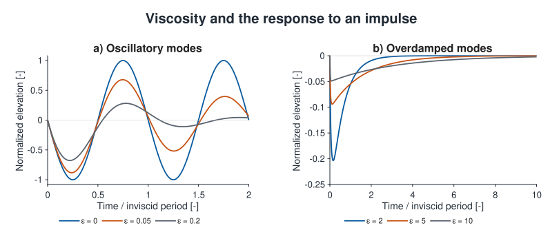
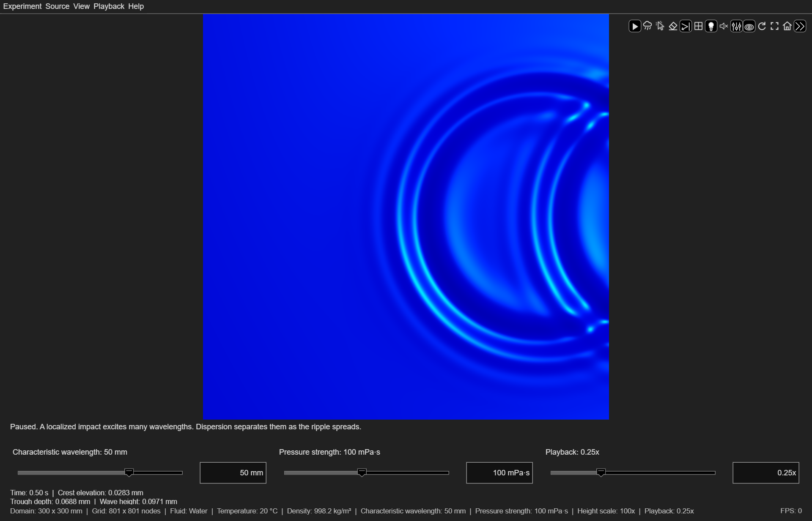
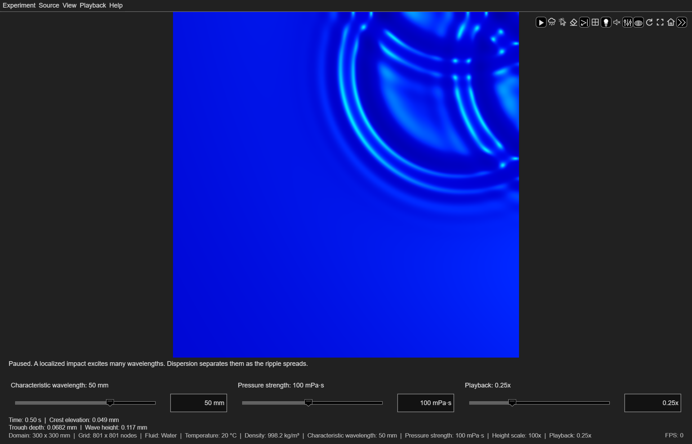
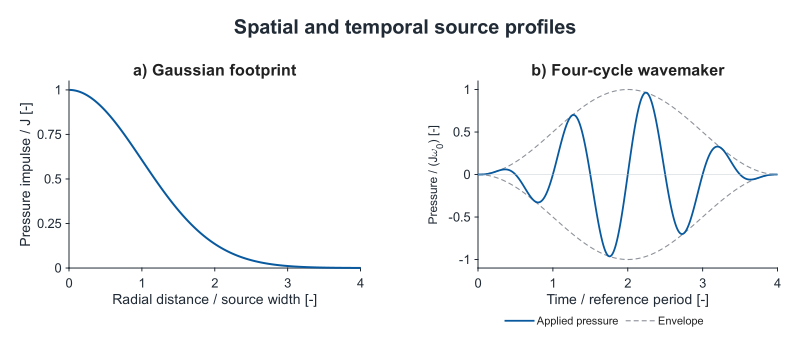

# Physics of ripples

[Ripple Simulator](../index.md) / Physics

Ripple Simulator models small-amplitude gravity–capillary waves on a homogeneous,
incompressible Newtonian fluid of infinite depth. A source supplies a localized
excitation, and the response propagates according to the governing equations below.
Gravity and surface tension restore the displaced surface, and viscosity dissipates
the wave energy. The full viscous response is obtained by solving the linearized
Navier–Stokes and continuity equations subject to the linearized kinematic and
dynamic free-surface boundary conditions. For the definitions of the terms used
below, see the [Glossary](#glossary).

The following table lists the physical quantities used in the model and their
units in the International System of Units (SI):

| Symbol | Quantity | Units |
| --- | --- | --- |
| *η* | Surface elevation relative to the still water level | m |
| **u** = (*u*, *v*, *w*) | Fluid velocity | m/s |
| *p* | Pressure perturbation from hydrostatic equilibrium | Pa |
| *p*ext | Applied downward pressure | Pa |
| *ρ* | Density | kg/m³ |
| *μ* | Dynamic viscosity | Pa s |
| *ν* = *μ*/*ρ* | Kinematic viscosity | m²/s |
| *σ* | Surface tension | N/m |
| *g* | Gravitational acceleration, 9.81 | m/s² |
| *k* = 2π/λ | Wavenumber | rad/m |
| *ω*₀ | Inviscid reference angular frequency | rad/s |

## Governing equations

The model is based on
[small-amplitude wave theory](https://web.mit.edu/fluids-modules/www/potential_flows/LecturesHTML/lec19bu/node3.html)
([Airy, 1845](https://books.google.com/books?id=41dSAAAAcAAJ)).
It assumes small wave amplitudes relative to the wavelengths and small
free-surface slopes. The governing equations are therefore linearized,
retaining first-order terms in the surface displacement and fluid velocity.
For a sinusoidal component of amplitude *a* and wavenumber *k*, the maximum
slope is *ka*.

<!-- equation: maximum-surface-slope | For a sinusoidal wave, the maximum surface slope is k times a, equal to two pi times a divided by wavelength. -->

$$
\eta=a\cos(kx-\omega t),\qquad
\max_x|\partial_x\eta|=ka=\frac{2\pi a}{\lambda}.
$$

For overlapping ripples, the small-slope condition applies to the combined
surface:

<!-- equation: combined-surface-slope | The maximum slope of the combined surface is the maximum magnitude of the horizontal gradient of the sum of the individual elevations, and must be much smaller than one. -->

$$
\epsilon_s(t)=\max_{x,y}\left\|\nabla_h\sum_j\eta_j(x,y,t)\right\|\ll1.
$$

### Linear boundary-value problem

Let **u** be the three-dimensional fluid velocity, *w* its vertical component,
and *ξ* the upward vertical coordinate. The undisturbed surface is at *ξ* = 0.
The pressure *p* is the perturbation after subtracting hydrostatic equilibrium.
The fluid satisfies the linearized incompressible Navier–Stokes and continuity
equations ([Patibandla et al., 2023](https://doi.org/10.1016/j.ijmultiphaseflow.2023.104592)):

<!-- equation: linear-momentum | The time derivative of velocity equals minus the pressure gradient divided by density plus kinematic viscosity times the velocity Laplacian. The velocity divergence is zero. -->

$$
\frac{\partial\mathbf{u}}{\partial t}=-\frac{1}{\rho}\nabla p+\nu\nabla^2\mathbf{u},\qquad\nabla\cdot\mathbf{u}=0
$$

At the undisturbed surface, *ξ* = 0, the linearized kinematic and
tangential stress boundary conditions are:

<!-- equation: surface-kinematics | The time derivative of surface elevation equals vertical velocity. The vertical derivative of horizontal velocity plus the horizontal gradient of vertical velocity is zero, at xi equals zero. -->

$$
\frac{\partial\eta}{\partial t}=w,\qquad\frac{\partial\mathbf{u}_h}{\partial\xi}+\nabla_h w=0\quad(\xi=0)
$$

The linearized normal stress boundary condition includes gravity, surface
tension, and the imposed pressure:

<!-- equation: surface-normal-stress | Pressure minus twice dynamic viscosity times the vertical derivative of vertical velocity equals density times gravity times elevation minus surface tension times the horizontal Laplacian of elevation plus external pressure, at xi equals zero. -->

$$
p-2\mu\frac{\partial w}{\partial\xi}=\rho g\eta-\sigma\nabla_h^2\eta+p_{\mathrm{ext}}\quad(\xi=0)
$$

The tangential and normal stress conditions are the dynamic free-surface
boundary conditions. The subscript *h* denotes horizontal components or
derivatives. Velocity and pressure disturbances decay with depth. The fluid is
initially at rest before the applied excitation. Positive external pressure
acts downward.

Linearization about a flat, stationary surface omits nonlinear advection and
higher-order free-surface geometry. The viscous terms remain in the momentum
equation and surface stress conditions.

The pressure input does not add fluid. Its zero-wavenumber elevation response
is zero, so it does not impose a uniform change in the level of the unbounded
surface. The mean elevation within the visible area can still
vary as waves enter and leave that region. Subtracting that local mean would
change the physical response and is not part of the calculation.
For perfectly reflecting boundaries, the zero cosine mode is absent from elevation,
so the mean over the entire domain remains zero.

## Gravity and surface tension

For an inviscid wave of wavenumber *k* on deep water, the angular frequency satisfies

<!-- equation: deep-dispersion | Omega squared equals g times k plus surface tension divided by density times k cubed. -->

$$
\omega_0^2(k)=gk+\frac{\sigma}{\rho}k^3,\qquad k=\frac{2\pi}{\lambda}
$$

Gravity supplies the term proportional to *k*. Surface tension supplies the
term proportional to *k* cubed. Surface tension is a restoring mechanism; it
is not the damping coefficient.

The two restoring terms are equal at the gravity–capillary crossover
wavelength ([Falcon & Mordant, 2022](https://doi.org/10.1146/annurev-fluid-021021-102043)):

<!-- equation: crossover | The crossover wavelength is two pi times the square root of surface tension divided by density times gravity. -->

$$
\lambda_c=2\pi\sqrt{\frac{\sigma}{\rho g}}
$$

For clean water at 20 °C, this is approximately 17.1 mm. Waves much longer than
this are predominantly gravity waves. Much shorter waves are predominantly
capillary waves. The model includes both restoring terms at every wavelength.
The capillary length, √(σ/(ρ*g*)), is approximately 2.7 mm; the crossover
wavelength is 2π times that length. The 50-mm water experiment is predominantly
gravity driven at its characteristic wavenumber, whereas the 5-mm experiment
is predominantly capillary driven. Both exhibit dispersion.

The everyday word *ripple* does not identify a single physical regime. A pond
disturbance contains a spectrum of wavelengths, and its gravity and capillary
components can behave differently. The small, short waves are often strongly
influenced by surface tension. The initial cavity and splash from a falling
stone lie outside this linear model.

## Wave dispersion

Different wavelengths travel at different speeds. Phase velocity describes a
moving crest; group velocity describes the propagation of a narrow wave packet:

<!-- equation: wave-speeds | Phase velocity is omega divided by k. Group velocity is the derivative of omega with respect to k. -->

$$
c_p=\frac{\omega_0}{k},\qquad c_g=\frac{d\omega_0}{dk}=\frac{g+3\sigma k^2/\rho}{2\omega_0}
$$

In the deep-water gravity limit, group velocity is half the phase velocity. In the
capillary limit, group velocity is one and a half times the phase velocity. These
limits explain why a packet's crests and its envelope do not necessarily move together.
They do not describe every feature of a broad, viscous disturbance with one
constant propagation speed.

For water at 20 °C, the inviscid relation gives the following reference values:

| Wavelength (mm) | Period (s) | Phase velocity (m/s) | Group velocity (m/s) |
| --- | --- | --- | --- |
| 25 | 0.1044 | 0.2395 | 0.1962 |
| 50 | 0.1693 | 0.2953 | 0.1787 |
| 100 | 0.2494 | 0.4009 | 0.2119 |

The 50-mm component completes approximately 5.91 oscillations per second.
These are physical time and distance scales; playback speed changes the rate
at which they are displayed. The complete viscous response also includes the
attenuation and frequency effects described below.

Each source is reconstructed from its wavenumber spectrum. The reconstruction
accounts for wave dispersion, geometric spreading, and viscous dissipation.

Small elevations can produce visible rings by changing the surface slope and
the reflected light. Measurements of drop-generated waves give a
characteristic wavelength of approximately 31 mm and elevations of order
0.05–0.1 mm near a radius of 130 mm, approximately 0.8 s after impact
([Craeye et al., 1999](https://doi.org/10.1109/48.775294)). The
optical measurements distinguish the outgoing ring waves from the initial
crater, crown, and subsequent water jet. These measurements provide experimental
scales for [ring waves](references.md#impulsive-excitation-and-ring-waves); the Gaussian
source parameters specify a localized pressure load rather than a drop size
and fall height.

Wave-height measurements also depend on the excitation. In wind-driven tank
experiments, reported crest-to-trough heights range from 0.06 to 8.8 mm for
wind speeds of 2.2–7.6 m/s ([Bobb et al., 1979](https://doi.org/10.1364/AO.18.001167)).
Those conditions cover a broad range of surface motion and do not define a
universal capillary-wave amplitude. Optical methods also measure capillary wave
dispersion and spatial decay, including the effects of surface films
([Slavchov et al., 2021](https://doi.org/10.1063/5.0066759)).

## Constitutive model and rheology

The viscous stress is proportional to the instantaneous rate of deformation:

<!-- equation: newtonian-stress | The viscous stress tensor equals twice the dynamic viscosity times the rate-of-deformation tensor. The latter is one half of the velocity gradient plus its transpose. -->

$$
\mathbf{T}_{\mathrm{v}}=2\mu\mathbf{D},
\qquad \mathbf{D}=\frac{1}{2}\left[\nabla\mathbf{u}+(\nabla\mathbf{u})^{\mathrm{T}}\right].
$$

Here, **T**ᵥ is the viscous stress tensor, **D** is the rate-of-deformation
tensor, and *μ* is constant throughout
each experiment. This Newtonian constitutive law gives the viscous term
*ν*∇²**u** in the incompressible momentum equation. In simple shear, it reduces
to shear stress equal to viscosity times shear rate
([IUPAC](https://goldbook.iupac.org/terms/view/N04138)).

The honey and compound-chocolate presets use constant-viscosity
approximations supported by specified flow measurements. Their
[material descriptions](materials.md) distinguish measured conditions from
extrapolation to weak surface motion. Small amplitude justifies linearizing
the surface equations; it does not, by itself, establish Newtonian rheology.

Shear thinning, yield stress, thixotropy, and viscoelastic stress memory are
not represented. With shear-dependent viscosity or yielding, the constitutive
response generally depends on the combined flow, so adding fixed single-source
responses would not solve that nonlinear problem. Linear viscoelastic models
can also admit superposition, but require a different stress law and response
kernel. These distinctions matter particularly for chocolate formulations
with measurable yield stress or strong low-shear viscosity variation
([TA Instruments](https://www.tainstruments.com/pdf/literature/RH113.pdf)).

## Viscosity and transient motion

The underlying equations are the linearized incompressible Navier–Stokes and
continuity equations, subject to the linearized kinematic and dynamic boundary
conditions at the free surface. The response includes the surface-wave modes
and the transient contribution from vorticity diffusion.

For one wavenumber, define the inviscid frequency *ω*₀, dimensionless
viscosity *ε = νk*²/*ω*₀, and dimensionless Laplace variable *z*.
With dimensionless time *τ = ω*₀*t*, the response satisfies *h*ε(0) = 0 and
*h*ε′(0) = 1, where the derivative is with respect to *τ*. Its Laplace transform is

<!-- equation: viscous-transfer | H of z equals one over the quantity: (z plus two epsilon) squared, plus one, minus four epsilon squared times the square root of (one plus z divided by epsilon). -->

$$
H_\epsilon(z)=\frac{1}{(z+2\epsilon)^2+1-4\epsilon^2\sqrt{1+z/\epsilon}},\qquad\epsilon=\frac{\nu k^2}{\omega_0}
$$

The square root uses the branch consistent with decay into the fluid. The
surface-wave modes correspond to poles of the Laplace transform, where its
denominator vanishes. Their real and imaginary parts determine modal decay
and oscillation, respectively. The inverse transform also includes the branch
contribution from vorticity diffusion.

As viscosity tends to zero, the transfer function tends to 1/(*z*² + 1),
whose inverse is sin(*τ*). This limit supplies the inviscid response; the
formula containing *z/ε* is not evaluated by substituting *ε* = 0 directly.

In the weak-viscosity limit, a nearly monochromatic wave has the familiar
leading amplitude decay

<!-- equation: weak-damping | Wave amplitude is proportional to the exponential of minus two times kinematic viscosity times wavenumber squared times time. -->

$$
A(t)\propto\exp(-2\nu k^2t)
$$

Short waves therefore attenuate more rapidly under this approximation. The
full response is used in the app, including regimes where this simple
exponential is insufficient. Dynamic viscosity and kinematic viscosity have
different units; the latter is computed from the former and the density.

At sufficiently large viscosity, a spectral component ceases to oscillate.
It relaxes toward equilibrium instead of traveling as a wave. In the limit
of strong viscosity, the slower relaxation mode has the approximate time scale

<!-- equation: viscous-relaxation | The viscous relaxation time is approximately twice kinematic viscosity times wavenumber squared divided by the squared inviscid frequency, equivalently twice dynamic viscosity times wavenumber divided by density times gravity plus surface tension times wavenumber squared. This applies when epsilon is much greater than one. -->

$$
\tau_{\mathrm{relax}}\simeq\frac{2\nu k^2}{\omega_0^2}
=\frac{2\mu k}{\rho g+\sigma k^2},\qquad\epsilon\gg1
$$

For a given wavelength, increasing viscosity in this regime prolongs the
leveling of an established deformation. It also suppresses the displacement
produced by a brief pressure impulse. Slow leveling therefore does not imply
a slowly traveling ring. This expression describes the strong-viscosity limit;
the simulator evaluates the full response above.

*Calculated modal responses with equal initial downward velocities at a fixed
wavenumber and inviscid frequency. The curves show −hε, with
ε = νk²/ω₀ and time scaled by the inviscid period 2π/ω₀.
Increasing viscosity suppresses the displacement and, in the overdamped
regime, prolongs its late relaxation. Axis ranges differ between plots.
These modal responses exclude the finite-duration settling envelope.*

Viscous dispersion relations establish the limits of common damping
approximations ([Armaroli et al., 2018](https://doi.org/10.1103/PhysRevFluids.3.124803)).
Initial-value analyses distinguish the surface-wave and vorticity contributions
([Patibandla et al., 2023](https://doi.org/10.1016/j.ijmultiphaseflow.2023.104592)).

## Why a ripple becomes less visible

Several effects contribute, with different meanings:

- **Viscous dissipation:** viscous stresses within the deforming fluid convert
  wave mechanical energy into heat.
- **Geometric spreading:** a localized disturbance distributes its motion over
  a growing region.
- **Wave dispersion:** wavelengths separate and a packet changes shape.
- **Radiation from the window:** waves travel beyond the visible area.

The last three effects are not additional viscosity. They must not be counted
as arbitrary damping. Radiation carries energy beyond the visible area.
Perfectly reflecting walls return waves into the observation domain.
Viscous dissipation remains active in both cases.
The finite-duration envelope described below applies equally to both.

## Wave reflection

Perfectly reflecting boundaries are modeled as impermeable, free-slip vertical
walls: fluid cannot flow through them,
and tangential viscous stress at each wall is zero. The free surface meets the
walls at 90 degrees. Cosine modes enforce zero wall-normal surface slope;
their wavenumbers enter the same gravity-capillary and full-viscosity response
used for open water.

The boundary model excludes no-slip wall layers, contact-angle hysteresis,
dynamic wetting, and bottom friction. The slipping, 90-degree contact-line
idealization also appears in an inviscid rectangular-container model
([Daqaq et al., 2017](https://doi.org/10.1115/1.4035363)).

The following views show a localized impulse in water at 20 °C, with a
50-mm characteristic wavelength, a pressure strength of 100 mPa·s, and a 100%
reflection coefficient. The 300 × 300 mm domain is sampled on an 801 × 801 grid. Both
views show the field at 0.50 s.

*Single wall (side), viewed from above. Incident rings meet the right boundary.
The reflected arcs curve back into the domain and overlap the outgoing waves.*

*Perpendicular walls (corner), viewed from above. Reflections from the right and upper boundaries
intersect near the corner. The incident, singly reflected, and two-wall
contributions are superimposed in the displayed field.*

### Partial wave reflection

**Experiment > Wave reflection > Reflection coefficient** selects the reflected
amplitude fraction *R*, from 0 to 1. For an individual incident wave component, the
corresponding reflected energy fraction is *R*². Thus 50% amplitude reflection
corresponds to 25% reflected energy. Viscosity acts throughout the motion;
changing *R* does not change the fluid's viscosity.

For intermediate coefficients, the app superimposes mirrored copies of the
open-water response. A copy associated with *N* wall encounters has weight
*R* to the power *N*. The copies retain the original source age, spectrum,
and viscous evolution. A reflection does not create a fresh, undamped ripple.

This model prescribes a real, frequency-independent coefficient and specular
reflection without a phase reversal. It represents reduced returning wave
amplitude, without resolving whether the missing energy is transmitted into
another region or dissipated in a boundary. It is not a viscous wall-layer or
wall-impedance calculation. For *R* < 1, the boundary is not the impermeable
free-slip boundary used by the 100% model, and the mean elevation within the domain
does not necessarily remain zero. At 0%, propagation is the open-water response.

The [reflection diagrams and equations](numerics.md#wave-reflection-geometry)
show how mirrored sources represent single, corner, and repeated reflections.
The [numerical methods](numerics.md#images-for-partial-wave-reflection) describe their
precomputed representation, convergence checks, and supported spatial range.

Switching boundaries clears existing waves and scheduled rain. A surface
elevation alone is insufficient to transfer the fluid's velocity and vorticity
into a different boundary problem. Pressure strength, material, physical size,
display settings, and pause state are preserved.

## Depth

For an inviscid fluid of finite depth *h*, the restoring relation contains
the factor tanh(*kh*), which approaches one in the deep-water limit. A
finite-depth viscous model requires a bottom boundary condition and can include
bottom boundary-layer losses. The model assumes infinite depth.

## Height scale and simulation time

The numerical field is stored and sampled in meters. Vertical exaggeration
multiplies only the rendered elevation; it does not change the forcing, wave
frequency, viscosity, or propagation. The displayed factor is the total
Cartesian vertical exaggeration, including the axes aspect ratio.

Playback rate specifies simulation seconds per second of real time. Slowing
playback makes fast waves easier to inspect without changing the physical
equations. The simulation pauses while a new wave response is calculated.
During playback, wave motion follows elapsed time rather than advancing by a
fixed amount per frame.

The displayed crest elevation is the maximum sampled surface elevation relative
to the still water level. Trough depth is the greatest depth below the still water
level, reported as a nonnegative value. Wave height is the difference between the maximum and
minimum sampled elevations. Opposite extrema are
equal in magnitude for a single sinusoid, but a localized or superimposed
wave field does not necessarily have that symmetry. Its largest crest and deepest trough
can also occur in different parts of the domain. These readings are in
physical units and do not include vertical exaggeration.

## Model assumptions and numerical approximations

The model assumes a clean interface, negligible air inertia and stress, no
background current, and small surface slopes. It does not resolve an impacting
object, splashes, breaking waves, bubbles, surfactant films, or a container's
bottom or dynamic wetting. By default, the model represents the fluid's
unbounded surface. Perfectly reflecting boundaries use ideal free-slip vertical
walls and a freely moving contact line with a fixed 90-degree angle.
Lower reflection coefficients use the partial-reflection approximation
described in [Wave reflection](#wave-reflection).

The simulator's
[loading criterion](numerics.md#small-disturbance-loading) bounds the slope
of the combined disturbance; its numerical cutoff is an operating choice,
not a universal threshold established by linear theory.

Finite-amplitude limiting waves belong to a different regime. Crapper's
exact progressive pure-capillary family reaches a limiting
crest-to-trough height ratio *H*/λ ≈ 0.730. Here *H* is the full wave height,
not the sinusoidal amplitude *a*. This nonlinear geometric limit does not
define the range of a linear approximation
([Crapper, 1957](https://doi.org/10.1017/S0022112057000348)).

The linear, clean-interface, infinite-depth equations describe the underlying
response. Their viscous tails generally approach equilibrium asymptotically.
To provide a definite end to each disturbance, the app applies a separate
finite-duration envelope. This is an explicit model approximation,
not a material property or an exact consequence of viscosity.

The duration accounts for both the inviscid reference period and slow viscous
relaxation. With Gaussian width *s* and source wavenumber *k*₀, define

<!-- equation: settling-time-scale | The settling time scale is the maximum of the inviscid reference period and the longest Stokes relaxation time over retained wavenumbers up to twelve divided by the Gaussian width. -->

$$
T_s=\max\left\lbrace\frac{2\pi}{\omega_0(k_0)},\mskip5mu\max_{0< k\leq12/s}\frac{2\nu k}{g+(\sigma/\rho)k^2}\right\rbrace.
$$

The second term is the Stokes relaxation time of an overdamped surface mode.
It sets the numerical lifetime; the full viscous response still determines
the wave motion. For positive surface tension, the longest such time occurs
at the smaller of √(*ρg/σ*) and *12/s*. This prevents the inviscid period from
prematurely truncating a slowly relaxing viscous disturbance.

For source age *a*, the physical response is unchanged through *8T*ₛ. Between
*8T*ₛ and *10T*ₛ, define *q* = (*10T*ₛ − *a*)/(*2T*ₛ) and use

<!-- equation: settling-polynomial | The settling envelope is q cubed times ten minus fifteen q plus six q squared. -->

$$
E(a)=q^3(10-15q+6q^2),\qquad q=\frac{10T_s-a}{2T_s},\quad8T_s<a<10T_s
$$

Before this interval, *E* = 1; at and after *10T*ₛ, *E* = 0. The envelope and
its first two derivatives join continuously. The reported physical fields
include the time derivative of the envelope:

<!-- equation: settling-fields | Elevation is E times the viscous elevation; vertical velocity is E times viscous velocity plus E prime times viscous elevation. -->

$$
\eta=E\eta_{\mathrm{v}},\qquad\partial_t\eta=E\partial_t\eta_{\mathrm{v}}+E'\eta_{\mathrm{v}},\qquad\nabla_h\eta=E\nabla_h\eta_{\mathrm{v}}
$$

The subscript v denotes the unmodified viscous response. Every reflected
contribution uses the original source age; reflection never restarts the
fade. Subsequent clicks have their own start times and settling time scales.
Each accepted source is retained through its deadline; all of its
contributions are exactly zero afterward.

In the default gravity-scale experiment at 0.25x playback, the unmodified
interval lasts approximately 5.4 real seconds and exact settling occurs by
approximately 6.8 seconds after each input. Smaller-scale presets have shorter
reference periods. Pausing or changing playback speed changes these real durations.
This timing is chosen for the
interactive presentation; it is not a measured relaxation time for water or oil.
During the fade, the reported field is the modified field above and no longer
the unforced solution of the stated boundary-value problem. Numerical omission
bounds cover the response evaluation, not the discrepancy introduced by this
envelope. Quantitative decay studies must therefore use the initial unmodified
interval and account for all other model assumptions.

The envelope is uniform in space for each source. Viscosity acts throughout
the entire lifetime, including on reflected waves.

See [Numerical methods](numerics.md#exact-numerical-equilibrium) for source
retirement and the distinction between finite settling and numerical error.

## Source definitions

A click in open water applies a circular Gaussian excitation centered at its physical
position. Automatic rain calls the same source operation at twenty scheduled
positions, with the same pressure strength by default. A separate multiplier
adjusts the pressure strength for rain without changing the source shape or propagation model.

### Characteristic wavelength

The source's characteristic wavelength *λ* defines its Gaussian width
*s* and reference wavenumber *k*₀:

<!-- equation: source-scale | Gaussian width s equals lambda divided by two pi, and reference wavenumber k0 equals one divided by s. -->

$$
s=\frac{\lambda}{2\pi},\qquad k_0=\frac{1}{s}
$$

A localized ripple contains a spectrum of wavelengths. Their different
propagation speeds produce dispersion and varying ring spacing.

In **Pressure impulse** mode, this parameter controls the spatial footprint
of the applied impulse. There is no imposed oscillation frequency. Each
wavenumber evolves according to the fluid's gravity-capillary and viscous
response. The characteristic wavelength is a source parameter, not a material
property or a single wavelength shared by all the rings.

Changing the source wavelength affects subsequent clicks. Existing waves keep
their original source definition and physical age. A resolution change samples
those same waves on another grid; it does not retune their wavelength.

### Pressure impulse

For an individual Gaussian source in **Pressure impulse** mode, the
time-integrated applied pressure is

<!-- equation: pressure-impulse | The pressure impulse at distance r is J times the exponential of minus r squared divided by twice s squared. -->

$$
\int p_{\mathrm{ext}}(r,t)\,dt=J\exp\!\left(-\frac{r^2}{2s^2}\right)
$$

The pressure impulse has its maximum value *J*, in Pa·s, at the source center.
Positive applied pressure acts downward. The idealized impulse changes the fluid's
velocity instantaneously; surface elevation is continuous at the input time.
This initial-value formulation follows the pressure-impulse treatment
([Naugol'nykh et al., 1993](https://doi.org/10.1017/S0022112093001508)).
Gaussian impulsive velocity potentials have also been studied in nonlinear
inviscid flow ([Tjan & Phillips, 2007](https://doi.org/10.1017/S0022112007004648)).
Here the subsequent motion follows the linear viscous equations.

A new impulse contributes zero elevation at its exact start, including when
it is added to an existing wave field. The center initially moves downward;
a surrounding upward response accompanies the displacement of fluid. The
initial velocity distribution follows from the Gaussian pressure impulse
and incompressibility.

At the source center on an unbounded surface, the initial conditions are

<!-- equation: impulse-initial-motion | The initial center elevation is zero. Its initial vertical velocity is minus the square root of pi over two times the pressure impulse divided by density and Gaussian width. -->

$$
\eta(0,0^+)=0,\qquad
\left.\frac{\partial\eta}{\partial t}\right|_{r=0,\,t=0^+}
=-\sqrt{\frac{\pi}{2}}\frac{J}{\rho s}.
$$

This follows from the Gaussian source spectrum and the unit initial slope of
the [viscous impulse response](physics.md#viscosity-and-transient-motion).
The velocity has units m/s; density, source width, and pressure impulse determine
its initial value.

The central elevation is a transient superposition, not a single periodic
oscillation. Each wavenumber has its own gravity–capillary response, so successive
extrema at a fixed location are not necessarily equally spaced. A sinusoid starting at
equilibrium with downward velocity reaches its first trough after a quarter
period; the following crest occurs half a period later. For water at 20 °C with
a 50-mm characteristic wavelength and *J* = 0.10 Pa·s, the calculated center
reaches its first trough at approximately 0.032 s. The inviscid reference period
at that wavelength is approximately 0.169 s; it does not define the period of
the complete ripple. The larger initial depression and smaller outward rings
also occur in the inviscid solution as the disturbance spreads radially and
its components disperse.

The pressure-impulse approximation describes the generation of gravity–capillary
ring waves by localized impacts ([Le Méhauté, 1988](https://doi.org/10.1017/S0022112088003301)).
In the linear model, the surface displacement is small relative to its horizontal
variation scale. Comparing a source with a drop impact requires both the spatial
footprint and the transferred impulse; the drop diameter alone does not specify *J*.
In drop-generated ring-wave models, the effective footprint can extend beyond
the drop itself. Comparisons of a momentum-based source with measured rings
use an enlarged impact footprint and a generation delay associated with the
collapsing stalk ([Contreras & Plant, 2006](https://doi.org/10.1029/2005JC003356)).
Those fitted impact parameters are distinct from the fluid properties.

The impulse integrated over the unbounded surface is

<!-- equation: integrated-pressure-impulse | The total applied impulse is the integral of the Gaussian pressure impulse over the surface, equal to two pi times s squared times J. -->

$$
I=\int_0^\infty J e^{-r^2/(2s^2)}\,2\pi r\,dr=2\pi s^2J.
$$

Here *I* has units N·s, while *J* has units Pa·s. A pressure in Pa additionally
requires a finite loading duration and a specified time profile. For the
initially stationary, unbounded fluid, the kinetic energy immediately after
the ideal impulse is

<!-- equation: impulse-energy | The initial kinetic energy is pi to the power three halves times s times J squared divided by four times density. -->

$$
E_0=\frac{\pi^{3/2}sJ^2}{4\rho}.
$$

This follows by integrating the kinetic energy of the initial velocity
potential through the fluid depth. Displacement scales with *J*, whereas
energy scales with *J*². Source width therefore matters when comparing loads:
equal values of *J* applied over different footprints supply different total
impulses and energies.

For perfectly reflecting boundaries, the Gaussian pressure profile is extended
evenly across each wall and repeated with twice the domain width. This is
the pressure source compatible with the cosine-mode boundary model. Mirror
contributions overlap near a wall: the local peak there can exceed *J*.
The pressure impulse integrated over the domain is always *2πs²J*, including
edge and corner clicks. Rain and manual input use the same boundary-compatible
profile; rain uses the same *J* at its default multiplier. The zero elevation
mode remains unforced; the pressure source does not add fluid.

### Four-cycle wavemaker

In **Four-cycle wavemaker** mode, the Gaussian pressure oscillates for four
reference periods with a smooth envelope:

<!-- equation: wavemaker | Pressure equals J times omega0 times the Gaussian spatial profile times sin tau times sin squared of tau divided by eight, for tau from zero through eight pi. -->

$$
p_{\mathrm{ext}}(r,t)=J\omega_0 e^{-r^2/(2s^2)}\sin\tau\,\sin^2(\tau/8),\quad 0\leq\tau\leq8\pi
$$

Here *τ = ω*₀*t*, measured from that click. The forcing frequency *ω*₀ is
calculated from the [inviscid gravity-capillary wave dispersion relation](physics.md#wave-dispersion)
at *k*₀ = 2π/λ. The characteristic wavelength therefore sets both the Gaussian
footprint and the reference forcing frequency in this mode. The applied pressure is zero outside the
stated interval. This mode is a finite-duration wavemaker, not an instantaneous
impact. Its completed response continues to propagate and dissipate.

The surface begins at equilibrium with zero velocity. The first pressure
stroke acts downward. The envelope increases smoothly from zero, so the first
oscillation is weaker than the central cycles.

Oscillating surface pressure can excite both gravity and capillary waves.
Experiments using periodic radiation pressure demonstrate outward propagation
of capillary waves ([Sakai et al., 2003](https://doi.org/10.1016/S0021-9797(03)00448-X)).
The four-cycle Gaussian forcing specifies the spatial footprint and duration
of the excitation; the fluid properties determine its dispersive response.

For the wavemaker, *J* is a pressure-time scale in Pa·s. The coefficient
*P*₀ = *Jω*₀ has units Pa and sets the pressure amplitude before the envelope
is applied. The signed pressure integral over all four cycles is zero.

*The Gaussian footprint decreases with distance from the source center.
The wavemaker combines that footprint with four alternating pressure cycles;
the dashed curves show the temporal envelope. Positive pressure acts downward.
Both profiles are normalized by their defining source scales.*

### Pressure strength

The **Pressure strength** in the menu, slider, and bottom panel specifies the common
coefficient *J* in the two pressure histories above, expressed in mPa·s.
Its physical interpretation depends on the excitation method:

| Excitation method | Physical interpretation of *J* |
| --- | --- |
| Pressure impulse | The time-integrated pressure at the center of an individual Gaussian source |
| Four-cycle wavemaker | The pressure amplitude coefficient divided by the reference angular frequency, *J* = *P*₀/*ω*₀ |

The common coefficient scales the applied pressure and the resulting wave
field. For fixed fluid properties, source width, and excitation method, the
surface displacement is directly proportional to *J*. Equal values of *J*
across the two methods do not imply equal transferred energies or wave
amplitudes, which also depend on the pressure history.

The characteristic elevation scale *A*₀ = *J k*₀/(*ρ ω*₀) relates the pressure
loading to the fluid and source scale. It is a normalization scale, not the
maximum elevation of every resulting ripple.

For water at 20 °C, *J* = 0.10 Pa·s and *λ* = 50 mm give
*A*₀ ≈ 0.339 mm and *A*₀/*λ* ≈ 0.00678. The balanced and capillary
setups preserve this dimensionless loading while changing the physical scale.
The actual crest, trough, and surface slope follow from the complete response.

See [Source controls](controls.md#source) for the pressure strength presets and the
Auto-click and rain multipliers.

### Physical scales and drop impacts

Drop momentum provides a useful comparison for the integrated impulse *I*.
A measured 2.8-mm water drop falling 5.5 m has an incident kinetic energy of
approximately 0.0003 J ([Craeye et al., 1999, p. 328](https://doi.org/10.1109/48.775294)).
Using a drop density of 1000 kg/m³ gives
a mass of approximately 11.5 mg and momentum of 83.0 µN·s:

<!-- equation: drop-momentum | The drop mass is pi times density times diameter cubed divided by six. Its momentum is the square root of twice its mass times its kinetic energy. The Gaussian strength with equal total impulse is the momentum divided by two pi times the squared source width. -->

$$
m_d=\frac{\pi\rho_d d^3}{6},\qquad
P_d=\sqrt{2m_d E_d},\qquad
J_{\mathrm{eq}}=\frac{P_d}{2\pi s^2}.
$$

For a 50-mm characteristic wavelength, *s* ≈ 7.96 mm and the equal-impulse
Gaussian has *J* ≈ 0.209 Pa·s. This strength is calculated from the reported
drop size and kinetic energy; it is not a measured pressure history.

At *J* = 0.10 Pa·s, the Gaussian supplies 39.8 µN·s of total impulse.
The linear viscous response in unbounded water gives an early central
depression of approximately 0.30 mm and an outward crest of approximately
0.055 mm beyond a radius of 25 mm. The maximum calculated surface slope is
approximately 0.027. These values describe a localized, small-slope disturbance;
the central depression and the outward crest occur at different positions
and times.

At 0.8 s, the calculated outer crest is approximately 0.025 mm in the
100–180-mm radial interval. The measured ring elevations are approximately
0.05–0.10 mm near a radius of 130 mm at that time, with a timing uncertainty
of about 0.04 s ([Craeye et al., 1999](https://doi.org/10.1109/48.775294)).
The Gaussian example therefore
represents a gentler disturbance. Equal total impulse does not imply identical
wave profiles: the forcing footprint, impact cavity, crown, and subsequent jet
affect how drop momentum and energy enter the outgoing waves. This comparison
establishes physical scales rather than a calibration of an individual drop.

### Overlapping sources and rain

Within the linear model, surface elevations and velocities are superimposed. Sources
can interfere constructively or destructively without changing one another's
definitions. Destructive interference in elevation does not imply that the
fluid has no velocity or energy.

A rain burst schedules twenty clicks at 0.05-second intervals of elapsed real
time while playback runs.
The first is issued immediately.

Each scheduled click uses the wavelength, pressure strength, and excitation method
in effect when it occurs, together with its burst's pressure multiplier.

## Glossary

| Term | Definition |
| --- | --- |
| Capillary wave | A surface wave whose restoring force is dominated by surface tension. |
| Characteristic wavelength | The source parameter λ = 2πs, where s is the Gaussian width. It sets the pressure footprint and, for the four-cycle wavemaker, the reference forcing frequency. A localized source contains a spectrum of wavelengths. |
| Clean interface | An interface without modeled surfactant, surface-film, or Marangoni stresses. |
| Deep water | The infinite-depth model used here; bottom motion and bottom friction are absent. |
| Density, ρ | Mass per volume, in kg/m³. |
| Dispersion | Dependence of wave frequency and propagation speeds on wavenumber. |
| Dynamic viscosity, μ | Newtonian shear-stress coefficient, in Pa s. |
| Gravity wave | A surface wave whose restoring force is dominated by gravity. |
| Group velocity | Rate of change of angular frequency with wavenumber; describes narrow wave-packet transport in the inviscid relation. |
| Hankel reconstruction | Radially symmetric spectral reconstruction using Bessel functions. |
| Kinematic viscosity, ν | Dynamic viscosity divided by density, in m²/s. |
| Linearization | Retaining first-order disturbances around the flat, motionless state. It permits superposition. |
| Newtonian fluid | A fluid whose deviatoric stress is proportional to strain rate with the specified constant viscosity. |
| Numerical rest | An exactly flat represented surface with zero velocity and slopes after all source contributions end. |
| Observation domain | The physical area sampled and displayed. By default, it shows part of the fluid's unbounded surface; optional boundaries reflect waves back into this area. |
| Phase velocity | Angular frequency divided by wavenumber; the velocity of a constant-phase crest in a monochromatic component. |
| Physical time | Time in the governing equations, in seconds. |
| Playback rate | Simulation seconds per second of real time while playback is running. Time spent paused is excluded. |
| Pressure impulse | Pressure integrated over time, in Pa s. |
| Radial slope | Spatial derivative of elevation with distance from a source; dimensionless. |
| Surface elevation, η | Vertical displacement relative to the still water level, in meters. |
| Surface tension, σ | Interfacial restoring coefficient, in N/m. It is not the damping coefficient. |
| Height scale | Display multiplier that specifies the vertical exaggeration. |
| Vertical exaggeration | Ratio of the displayed vertical scale to the physical scale used horizontally. |
| Wavenumber, k | 2π divided by wavelength, in rad/m. |
| Wavemaker | The finite-duration, four-cycle imposed pressure source available alongside the impulse. |

## Further reading

[Materials](materials.md) ·
[Numerical methods](numerics.md) · [References](references.md)
