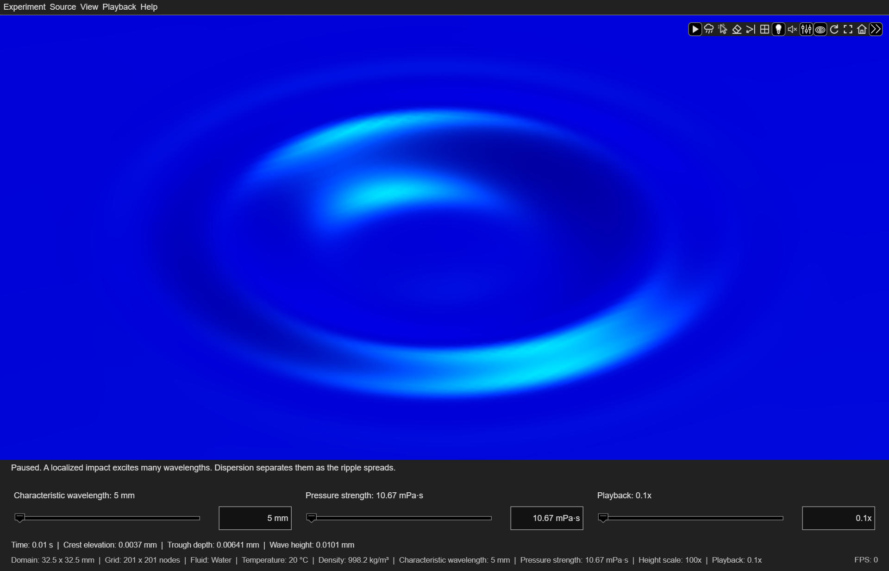

# rippleSimulator

Launch the application

[Ripple Simulator](../index.md) / [Functions and Properties](index.md)

## Syntax

```text
rippleSimulator()
app = rippleSimulator()
app = rippleSimulator(Name=Value)
```

## Description

`rippleSimulator()` opens the default gravity-scale water experiment. Click
the surface to create a ripple, or choose commands from the menus and axes
toolbar. Closing the figure releases the app's resources.

---

`app = rippleSimulator()` also returns the owning [`app.RippleSimulatorApp`](RippleSimulatorApp.md)
handle. Use it to change properties, create sources, and inspect physical data.

---

`app = rippleSimulator(Name=Value)` forwards name-value arguments to the
class constructor.

---

The only required MathWorks product is MATLAB R2022a or later. No additional
toolboxes are required. See
[Installation and requirements](../guide/installation.md) for setup instructions and troubleshooting.

## Examples

### Explore a capillary-scale disturbance

Create a localized disturbance in the Capillary water experiment.

```matlab
app = rippleSimulator(Setup="Capillary");
app.addRipple([0, 0]);
```

Surface tension dominates over gravity at the Capillary setup's characteristic wavelength.
The Gaussian pressure impulse excites a spectrum of wavelengths, producing a dispersive
wave packet with concentric rings.



*Water at 20 °C, 8.72 ms after a central impulse; 5 mm characteristic wavelength,
32.5 × 32.5 mm domain, 201 × 201 grid, and 100x height scale.*

Close the app when finished:

```matlab
app.close();
```

## Name-Value Arguments

| Argument | Description |
| --- | --- |
| `Setup` | `"Gravity"` (default), `"Balanced"`, or `"Capillary"`; select a scaled water experiment. |
| `GridResolution` | Integer from 51 to 801; default 201. Must also satisfy spatial sampling requirements. |
| `Visible` | `"on"` or `"off"`; default `"on"`. |
| `AutomaticUpdates` | Logical scalar; default `true`. Set `false` to call `update` explicitly. |
| `Paused` | Logical scalar; default `false`. Set `true` to start paused at physical time zero. Setting the `Paused` property to `false` resumes time; automatic updates start only if `AutomaticUpdates=true`. |
| `TimeSource` | Optional function handle returning a finite, monotonic scalar time in seconds. The default uses MATLAB's elapsed timer. |
| `ReflectionsEnabled` | Logical scalar; default `false`. Set `true` to start with reflecting boundaries. |
| `ReflectionCoefficient` | Real scalar from 0 to 1; default 1. Reflected amplitude fraction when wave reflections are enabled. |

## Output Arguments

### app – Owning application

Scalar `app.RippleSimulatorApp` handle. The handle becomes invalid when the application closes.

> **Caution:** An output variable named `app` shadows the `app` namespace.
> This does not affect calls to object methods, such as `app.addRipple`.
> Use a different variable name when calling `app.RippleSimulatorApp(...)`
> directly. If `app` already exists in the Command Window workspace, close
> the application and run `clear app` before accessing the namespace.

## See Also

[`app.RippleSimulatorApp`](RippleSimulatorApp.md) · [Examples](../guide/examples.md) · [Controls](../guide/controls.md)
